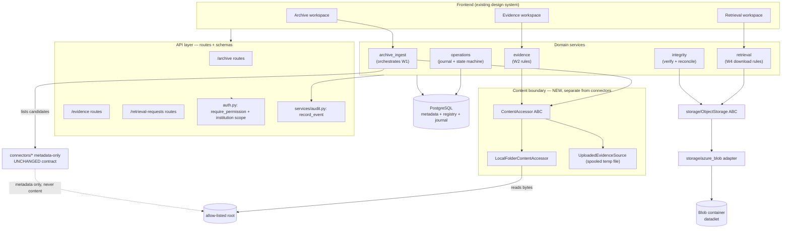
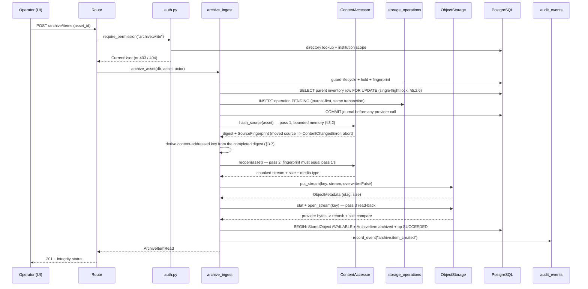
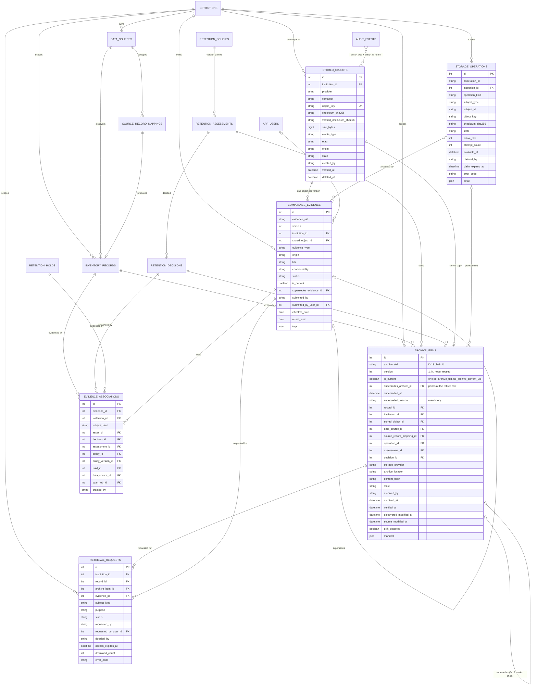
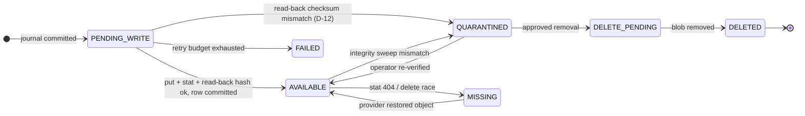
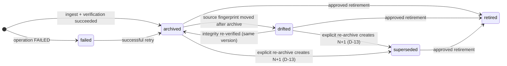
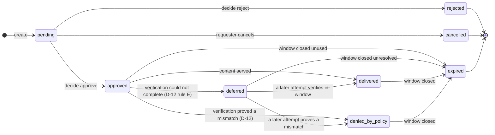
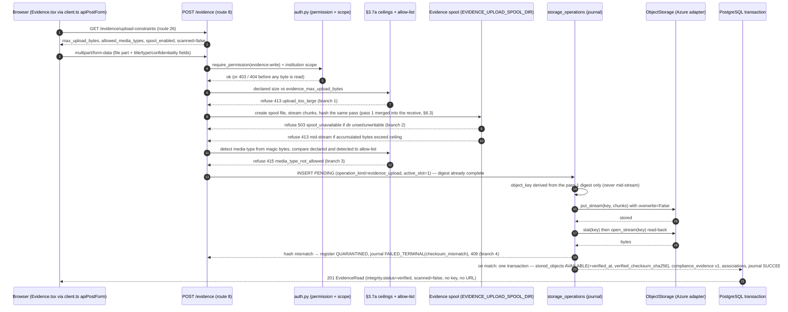
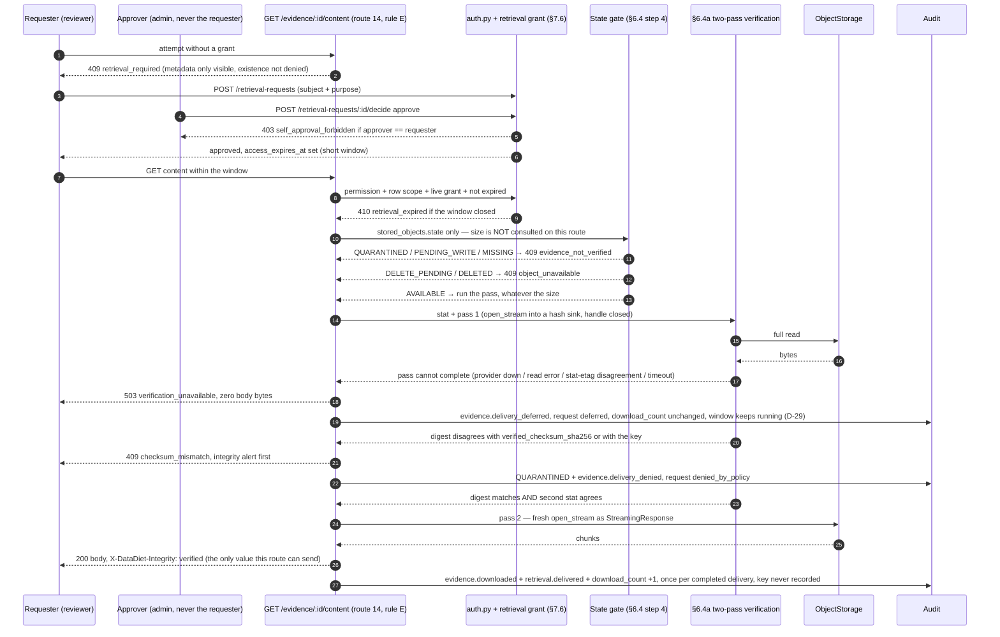

# DataDiet — Archive & Compliance Evidence Architecture

**Phase 7.0 deliverable. Status: PROPOSAL ONLY — nothing here is implemented.**

| | |
| --- | --- |
| Verified against | branch `feat/phase6-clerk-postgresql`, HEAD `244e096`, Alembic head `0014_external_identities` (re-verified during the 7.1-plan revision pass: 14 revision files, exactly one head) |
| Inspection date | 2026-11-06 (re-inspected after the decision resolution, same day) |
| Revision pass | 2026-11-06, after the Phase 7.1 plan review. Four mandated corrections: the MySQL single-flight mechanism (§5.2.6, §6.3, §11.3, §11.3a), the content-hash/ordering contract (§2.4, §3.2, §3.6, §3.7, §6.3, §10.2), the ADR acceptance rule (§14.1) and the stale permission/section references (§3.9, §7.2a). Documentation only — no code, migration, test or config file changed. Record: §16.17 |
| Clarification pass | 2026-11-07, before any 7.1 approval. Three conditions made explicit and testable in words, with no design change: the reservation invariants SF-1…SF-6 and the five single-flight test classes (§5.2.6a, §11.3, §13), the limits of source fingerprinting and the fail-closed table (§3.2, new §6.3a, §13), and the MySQL CI execution and expected-test-count rules (§5.2.6a, §15.5, §13). Documentation only; record §16.18 |
| Application code changed in this phase | none (this file and `phase-7-1-implementation-plan.md` only) |
| Migrations created in this phase | none |
| Decision resolution | **D-1, D-3, D-10, D-12, D-13, D-15 resolved** (§16.1, register §14.2a); **D-12 refined by the final review** — compliance evidence is now verified before every release with no size threshold (§6.4 rule E, §6.4a, ADR-0038); 17 pre-existing decisions remain open (§14.2b) and the resolutions create 7 more (§14.2c) — 24 in the open register (§16.15) |
| Resolution deliverables | resolved register (§14.2a), ER diagram (§5.4, §16.2), state machines (§6.8, §11), permission matrix (§7.4a), upload + retrieval sequence diagrams (§16.9), failure and recovery (§6.7 + §16.8), revised migration plan (§5.5 + §13), security and operational requirements (§16.11 + §16.13), remaining unresolved decisions (§16.14/§16.15) |
| Approval required before | Phase 7.1 implementation |

Every statement is tagged:

- **[EXISTING]** — read from the repository at the commit above, with a
  `file:line` citation you can open.
- **[PROPOSED]** — a design decision that does not exist in code yet. A
  `[PROPOSED]` claim is never evidence that something works.

Citations are repo-relative shorthand: a bare `base.py` is
`backend/app/services/storage/base.py` (the connector contract is always written
out as `connectors/base.py`), a bare `auth.py` is `app/core/auth.py` and a bare
`retention.py` is `app/services/retention.py`. A bare `:N` continues the file
named immediately before it.

Anything the repository does not do today is stated as absent rather than
described in the present tense. Section 15 repeats the split as a checklist.

---

## 1. Purpose, scope, and the verified starting point

### 1.1 Problem statement

DataDiet is a **metadata** application. It discovers assets, classifies them,
assesses them against retention policy and records human decisions — and it
explicitly cannot touch the content of a single file. The product therefore
recommends `ARCHIVE_RECOMMENDED` while having no way to archive, and records an
`approve_for_later_workflow` decision while having no way to prove to an auditor
*why* it decided that.

This architecture adds a content layer for two domains that must not be
conflated:

1. **Institutional file archive** — durable copies of files that institutional
   data sources already discovered as metadata. The asset is the business
   object; the archived blob is its copy.
2. **Compliance evidence** — documents submitted by users or generated by
   workflows that prove governance happened. Here the blob *is* the business
   object; assets it mentions are context, not owners.

They share one object-storage boundary [EXISTING]
(`backend/app/services/storage/base.py:112`) and one integrity model, and share
nothing else: different owners, different authorization, different lifecycle,
different deletion rules.

### 1.2 What exists today (verified)

| Capability | State | Evidence |
| --- | --- | --- |
| Metadata-only discovery connectors | [EXISTING] | `backend/app/services/connectors/base.py:1-9`, `:73-86` |
| Server-side allow-listed local roots, keyed by `DataSource.root_key` | [EXISTING] | `backend/app/db/models.py:63-68`, `backend/app/services/scan.py:112-121`, `backend/app/core/config.py:79` |
| Idempotent metadata ingestion + observation refresh | [EXISTING] | `backend/app/services/scan.py:458-542`, `models.py:655-690` |
| Per-record discovery errors with relative paths only | [EXISTING] | `backend/app/services/connectors/base.py:51-61`, `scan.py:602-620` |
| Provider-neutral object storage (`put/get/delete/exists/stat`) | [EXISTING], unused | `backend/app/services/storage/base.py:112-158` |
| Azure Blob adapter (lazily imported) | [EXISTING], unconnected | `backend/app/services/storage/azure_blob.py`, `storage/__init__.py:build_object_store` |
| `STORAGE_PROVIDER=none` default; SDK never imported unless enabled | [EXISTING] | `backend/app/core/config.py:139-149`, `test_storage_provider.py` |
| `ArchiveItem` / `RetrievalRequest` tables | [EXISTING] as **dormant placeholders** | `models.py:385-403`, `:406-423` |
| Append-only decisions, optimistic concurrency, hold blocking | [EXISTING] | `models.py:281-337`, `services/retention.py:320`, `:1211` |
| Authorization: 11 permissions, 3 roles, directory-authoritative | [EXISTING] | `backend/app/core/auth.py:67-129` |
| Institution scoping that answers 404, not 403 | [EXISTING] | `auth.py:671-729` |
| Audit trail with one helper | [EXISTING] | `models.py:426-444`, `services/audit.py:16-46` |
| Scan state machine + `409` on illegal transition | [EXISTING] | `scan.py:50-98`, `routes/connectors.py:377-379` |
| `/archive`, `/retrieval`, `/reports`, `/users` pages | [EXISTING] as `PlaceholderPage` | `frontend/src/pages/Archive.tsx:1-16` |

The critical sentence in the storage boundary is its own docstring [EXISTING]:

> "DataDiet is a *metadata* application: discovery connectors deliberately
> cannot read file contents … nothing in the product today stores or serves a
> blob."

### 1.3 Verified absences (do not assume any of these exist)

1. **No content access anywhere.** No module outside tests opens a discovered
   file. `LocalFolderConnector` sets `checksum_sha256=None  # contents are never
   read` (`local_folder.py:150`) and `sensitivity="unknown"`.
2. **No consumer of storage.** `build_object_store` is called only by tests; the
   dormant `ArchiveItem`/`RetrievalRequest` tables are referenced by no route,
   service or schema. The only textual reference is a docstring
   (`storage/base.py:10`).
3. **No archive/restore/move/delete execution.** Stated in
   `docs/architecture.md` (Phase 6 bullet: "no archive/restore/move/delete is
   implemented") and `main.py:33-35`.
4. **No evidence, compliance-document or chain-of-custody concept**: no route,
   permission, table, enum or page.
5. **No file upload transport anywhere in the frontend.** No `type="file"`,
   no `FormData`, no `multipart`, no `accept=`; `api/client.ts` speaks JSON only
   and implements exactly `GET`, `POST`, `PATCH` — there is no `PUT`/`DELETE`
   helper.
6. **`python-multipart` is not installed**, so a FastAPI `UploadFile` endpoint
   cannot exist without a new dependency. Verified: `find_spec("multipart")`
   returns `None` against `backend/../.venv`.
7. **No streaming in the storage boundary.** `ObjectStorage.put(key, data:
   bytes, …)` (`base.py:126-128`) and `get(key) -> bytes` (`:137`) hold the
   whole object in memory.
8. **No audit read/export endpoint**, and no database-level append-only
   enforcement on `audit_events`.
9. **No background worker or queue.** Scans execute inside the request thread
   (`routes/connectors.py:367-380`).
10. **Institutional connectors cannot be trusted to still see the same file.**
    `SourceRecordMapping` stores `source_modified_at` and `checksum_sha256`
    (`models.py:677-685`), but `checksum_sha256` is always `NULL` for local
    sources today, so the only drift signal available is mtime + size.

**Two kinds of absence, and why they must not be reported as one.** "No route"
and "no table" are different claims with different consequences, and a status
line that says "no route, no table, no consumer" after a phase that created
tables is not conservative — it is simply wrong, in the direction that makes
work invisible (rule 3's subject is over-claiming, not under-claiming; an
accurate "built but unused" is the state Phase 6.x's storage provider is
actually in, `docs/decisions.md:320`). The vocabulary this document and every
phase report uses:

| Claim | Meaning | True today | After 7.1 | After 7.2 |
| --- | --- | --- | --- | --- |
| no **table** | the database has no such relation | archive/evidence/storage-operation tables | `stored_objects`, `storage_operations` exist | + `archive_items` widened |
| no **application writer** | nothing outside tests inserts into it | every placeholder table | still true — 7.1 has no service that writes them | false: `archive_ingest` writes |
| no **route** | no HTTP surface reaches it | all of them | still true | archive routes exist |
| no **workflow consumer** | no page, decision path or operator action depends on it | all of them | still true | partial (frontend is 7.6) |

The distinction that matters for 7.1 is row 2 versus row 3: 7.1 creates tables
without writers, which is a real and reportable state, and describing it as "no
table" would erase the migration that shipped it.

### 1.4 Non-goals for the architecture

- **No automatic destruction.** Archiving never deletes a source file; a
  retrieval never removes a blob. Disposal remains out of scope, consistent with
  `AGENTS.md` rule 1.
- **No real institutional data.** Development stays on synthetic fixtures and
  operator-approved local roots.
- **No claim that the emulator authenticates.** Phase 6.x measured that Floci
  accepts unsigned *and* forged SharedKey requests, including writes
  (`docs/decisions.md` ADR-0026). Everything in section 6.10 is designed for a
  real Azure account; the emulator is a functional test surface only.
- **No malware scanning implemented.** Only an extension point is defined, and
  the UI must say scanning is not performed (`AGENTS.md` rule 3).
- **No multi-region replication, WORM/immutable blobs, or legal-hold
  integration with a cloud provider.** Deferred in section 14.

---

## 2. Architecture overview

### 2.1 Component view



Two rules are visible in that diagram and are the heart of the design:

- The dashed connector edge is **metadata only**. Nothing in
  `app/services/connectors/` gains a content method [PROPOSED invariant, see
  §3.2].
- Exactly one component crosses from the filesystem into blob storage, and it is
  not a connector — it is `ContentAccessor`.

### 2.2 Domain boundaries

| Boundary | Owned by | Never does |
| --- | --- | --- |
| Discovery [EXISTING] | `services/connectors/` | read content, hash, move, delete, transmit |
| Content access [PROPOSED] | `services/content_access/` | accept a client path, resolve outside an allow-listed root, follow a symlink, keep bytes longer than the operation |
| Object storage [EXISTING] | `services/storage/` | know what an asset or an evidence item is |
| Registry + journal [PROPOSED] | `db/models.py` tables | store content, store absolute paths |
| Domain services [PROPOSED] | `archive_ingest`, `evidence`, `retrieval`, `integrity` | talk to an SDK, open a file path |
| Authorization [EXISTING] | `core/auth.py` | be bypassed by a storage URL |

### 2.3 Invariants

I-1. **A client never supplies a filesystem path, an object key, or a bucket.**
Keys are derived server-side (§6.1); a client supplies only surrogate ids that
already passed institution scoping.

I-2. **Server-side authorization is authoritative.** The blob container has no
public access, no SAS URL is ever generated or returned, and every read goes
through a permissioned route (§7.6, §8.3.3).

I-3. **Content is only ever addressed by its own hash, and compliance evidence
is only ever released after that hash has just been re-proved.** Every stored
object row records the SHA-256 of exactly the bytes it holds, and under resolved
D-12 — **refined by the final review** — that hash is *verified*: recomputed from
a read-back after ingest (§3.6, §6.3), and re-verified before the body is released
on a download (§6.4). The two release policies are deliberately different:

- **Compliance evidence — no threshold, no exception.** Every delivery completes
  a verification pass over the provider's bytes *before* the first byte reaches
  the requester. No size, ceiling, configuration value, missing scratch volume,
  provider outage or deployment limitation may downgrade that to a labelled
  stream (§6.4 rule E, ADR-0038). If verification cannot complete, the delivery
  **fails closed**: deferred (§11.2's `deferred`) or rejected
  (`denied_by_policy`), with an auditable outcome and zero body bytes.
- **Institutional archive — a separately documented policy.** Above
  `archive_verify_before_serve_bytes` the response may stream and be marked
  `X-DataDiet-Integrity: unverified` (§6.4 rule A, §8.4a), because those bytes are
  the operator's own copy of a file that still exists at the source and the
  archive is not the only surviving record (§6.8b, D-23).

The policies must not be merged and must not be traded: no configuration that
weakens rule A is permitted to reach rule E, and a test asserts that the evidence
branch never consults the ceiling (§13 7.4 criterion 4). A number that was never
checked against the provider's bytes is not integrity evidence.

I-4. **Metadata and content are allowed to disagree, and the system must notice.**
`InventoryRecord` keeps the *discovered* fingerprint; `StoredObject` keeps the
*archived* fingerprint; a mismatch is a first-class state (`state='drifted'`) and
leads to a new immutable version, never a silent overwrite (§3.5, §6.9, D-13).

I-5. **Nothing is deleted to make room.** Deletion is a separate, hold-checked,
audited decision (§6.5).

I-6. **Every cross-system mutation is journalled before it happens** so that a
crash between PostgreSQL and Blob leaves a discoverable record rather than an
invisible orphan (§6.7).

I-7. **Existing contracts stay stable.** No route, schema, permission, nav key,
connector ABC or migration changes as a consequence of this document (§15.4).

I-8. **Discovery never ingests content.** Resolved D-1. A scan — `run_scan`,
`_ingest_record`, or any route that starts one — must never open a file, hash a
byte, write an object, or create a `storage_operations` row. Content access is a
separate abstraction reached only by the archive/evidence services, and a test
asserts that a completed scan leaves the journal and the container untouched
(§3.2, §16.3).

I-9. **PostgreSQL is the only authority.** Resolved with the authority rule:
metadata, tenant scope, permissions, retrieval grants and object registration
are decided from database rows only. The blob container is a byte store with no
opinion: no authorization decision, no listing, no provider-side metadata read
and no key pattern may serve as a source of truth (§16.12).

I-10. **The frontend never addresses content.** Resolved D-3's security half:
there is no URL, SAS token, container name, object key or provider identifier in
any response body, header, audit payload, log line or `VITE_*` variable. The
browser names content only by a surrogate id, and bytes move only through a
permissioned route that re-checks scope and the retrieval grant (§6.10, §16.12).

I-11. **Archived content is immutable; correction is a new version.** Resolved
D-13. No `stored_objects` row is ever overwritten in place, no blob is ever
written with `overwrite=True`, and no `archive_items` row is ever repointed at
different bytes. A changed file or a corrected document produces a *new* row, a
*new* object and a `superseded` predecessor that keeps its own associations,
provenance and audit trail (§4.6, §5.2.2, §6.8b, ADR-0031).

I-12. **State machines are domain contracts, not reused enums.** Resolved D-10.
`storage_operations` has its own states, its own retryability rules and its own
terminal set; it borrows nothing from `ScanJob` beyond the vocabulary style
(§5.6, §11.3). Every state must be reachable, every transition must name the
actor that causes it, and every non-terminal state must be explainable to an
operator.

I-13. **A permission is a name before it is a grant.** Resolved D-15. New
permission strings may exist while granted to no role; a role gaining a
permission is a separate, explicitly approved change to `ROLE_PERMISSIONS`
(`auth.py:119-129`), never a side effect of shipping a route (§7.4, §16.6).

### 2.4 Primary data flow: archiving one institutional asset



Three orderings that matter, and none is negotiable:

1. **The lock and the journal row precede every side effect.** The parent-row
   lock is taken in the same transaction that inserts the `PENDING` journal row,
   so two concurrent requests for the same subject serialize instead of racing
   an existence check against an insert (§5.2.6, §11.3a).
2. **The digest precedes the key.** The object key is derived from a SHA-256
   computed by a dedicated first pass over the source; nothing streams to the
   provider until that pass has finished and re-checked the source's
   fingerprint. There is no field on `ContentHandle` that could have carried a
   hash while the stream was still lazy (§3.2, §3.6, §3.7).
3. **The read-back verification precedes `AVAILABLE`.** The provider object is
   stat'd and streamed back, re-hashed, and only a match lets the object row
   commit as `AVAILABLE`; a mismatch quarantines it and fails the operation
   (§6.3, §11.1).

The blob write happens before the object row commits, and the journal row is
created and committed before the blob write. Never the reverse. §6.7 enumerates
the crash windows this ordering leaves open.

---

## 3. Workstream 1 — Institutional file ingestion

### 3.1 What the repository actually guarantees today

Four facts decide the whole design, so they are quoted rather than paraphrased.

**a) `root_key` is an allow-list *key*, not a path.** The column comment is
explicit [EXISTING] `models.py:63-68`:

> "``root_key`` is an allow-list key that is resolved server-side (never a
> client-supplied path)"

Resolution from a key to a **path** happens in exactly one place today
[EXISTING] `scan.py:112-121` (membership is separately validated at source
registration, `routes/connectors.py:132-148`):

```python
root_key = source.root_key
if not root_key:
    raise UnauthorizedRootError("Local source has no allow-listed root configured")
root_path = settings.local_source_roots.get(root_key)
if not root_path:
    raise UnauthorizedRootError(f"Root key {root_key!r} is not in the server allow-list")
return LocalFolderConnector(root_path=root_path)
```

`local_source_roots` is `dict[str, str]`, empty by default, with the documented
rule that "The API only ever accepts an allow-list key, never a raw filesystem
path, and absolute paths are never returned to clients"
(`core/config.py:75-79`). **The archive path may obtain a root no other way than
through that same allow-list lookup** — and, under resolved D-1, it repeats the
lookup in its own module rather than sharing `scan.py`'s copy, with a parity test
as the guard against divergence (§3.2).

**b) `source_key` is a root-relative POSIX path.** `InventoryRecord.external_id`
is `_external_id(source_key)` (`scan.py:552`), and `source_key` comes from
`local_folder.py:143` `source_key=relative`, where `relative =
resolved.relative_to(self._root).as_posix()` (`local_folder.py:140`).

Two consequences:

1. `_external_id` truncates long keys to `"h:" + sha256(source_key)` for the
   100-char column (`scan.py:642-646`). **A hashed `external_id` is not
   reversible**, so it cannot be used to reopen a file.
2. The reversible value lives in `SourceRecordMapping.source_key`
   (`String(512)`, unique per `(data_source_id, source_key)`, `models.py:673`,
   `:688`) and in `ScanResult.source_key` (`:604`).

Therefore: **ingestion must resolve content through the mapping row, never
through `external_id`.** §3.4 gate G1 enforces it; deriving a filesystem path
from `external_id` is rejected outright, because `_external_id` can be a one-way
hash (`scan.py:642-646`).

**c) The discovery root is resolved, and keys are relative to the *resolved*
root** (`local_folder.py:41` `Path(root_path).expanduser().resolve(strict=False)`
and `:140`). So the root used at reopen time must go through the identical
`expanduser().resolve()` step, or a root given as `~/data` will not match the
keys recorded as relative to `/home/user/data`.

**d) The connector contract forbids content access** [EXISTING]
`connectors/base.py:5-9`:

> "A connector's only job is to *discover metadata* … Connectors deliberately
> have no capability to read file contents, move, archive, or delete anything,
> or send data anywhere. Every implementation must honour that contract."

### 3.2 The contract is preserved; content lives in a new abstraction

No file in `backend/app/services/connectors/` is modified by any phase in this
plan, and no method is added to `SourceConnector`. Instead [PROPOSED]:

```
backend/app/services/content_access/
  __init__.py        # get_content_accessor(source, settings) — the only entry point
  base.py            # ContentAccessor ABC, ContentHandle, HashResult, SourceFingerprint, 5 exceptions
  local_folder.py    # LocalFolderContentAccessor (owns its own root resolution)
  upload.py          # UploadScratch (evidence + delivery spool, §6.3, §6.4) — arrives in 7.3, not 7.1
```

```python
# base.py  [PROPOSED — illustrative, not applied]
class ContentAccessError(Exception): ...
class ContentUnavailableError(ContentAccessError): ...   # synthetic source, root gone
class ContentPathRejectedError(ContentAccessError): ...  # key failed validation
class ContentChangedError(ContentAccessError): ...       # drifted since discovery, or between passes
class ContentTooLargeError(ContentAccessError): ...      # exceeds the configured cap

@dataclass(frozen=True, slots=True)
class SourceFingerprint:
    """Cheap identity of the *source file* at one instant. Not a content hash."""
    size_bytes: int
    mtime_ns: int
    device: int
    inode: int

@dataclass(frozen=True, slots=True)
class HashResult:
    """The output of the first, hashing-only pass over a source file."""
    sha256: str                       # complete — the digest of every byte
    fingerprint: SourceFingerprint    # re-observed after EOF, not before the read
    media_type: str | None            # name-guess + magic cross-check
    modified_at: datetime | None      # naive UTC, same convention as the connector

@dataclass(frozen=True, slots=True)
class ContentHandle:
    """One reopened source file. Bytes are read lazily, never buffered whole."""
    read: Callable[[int], bytes]      # chunked read; b"" at EOF
    size_bytes: int                   # observed now, not discovered earlier
    fingerprint: SourceFingerprint    # must equal the HashResult this reopen answers
    media_type: str | None            # re-detected on this reopen, then compared to pass 1's
    modified_at: datetime | None      # from this reopen's fstat, not from the database row
    close: Callable[[], None]

class ContentAccessor(ABC):
    """Reopen, verify and stream the bytes behind one already-imported asset."""
    @abstractmethod
    def hash_source(self, record: InventoryRecord) -> HashResult: ...
    @abstractmethod
    def reopen(self, record: InventoryRecord) -> ContentHandle: ...
    @abstractmethod
    def probe(self, record: InventoryRecord) -> tuple[bool, str]: ...
```

`ContentHandle` deliberately has **no `sha256` field**. Earlier drafts of this
document carried one, annotated "computed while streaming". That is not
implementable: `read` is a lazy chunked callable, so the handle is constructed
before the last byte is seen, and a content-addressed object key is needed
*before* the first byte is sent to the provider. A field that can only be filled
by consuming the stream it is handed alongside would either force whole-file
buffering or produce a key that does not match the bytes. The digest therefore
belongs to its own operation — `hash_source()` — which is pass 1 of the three
passes §6.3 specifies and returns a `HashResult`, not a handle.

`hash_source()` reads the source in bounded chunks (never more than
`chunk_size_bytes` live), updates `hashlib.sha256` incrementally, and at EOF
re-`fstat`s the file and compares all four `SourceFingerprint` fields against
the values observed before the read began. If any differs — the file grew,
shrank, was rewritten, or was replaced by a different inode — the digest is
discarded and `ContentChangedError` is raised before a key is derived and before
the provider is called. The fingerprint exists to make that check honest: size
alone misses an equal-length rewrite, and mtime alone misses a touch-preserving
copy on filesystems with coarse timestamps; `device`+`inode` catch replacement
where the size and mtime are reproduced.

What that check is **not** is part of the contract, not a footnote: four integers
observed at two instants cannot prove the bytes in between were never touched.
`mtime_ns` is writable, a replacement can reproduce size and timestamp, and a
change that starts and finishes inside one pass leaves the metadata where it was
found. So a fingerprint match is best-effort detection of source change, while
the integrity claim an object carries rests on the digest and the provider
read-back — and `ContentChangedError` therefore never appears in a log or a
docstring as proof that the source was immutable. §6.3a states the boundary, the
window it leaves open, and the fail-closed behaviour on each side of it.

`reopen()` is the second read of the same file, called only after a completed
digest, and its handle's fingerprint must equal the `HashResult` fingerprint it
corresponds to; if it does not, `reopen()` raises `ContentChangedError` and the
operation stops with zero provider calls.

`probe()` answers "can this asset be archived, and if not why" without reading a
byte, which is what the list view needs (§9.2) and what keeps a 5 000-row page
from touching the filesystem.

**Root resolution under resolved D-1.** `ContentAccessor` is completely separate
from `SourceConnector`, and that separation now extends to `scan.py`: **no file
under `app/services/connectors/` and no line of `app/services/scan.py` is
modified by any archive phase.** The earlier draft of this document proposed
extracting `resolve_approved_root()` out of `build_connector()` so both paths
shared one lookup; that is **withdrawn**, because extraction is still an edit to
a tested authorization-adjacent function, and the brief for this phase forbids
weakening or touching existing security code as a side effect of new work.

The consequence is honest and must be stated: the allow-list is read in three
places, not one.

| Site | What it does | Citation |
| --- | --- | --- |
| `routes/connectors.py:132-148` `_check_root_key` | membership check at source registration → `422`, message names `LOCAL_SOURCE_ROOTS`, never a path | [EXISTING] |
| `scan.py:112-121` `build_connector` | membership check + `LocalFolderConnector(root_path=…)` at scan time | [EXISTING] |
| `content_access/local_folder.py` | the same membership check + `expanduser().resolve(strict=False)`, on the **content** path | [PROPOSED] |

Divergence between three readers of one setting is exactly the risk that the
extraction was meant to remove, so under D-1 it is removed a different way: a
**table-driven parity test** (§13, 7.1 criterion 3) enumerates root-key cases
(`None`, `""`, unknown key, a key present in settings, a key whose path is a
file, a key whose path is gone, a key with a trailing separator) and asserts
that `build_connector` and `LocalFolderContentAccessor` agree on accept/reject
for every one of them, using the same `Settings` object. The test, not the
shared function, is the guard. If it ever fails, the failure is a
path-traversal-shaped divergence caught in CI rather than in production.

Extraction remains available later as its own reviewed refactor with its own
ADR — it is simply not a precondition for archiving, and no phase in §13
requires it.

**Discovery never ingests.** The second half of D-1: a scan produces metadata
only, exactly as today. No scan path may reach `content_access/`, no scan may
create a `storage_operations` row, and archiving is always a separate,
permissioned, human-initiated request against a *record id* that a scan already
wrote (§3.4, §8.2 row 2). Invariant I-8 states it; 7.1 criterion 1 tests it.

### 3.3 Ingestion does not change the connector; it reads the same table

`LocalFolderConnector` never returns its root (`local_folder.py:43-45` exposes
`root` as a property, used only internally and by tests), and its output carries
no absolute path (`_relative()` at `:109-114` deliberately returns `path.name`
rather than leak an escaped path). Ingestion inherits that discipline: the
accessor resolves internally and returns only bytes, size, fingerprint and
timestamps — and, on the separate hashing pass, a digest.

### 3.4 Safe reopen: the ordered gates

`LocalFolderContentAccessor.reopen()` is a strict sequence. Every gate has a
distinct, code-bearing error so the UI can explain the failure without parsing a
message. All gates run before any byte is read.

| # | Gate | Rule | Failure code |
| --- | --- | --- | --- |
| G0 | Source kind | `connector_type`/`source_type` (`scan.py:109`) must be `local_folder`; `synthetic` has no bytes | `content_unavailable:synthetic_source` |
| G1 | Provenance | asset → `data_source_id` → `SourceRecordMapping(data_source_id, source_key)` must exist; `external_id` is never used to locate a path | `content_unavailable:no_mapping` |
| G2 | Key shape | `source_key` ≤512; non-empty; no `\`, `:` or NUL; no control chars; no leading `/`; no `.`/`..`/empty segment; no trailing `.`/space (Windows) | `content_path_rejected` |
| G3 | Root | the accessor's own `settings.local_source_roots` lookup — same two guards and same `UnauthorizedRootError` semantics as `scan.py:112-121`, then `expanduser().resolve(strict=False)` as at `local_folder.py:41`; root must exist and be a directory. Parity-tested against `build_connector` (§3.2) | `content_unavailable:root_unapproved` |
| G4 | Join | `candidate = root / key`, then `os.path.normpath` must still equal the joined relative form (no post-normalisation escape) | `content_path_rejected` |
| G5 | No link | every path component from `root` down is `lstat`-ed; any `is_symlink()` → reject. Mirrors `local_folder.py:66-71` and `:129-131` | `content_path_rejected:symlink` |
| G6 | Containment | `real = Path(candidate).resolve(strict=True)`; `real.is_relative_to(resolved_root)` else reject; identical to `_resolves_inside()` (`:116-127`) | `content_path_rejected:escaped_root` |
| G7 | Regular file | `stat.S_ISREG` on `lstat(real)`; FIFOs, sockets, devices, reparse points rejected — same test as `:137-138` | `content_unavailable:not_regular` |
| G8 | Identity drift | `mtime` and `size` now vs `SourceRecordMapping.source_modified_at` / `InventoryRecord.source_modified_at,size_bytes` | `content_changed` |
| G9 | Bounds | `size_bytes ≤ archive_max_object_bytes`, `size_bytes > 0`, and the `Content-Length` implied by G7 still holds after open (fstat) | `content_too_large` / `content_unavailable:empty_file` |
| G10 | Media | extension MIME vs magic-number sniff agree, and the type is not in the executable deny-list | `content_media_rejected` |

G5 and G6 are deliberately redundant with each other in the same way the
connector is redundant: a symlink check on components stops the escape before
resolution; the containment check stops junctions and other reparse tricks that
`is_symlink()` does not flag on Windows (the connector already treats those
specially — `local_folder.py:65-67` comment "or other directory link (e.g. a
Windows junction)").

G8 exists because a file may change between discovery and ingestion. Reopening
is a *read of a live path*, and the system must refuse rather than archive bytes
whose coordinates are stale. The recovery is a fresh scan (which refreshes the
mapping, `scan.py:494-521`) and then a new archive attempt. The asset's
`InventoryRecord` fingerprint is never rewritten to match what ingestion found
(invariant I-4); instead the archive records the archived fingerprint and flags
drift (§5.2.2).

### 3.5 Modification between discovery and ingestion

Three distinct cases, three distinct outcomes:

| Case | Detection | Behaviour |
| --- | --- | --- |
| File edited after discovery | G8 mtime/size differ | Refuse (`content_changed`), instruct rescan. No partial archive, no metadata overwrite. |
| File replaced by a symlink or moved out | G5/G6/G7 | Refuse, record `storage_operations` failure, leave the asset untouched. |
| File deleted after discovery | `resolve(strict=True)` raises | Refuse with `content_unavailable:path_gone`; the archived copy (if any) is unaffected — which is the point of archiving. |
| File changed after a *successful* archive | Integrity pass re-stats the source | `ArchiveItem.state='drifted'`; the existing archived copy stays current and untouched. The next explicit archive **creates version N+1** as a new immutable object and marks N `superseded` — it never replaces it (resolved D-13, §6.8b). |

### 3.6 Streaming without loading the file into memory

The existing boundary cannot stream: `put(key, data: bytes)` (`base.py:126-128`)
and `get(key) -> bytes` (`:137`) materialise the object. That is acceptable for
the metadata-free prototype and unacceptable for archiving a 2 GB file, so
[PROPOSED] the boundary gains a streaming pair — as new default methods so the
Azure adapter can implement them natively, and so no existing implementation is
forced to change:

```python
def put_stream(self, key, stream, *, size_bytes, content_type=None, overwrite=False)
    -> ObjectMetadata: ...
def open_stream(self, key, *, chunk_bytes=1 << 20) -> context-manager[BinaryIO]: ...
```

Both stay on `ObjectStorage` so `app/services/storage/` remains the only place
that knows a provider exists. Rules:

- Fixed 1 MiB chunks; **the same iterator feeds one purpose and nothing else**.
  Pass 1 (`hash_source`) hashes and discards; pass 2 (`reopen` → `put_stream`)
  uploads and does not hash. The source is therefore read **twice** per archive
  operation and the provider is read **once** more for the read-back. The
  alternative — hashing and uploading from one iterator — is what an earlier
  draft of this document assumed, and it cannot work: the object key is
  content-addressed, so the digest must exist before the first chunk is sent
  (§3.2, §6.3, §10.2).
- The Azure adapter maps to `BlobClient.upload(..., stream=True)` and, above the
  single-request threshold, staged blocks with a block list recorded in the
  operation journal, so an interrupted multi-block upload resumes rather than
  re-reads.
- `put(key, data: bytes)` is kept for small manifests only, with a documented
  size ceiling, and is what `ensure_container`-style tests keep using.
- No `bytes` object ever larger than the chunk size is created on either path;
  a test asserts it (see §13, 7.1 acceptance criteria). Neither may a spooled
  copy of the source be created to "save" the second read: pass 1's only output
  is 32 bytes of digest plus a fingerprint, and buffering the file to avoid
  re-reading it would violate the memory ceiling this section exists to protect.
- Memory ceiling is a *deployment* property, so the request-side budget in §10.2
  is expressed in seconds and bytes, not "it will be fine".

**Read-back verification is part of the stream path, not an optional extra.**
Under resolved D-12, an ingest operation is not complete when the provider
returns a 201; it is complete when the server has re-read the object it just
wrote and recomputed SHA-256 over the bytes that came back. That read is a
further pass through `open_stream()` over the same chunking rules, so the cost
model is explicit (§10.2): two local source reads (hash, then upload) and one
provider round-trip read (hash-on-read-back). Two consequences follow for this
section:

- `open_stream()` must be usable *without* the request context that produced it
  — the verify pass, the periodic sweep (§6.9) and the download path (§6.4) all
  call it outside an ingest.
- The verify pass writes its result in the same transaction as the metadata
  transition, so `stored_objects.state='AVAILABLE'` (§11.1's vocabulary) plus a
  recorded `verified_at`/`verified_checksum_sha256` is a single atomic claim; a
  verification failure leaves the object `QUARANTINED` (the hashes disagreed) or
  the *operation* `NEEDS_RECONCILIATION` (the verdict is unknown), and the object
  itself is **adopted, not deleted** (D-14's principle applies here too — see
  §6.7 W9b). There is deliberately no `state='unverified'`: an object that has
  never passed a read-back is not `AVAILABLE`, and §6.8 has no edge that would
  let it be.

### 3.7 Size, MIME and SHA-256 validation

- **SHA-256** is computed from the bytes actually read out of the source, by
  `hash_source()` in its own bounded-memory pass, and that digest — not the
  uploaded bytes — is what the object key is derived from. It is never taken
  from source metadata: `local_folder.py:150` guarantees discovered checksums
  are always `NULL` today, so there is no earlier value to trust. What is
  uploaded must be the *same* bytes that were hashed, which is enforced by the
  `SourceFingerprint` comparison at reopen (§3.2) rather than by reading the
  hash off the upload stream. Under resolved D-12 the hash is then **verified,
  not merely recorded**: the ingest operation re-reads the object and recomputes
  SHA-256 over the provider's bytes before the operation can reach a success
  state (§3.6, §6.3). An object that has not passed that read-back is
  `state='QUARANTINED'`, or still `PENDING_WRITE` while its operation is
  unresolved, and either way it is refused by every content route (§6.4, §8.4
  `evidence_not_verified` / `archive_not_verified`).
- **Size** is re-`fstat`ed after each pass opens the file (G9) and compared to
  the declared size and to the previous pass's `SourceFingerprint`; a growing or
  shrinking file fails the operation rather than producing a truncated archive,
  and it fails it *before* the provider is called rather than being discovered
  as a hash mismatch afterwards.
- **MIME** today comes only from `mimetypes.guess_type(candidate.name)`
  (`local_folder.py:141`) — a name-based guess, and the asset column is
  `String(100)` (`models.py:109`). Ingestion keeps `guess_type` as the *declared*
  type and cross-checks with a small magic-number table (§16.14 D-2: whether to
  depend on a sniffing library or keep ~15 hand-written signatures). A mismatch
  is a rejection for `application/*` executable and archive-bomb-prone types and
  a warning otherwise.

  **MIME validation is not a safety boundary.** A correct declared type plus a
  matching signature proves only that the bytes look like what they claim; it
  says nothing about whether they are hostile. The document therefore never
  describes a file as "validated" on the strength of its type, and §16.13 states
  the malware seam as the actual security boundary that does not exist yet.

#### 3.7a Configurable upload ceilings and media allow-list [PROPOSED settings]

The architecture does not guess byte limits (that is D-17, still open), but it
does define *where* they live and how they are shaped, following conventions
already in `config.py`:

| Setting (proposed name) | Shape | Convention it copies |
| --- | --- | --- |
| `archive_max_object_bytes` | `Annotated[int, Field(default=<D-17>, ge=1)]` | `azure_storage_timeout_seconds` `Field(default=30, ge=1, le=300)` (`config.py:149`) |
| `evidence_max_upload_bytes` | same shape, separate value | as above — a separate ceiling because an uploaded contract and an archived source file are different risk profiles |
| `evidence_allowed_media_types` | `Annotated[list[str], NoDecode]`, comma-or-JSON string in env | `cors_origins` (`config.py:67`) + `_split_cors_origins` (`config.py:170-193`), the only list-typed env setting in the project today |
| `evidence_upload_spool_dir` | `str`, empty by default → spool disabled → multipart uploads fail closed | `local_source_roots` empty-by-default refuse pattern (`config.py:79`) |
| `evidence_upload_spool_max_bytes` | `int`, `ge` bounded | as the two byte ceilings above |
| `archive_verify_before_serve_bytes` | `int` threshold (D-12 mechanism), **institutional-archive delivery only** — refined: it is never consulted on an evidence content route (§6.4 rule E) | `scan_max_records` (`config.py:83`) |
| `storage_sweep_max_objects` | `int` ceiling per sweep run | `scan_batch_size` (`config.py:86`) |
| `integrity_reverify_after_days` | `int`, `Field(ge=1)` — how stale a `verified_at` must be before `scope='due'` selects it (§6.9) | `azure_storage_timeout_seconds`' bounded int, as above |

Rules that hold regardless of the values chosen later:

1. Ceilings are checked **three times** — from the `Content-Disposition`/declared
   size, from the accumulated byte count while streaming, and from `stat()` on
   the stored object. A client cannot get a large object in by lying about the
   first two.
2. The allow-list is matched against the *detected* type and the *declared*
   type, and both must be present in it; the list is never a prefix or wildcard
   match, because `application/*` would admit every packed executable.
3. A ceiling is a rejection with a machine-readable code and the configured
   value in the message (`upload_too_large`, §8.4), not a silent truncation.
4. The browser is told the current values before it offers a file picker (§8.2
   `GET /evidence/upload-constraints`, §9.4) — an unenforced limit a user
   discovers by failing is a UX bug and an audit question at the same time.
5. No ceiling is embedded in the frontend bundle; `VITE_*` carries nothing but
   what the API returns (I-10, §2.3).

- **Malware**: out of scope for implementation, in scope for design.
  [PROPOSED] `ContentScanner` with one shipped no-op `DisabledScanner`; every
  route response that describes content carries `scanned: false`, and the UI text
  says "No malware scanning is performed" (§9.5). Introducing a real scanner is
  a dependency decision, not a config flip. Full statement of the seam and its
  disclosure obligations: §16.13.

### 3.8 Duplicate detection and idempotency

Two independent notions, deliberately kept apart:

1. **Retry idempotency** (same request twice) — the deterministic key (§6.1) is
   derived from `(institution, asset, fingerprint)`, so a retry computes the same
   key. `put(overwrite=False)` then raises `ObjectAlreadyExistsError`
   (`base.py:57-62`), whose documented correct response is "a decision, not a
   retry". The ingest service resolves it by comparing the recorded fingerprint:
   equal ⇒ succeed with the existing object; different ⇒ the asset is marked
   `drifted` and the next explicit archive becomes **version N+1** — the
   existing object is never replaced (resolved D-13, §6.8b). `uq_archive_current_uid`
   (§5.2.2) makes a second *current* archive of the same asset impossible at the
   database level, so a double submit returns the existing row's conflict rather
   than duplicating it.
2. **Content duplication** (same bytes in two assets) — deduplicated by the
   content-addressed `StoredObject` **within one institution only**. Cross-
   institution dedup is deliberately rejected: it would let one tenant's upload
   timing or storage volume reveal another tenant's content, and it would couple
   two institutions' deletion decisions (§16.14 D-4).
3. **Version versus duplicate** — resolved D-13 draws the line the repository
   already draws for evidence (§4.6): *the same bytes reached the same place by a
   different route* is a duplicate (one `StoredObject`, many references, §4.5),
   whereas *different bytes for the same asset at a later date* is a new version
   (a new `ArchiveItem` row, a new object, the predecessor `superseded`).
   Nothing in this design permits a version to share an object with its
   predecessor, because content-addressing makes that impossible by
   construction: different bytes ⇒ different key.

`ScanResult`/`SourceRecordMapping` already handle *discovery* dedup
(`scan.py:487-521`, `uq_source_mapping` at `models.py:688`) and ingestion reuses
that mapping as the lookup — it does not add a second dedup mechanism.

### 3.9 How ingestion interacts with source and asset permissions

| Concern | [EXISTING] state | [PROPOSED] rule |
| --- | --- | --- |
| Who may trigger an archive | `sources:write` gates scan start (`routes/connectors.py:311`, `:373`) | New `archive:write` (§7.4) — a source operator does not automatically get content read |
| Institution isolation | `resolve_institution_scope` (`auth.py:671-701`) | Archive rows carry `institution_id`; scope failure stays 404 |
| Denials recorded | `authorization.denied` for writes (`auth.py:635`) | unchanged; plus a new `archive.attempt_rejected` business event |
| Assets under legal hold | `count_active_holds_for_asset` (`retention.py:320`) forces `BLOCKED_BY_HOLD` (`:530`), and decisions 409 with `hold_conflict:` (`:1211`) | Archiving is *permitted* under hold (it protects content), while `DELETE`/retirement of an archive under active hold is blocked (§7.3) |
| Asset lifecycle | `InventoryRecord.lifecycle_status` default `active` (`models.py:119`) | `archived` becomes a legal value only in §13 phase 7.2; no existing value changes meaning |
| Demo/synthetic data | `SyntheticConnector` (`scan.py:110-111`), `SYNTH-` prefix rule (`AGENTS.md`) | G0 rejects it, UI shows "no content (synthetic record)" |

**Deliberate consequence for development:** with `local_source_roots` empty by
default (`config.py:79`) and every demo asset produced by the synthetic
connector, **there is nothing to archive in the current demo deployment**. The
first real archive therefore requires an operator to allow-list one directory
containing synthetic test files. Any UI that shows archive success on a synthetic
record would violate `AGENTS.md` rule 3, and §9.5 states the required wording.

---

## 4. Workstream 2 — Compliance evidence domain

### 4.1 Evidence taxonomy

[PROPOSED] one controlled vocabulary, held as a `String(40)` column with a
Pydantic `Literal` at the boundary — the same pattern the repository already uses
for policy status and recommendations (`backend/app/api/schemas/retention.py:10-32`).

| `evidence_type` | Meaning | Typical subjects | Typical origin |
| --- | --- | --- | --- |
| `audit_finding` | An external or internal audit artefact supporting a control | institution, policy | upload |
| `policy_governance` | Approved policy text, sign-off, framework attestation | policy, policy version | upload |
| `classification_review` | Proof a classification outcome was reviewed/accepted | asset, classification run | upload or workflow |
| `retention_support` | Supporting document behind a retention decision | decision, assessment, asset | workflow (on submit) or upload |
| `legal_hold_support` | The notice, order or instruction behind a hold | hold, institution | upload |
| `institutional_document` | Contracts, DPAs, register extracts, training records | institution, source | upload |
| `workflow_generated` | Manifests/reports DataDiet itself produced | any | workflow |
| `other` | Anything else, with mandatory `other_label` | any | upload |

`origin` is a separate `String(24)` enum — `user_upload`, `workflow_generated`,
`imported` — because the *type* says what the document is and the *origin* says
how it arrived; conflating them would make "a human uploaded a retention support
document" unrepresentable. Confidentiality reuses the existing sensitivity
vocabulary (`public`, `internal`, `confidential`, `restricted`, `unknown` — the
exact set validated in `scan.py:74-76`) rather than inventing a second scale.

### 4.2 Ownership and institution scope

- Evidence is **always** institution-scoped: `institution_id` is `NOT NULL` with
  `ondelete="RESTRICT"`. This is stricter than several existing tables where the
  column is nullable (`DataSource` `models.py:58-60`, `ScanJob` `:561-563`), and
  the reason is deliberate: an evidence row without a tenant cannot be scoped,
  and `resolve_institution_scope` (`auth.py:671-701`) can only answer "not yours"
  for rows that have an owner. Platform-level evidence is therefore decision D-5.
- The submitting subject is recorded twice, on purpose: `submitted_by
  String(120)` follows the existing actor convention (`ScanJob.requested_by`
  `models.py:573`, `LifecycleAction.requested_by` `:374`, `AuditEvent.actor`
  `:432`), and `submitted_by_user_id` FK → `app_users.id` `SET NULL` gives a
  joinable, non-destructive link if the account is later deactivated or re-bound
  (`ExternalIdentity` rebinding exists — audit events
  `users.clerk_identity_rebound`).
- **Ownership does not create access.** The submitter sees their evidence only
  while they still hold `evidence:read` in that institution; the directory is
  authoritative (`AGENTS.md`, ADR-0025), and no column in this design grants
  anything.

### 4.3 Submission metadata

Required at the boundary [PROPOSED]: `title` (≤300, mirroring
`InventoryRecord.title` width), `evidence_type`, `effective_date` (nullable),
`coverage_start`/`coverage_end` (nullable date range for period evidence such as
annual access reviews), `description` (`Text`), `original_file_name` (≤255, the
`file_name` precedent at `models.py:108`), `confidentiality`, `tags` (bounded
`JSON` array, max 20 entries × 60 chars — see D-6 for whether tags become a
table). Optional at the DB level, mandatory for `workflow_generated` rows:
`generated_by_workflow` (`String(60)`) and the association set.

Filename is stored as **display metadata only**. It never enters an object key,
never reaches a filesystem path, and is HTML-escaped by the frontend like any
other user string. The upload transport never uses the client filename as the
spool name (§6.3).

### 4.4 Associations: evidence ↔ domain objects

`EvidenceAssociation` rows connect one evidence item to many subjects, exactly
one typed FK per row (§5.2.4). Subject kinds and their FK targets are the
existing tables: `inventory_records` (`models.py:90`), `retention_decisions`
(`:281`), `retention_assessments` (`:242`), `retention_policies` (`:142`),
`policy_versions` (`:177`), `retention_holds` (`:209`), `data_sources` (`:52`),
`scan_jobs` (`:547`).

Rules [PROPOSED]:

- A2 **scope coherence**: every subject of one evidence item must belong to that
  evidence's institution. Enforced in the service by the same
  `ensure_institution_access` helper (`auth.py:709-729`) used by routes, not by a
  trigger.
- **Cardinality**: an evidence item may have zero associations (an institutional
  register document), one, or many — the brief's "evidence associated with
  multiple assets or decisions" is the reason associations are a table and not a
  column.
- **Deletion semantics**: associations to a *content-bearing* subject
  (`inventory_records`) use `CASCADE` — the evidence survives, only its pointer
  goes; associations to *decisions, policies, holds* use `RESTRICT`, because
  deleting governance history that evidence relies on must be an explicit act.
  This asymmetry matches existing choices (`InventoryRecord.duplicate_of_id` is
  `SET NULL` at `models.py:114`, while `ScanResult.imported_asset_id` is
  `SET NULL` at `:615`).
- Losing a subject never invalidates evidence. The row gains
  `has_orphan_associations`, surfaced in the UI, rather than being deleted.

### 4.5 One stored object, many references

The deduplication rule the brief asks for, stated precisely:

1. One upload ⇒ exactly one `StoredObject` and one blob.
2. N associations ⇒ N `EvidenceAssociation` rows pointing at the **same**
   `evidence_id`, hence the same `stored_object_id`.
3. N evidence *versions* ⇒ N evidence rows and, unless the bytes are identical,
   N objects — because supersession must never rewrite history (§4.6).
4. Identical bytes submitted twice inside one institution ⇒ the second evidence
   row reuses the first `StoredObject` (found by
   `ix_stored_objects_institution_checksum`), with `dedup_hit` recorded on the
   operation. No new blob, no new upload cost, and the object stays
   undeletable while any reference exists.

`StoredObject` therefore has **no reference-count column**. The count is always
derivable from `ArchiveItem` + `ComplianceEvidence` + `RetrievalRequest` joins,
and a stored count would be a second truth that can drift. Deletion (§6.5)
computes it live inside the same transaction that flips the state.

### 4.6 Versioning and supersession

Modelled on the decision-supersession mechanism that already exists
(`retention_decisions` supersedes chain, codes `supersession_not_found` /
`supersession_out_of_scope` → 404 else 409, `services/retention.py:947-993`) and
on policy version pinning (`create_policy_version` `:167`,
`activate_policy_version` `:203`):

- `evidence_uid` (`String(36)`, server-generated UUID) groups versions;
  `version` is a per-uid integer, `UNIQUE (evidence_uid, version)`.
- `supersedes_evidence_id` FK `SET NULL` forms the chain. `is_current` is true
  for exactly one version per uid, enforced by partial unique index
  `uq_evidence_current (evidence_uid) WHERE is_current` [PROPOSED, PostgreSQL
  only — see §5.5].
- Superseding **creates** a row and a new object; it never updates the old one.
  The superseded row keeps `status='superseded'`, `superseded_at`,
  `superseded_reason` (`Text`, mandatory at the boundary — an unexplained
  supersession is the exact tampering vector §12 threatens).
- Withdrawal is a state, not a delete: `status='withdrawn'` + reason + actor.
  Withdrawn evidence stops being served by download routes (§8.3.3) but stays
  addressable for audit.
- `effective_from`/`superseded_at` give a timeline view without any mutation of
  history.

**Archives version the same way, and this is the section that owns that rule.**
Resolved D-13 makes institutional archive content immutable-by-supersession too:
a changed institutional file is a *new* `ArchiveItem` version pointing at a *new*
object, never an overwrite of the historical one (§5.2.2, §6.8b). The two
mechanisms are deliberately isomorphic — same `version` integer, same
`supersedes_id` chain, same mandatory reason — because an auditor comparing "how
does DataDiet correct a record?" should get one answer, not two.

### 4.7 Access, audit history

- Every evidence read of **content** goes through a retrieval-authorized path or
  an `evidence:read` + institution-scope check; metadata listing never returns a
  URL (§8.2 rows 7 and 9, §8.3.3).
- New audit event types [PROPOSED], all written through the existing
  `record_event` helper (`services/audit.py:16-46`) so the payload shape stays
  uniform: `evidence.submitted`, `evidence.associated`, `evidence.superseded`,
  `evidence.withdrawn`, `evidence.downloaded`,
  `evidence.delivery_deferred` and `evidence.delivery_denied` (the two rule E
  outcomes, §6.4 step 5 — deliberately *separate* event types rather than
  `evidence.downloaded` with a flag, because a deferral is not a download and a
  count of downloads must not be derivable from a table that also contains
  refusals), `archive.item_created`, `archive.item_drifted`,
  `archive.item_superseded`, `archive.item_retired`, `archive.content_read`,
  `retrieval.requested`,
  `retrieval.approved`, `retrieval.rejected`, `retrieval.delivered`,
  `storage.operation_failed`, `storage.reconciliation_completed`,
  `integrity.verification_run`. Written evidence of a *denied* attempt continues
  to use `authorization.denied` (`auth.py:635`) — no second mechanism; note that
  `authorization.denied` answers "was the **permission** refused" and
  `evidence.delivery_deferred` answers "the permission stood but the bytes could
  not be proved", which are different questions and must stay different rows.
- Existing event names are not reused with new meanings; §13's phases only add.

### 4.8 Retention and legal-hold behaviour for evidence

Evidence is *about* retention; it is also *subject to* retention. The design
keeps the two separate and honest:

- **Retention policies do not govern evidence in the first release.** Policies
  match assets (`retention_policies` → assessments of `inventory_records`,
  `services/retention.py:468`); making them match evidence requires a new
  `applies_to` concept, which is decision D-8. Meanwhile evidence carries
  `retain_until` (`Date`, nullable) as an *annotation*, clearly labelled in the UI
  as "informational — policy does not yet retire evidence".
- **Legal holds protect evidence.** An evidence item associated with a held
  asset, a held institution-wide hold row (`RetentionHold.asset_id IS NULL`, the
  institution-wide case already counted by `count_active_holds_for_asset` at
  `retention.py:320-329`), or a hold subject directly, becomes
  **hold-protected**: supersession stays allowed (it adds, never removes), but
  `withdrawn` → object deletion is blocked with `409 hold_conflict:` — the exact
  code the decision path already returns (`retention.py:1211`).
- **Archive items under hold**: archiving is allowed; retiring an archive item
  whose asset is under active hold is blocked, same code. This mirrors the
  recommendation path that already forces `BLOCKED_BY_HOLD` with severity
  `blocked` (`retention.py:48`, `:530`).
- Evidence supporting a hold inherits protection transitively: if
  `legal_hold_support` is associated with an active hold, it cannot be deleted
  while the hold is active — checked against the hold's live status, not a
  copied flag.

### 4.9 Immutability rules

| Rule | Enforcement point |
| --- | --- |
| Stored bytes are never overwritten | `put(overwrite=False)` at every call site; `ObjectAlreadyExistsError` is never caught-and-retried-with-overwrite (`base.py:126-135`) |
| An evidence row's `stored_object_id` never changes after `AVAILABLE` | service refuses; no UPDATE path exists in the proposed API |
| `checksum_sha256` of an `AVAILABLE` object is immutable | same; a mismatch discovered later is `DRIFTED`/`MISSING` state, not a rewrite |
| Superseded/withdrawn rows are never deleted by user action | no delete route exists (§8.2) |
| Audit rows are never updated or deleted | unchanged [EXISTING] behaviour + explicit DB privilege restriction (§7.8) |
| Keys are derived, never edited | `object_key` is not accepted from any client; unique index makes collisions visible |

---

## 5. Workstream 3 — Database and domain model

### 5.1 The two placeholder tables, read exactly as they are today

`ArchiveItem` [EXISTING] `backend/app/db/models.py:385-403` — docstring:
"Placeholder manifest for archived records (Phase 5+, no execution yet)":

| Column | Type | Notes as written today |
| --- | --- | --- |
| `id` | `Integer` PK autoincrement | |
| `record_id` | `Integer` FK → `inventory_records.id`, `RESTRICT`, NOT NULL | |
| `storage_provider` | `String(50)` NOT NULL | free text, no enum |
| `archive_location` | `String(500)` NOT NULL | no format rule today |
| `manifest` | `JSON` NOT NULL default `{}` | |
| `content_hash` | `String(64)` NOT NULL | length already fits a SHA-256 hex digest |
| `archived_at` | `DateTime` NOT NULL `server_default=func.now()` | |
| `verified_at` | `DateTime` nullable | |
| index | `ix_archive_items_record_id` | no uniqueness, no institution column, no state |

`RetrievalRequest` [EXISTING] `models.py:406-423` — "Placeholder authorized-
retrieval request (Phase 5+, no execution yet)": `id`, `record_id` (FK
`RESTRICT`, NOT NULL), `requested_by String(120)`, `reason Text`, `status
String(30)` default `"pending"`, `created_at`, `fulfilled_at` nullable, index
`ix_retrieval_requests_record_id`.

`AuditEvent` [EXISTING] `models.py:426-444`: `actor String(120)`, `event_type
String(80)`, `entity_type String(80)`, `entity_id String(64)`, `payload JSON`,
`occurred_at`, indexes on `event_type` and `occurred_at`. No FK to anything,
which is why it can already describe objects in tables that do not exist yet.

Both placeholder tables are referenced by **no route, no service and no
schema** — verified by grep across `backend/app`; the only textual mention
outside `models.py` is the docstring at `storage/base.py:10`. That fact is what
makes the widening plan in §5.5 safe.

### 5.2 Entities

Seven entities. For each: responsibility → fields → keys/indexes → lifecycle →
relationship to existing tables.

#### 5.2.1 `stored_objects` — the single object registry [PROPOSED, new table]

**Responsibility:** be the only place that says what bytes exist in object
storage, what they hash to, and whether they can currently be trusted. Nothing
else stores a key.

| Field | Type | Rule |
| --- | --- | --- |
| `id` | `Integer` PK autoincrement | surrogate id is the only client-facing handle |
| `institution_id` | FK → `institutions.id`, `RESTRICT`, **NOT NULL** | tenant namespace; `RESTRICT` because an institution cannot be deleted while its content exists |
| `provider` | `String(50)` NOT NULL | same width/vocabulary as `ArchiveItem.storage_provider` (`models.py:394`); value = `ObjectStorage.provider_name` |
| `container` | `String(63)` NOT NULL | validated by `validate_container_name` (`base.py:102-109`) |
| `object_key` | `String(1024)` NOT NULL | validated by `validate_object_key` (`base.py:81-99`); length matches `_MAX_KEY_LENGTH` (`:30`) |
| `checksum_sha256` | `String(64)` NOT NULL | 64 hex chars — same width as `InventoryRecord.checksum_sha256` (`models.py:111`) |
| `size_bytes` | `BigInteger` NOT NULL default 0 | matches `models.py:110` precedent |
| `media_type` | `String(100)` nullable | matches `mime_type` width (`:109`) |
| `etag` | `String(128)` nullable | opaque, correlation only — `ObjectMetadata.etag` docstring forbids interpreting it (`base.py:69-72`) |
| `origin` | `String(24)` NOT NULL | `ingested_source` / `user_upload` / `workflow_generated` |
| `state` | `String(20)` NOT NULL default `PENDING_WRITE` | §11.1; drawn in §6.8 |
| `created_by` | `String(120)` NOT NULL | actor convention |
| `created_at` | `DateTime` NOT NULL `server_default=func.now()` | |
| `verified_at` | `DateTime` nullable | last successful independent verification (§6.3 step 6, §6.9) |
| `verified_checksum_sha256` | `String(64)` nullable | the hash recomputed **from the provider's bytes**, same width as `checksum_sha256`; resolved D-12 makes it non-NULL on every `AVAILABLE` row, and a divergence from `checksum_sha256` is what `QUARANTINED` records (both hashes are kept so the operator can see the disagreement, §6.3 step 11) |
| `verify_error` | `Text` nullable | path-free, ≤2000 chars, same limit as `ScanError.error_message` (`scan.py:617`) |
| `deleted_at` | `DateTime` nullable | only when `state='DELETED'` |

Keys/indexes: `UNIQUE (object_key)` (globally unique because the key embeds the
institution, §6.1); `ix_stored_objects_institution_checksum
(institution_id, checksum_sha256)` for dedup lookup;
`ix_stored_objects_state (state)` and `ix_stored_objects_institution
(institution_id)` for reconciliation scans.

Relationships: `ArchiveItem.stored_object_id`, `ComplianceEvidence.stored_object_id`
both `RESTRICT` — an object cannot disappear under a manifest or a piece of
evidence.

#### 5.2.2 `archive_items` — institutional archive manifest [PROPOSED, widening of the existing table]

**Responsibility:** record that one asset's content was archived, with the
provenance that explains *why* and the two fingerprints that prove *what*.

Existing columns are **kept with their current types** (`record_id`,
`storage_provider`, `archive_location`, `manifest`, `content_hash`, `archived_at`,
`verified_at`) and the following are added:

| New field | Type | Rule |
| --- | --- | --- |
| `institution_id` | FK → `institutions.id`, `RESTRICT`, NOT NULL | required by `resolve_institution_scope` |
| `stored_object_id` | FK → `stored_objects.id`, `RESTRICT`, NOT NULL | authoritative location |
| `data_source_id` | FK → `data_sources.id`, `SET NULL` | frozen provenance: the source may later be deleted |
| `source_record_mapping_id` | FK → `source_record_mappings.id`, `SET NULL` | the exact key that was reopened (G1) |
| `operation_id` | FK → `storage_operations.id`, `SET NULL` | the journalled write that produced it |
| `assessment_id` | FK → `retention_assessments.id`, `SET NULL` | policy basis, version-pinned by the assessment itself (`retention.py:509-525`) |
| `decision_id` | FK → `retention_decisions.id`, `SET NULL` | human approval basis |
| `archived_by` | `String(120)` NOT NULL | actor convention |
| `state` | `String(20)` NOT NULL default `archived` | `archived` / `drifted` / `superseded` / `retired` / `failed` (resolved D-13 adds `superseded`; §6.8b) |
| `archive_uid` | `String(36)` NOT NULL | version group, server-generated UUID; every existing row is backfilled `uuid4()` and made version 1 of its own uid, so no historical row can be reinterpreted (§5.5) |
| `version` | `Integer` NOT NULL default 1 | monotonic per `archive_uid`; the version counter is **per archive uid**, not per asset — an asset can have several archived generations over time and each one is its own chain head when it is current |
| `is_current` | `Boolean` NOT NULL default `true` | exactly one per `archive_uid`, partial unique index (§5.5); a `retired`/`failed` row keeps `is_current` true only while it is the latest version — retirement is a *state*, supersession is a *state*, and they are not the same flag |
| `supersedes_archive_id` | FK → `archive_items.id`, `SET NULL` | the predecessor version, same shape as `supersedes_evidence_id` (§5.2.3) |
| `superseded_at` / `superseded_reason` | `DateTime` / `Text` nullable | paired, mandatory reason when `state='superseded'` — an unexplained replacement of archived evidence is the exact tampering shape §12 T-12 worries about |
| `source_modified_at` | `DateTime` nullable | mtime *observed at ingest* |
| `discovered_modified_at` | `DateTime` nullable | mtime from the mapping — the drift pair |
| `source_size_bytes` | `BigInteger` nullable | size observed at ingest |
| `drift_detected` | `Boolean` NOT NULL default `false` | §6.9 |
| `drift_note` | `Text` nullable | path-free |

Keys/indexes: `UNIQUE (stored_object_id)`; `UNIQUE (archive_uid, version)`;
partial unique `uq_archive_current_uid (archive_uid) WHERE is_current` — the
"one current version per archive chain" rule, PostgreSQL-only form (§5.5) —
plus the service-level rule that **at most one row per `record_id` may be in a
non-`superseded`, non-`retired`, non-`failed` state**, which is the "one current
archive per asset" invariant D-13 keeps. The reason the DB-enforced and the
service-enforced forms differ is that a version chain is keyed by uid while the
product invariant is keyed by asset, and no portable constraint expresses the
join across two tables' rows. `ix_archive_items_institution_state`
(`institution_id, state`), `ix_archive_items_uid (archive_uid)`,
`ix_archive_items_record_id` kept, plus `ix_archive_items_decision`,
`ix_archive_items_assessment`.

**Resolved D-13, in database terms.** No `archive_items` row is ever updated to
point at different bytes, and no blob is ever overwritten. A drifted
institutional file produces a *new* row (new `stored_object_id`, new key, new
content hash) whose `supersedes_archive_id` names the old one, and the old row
moves to `state='superseded'` with a reason in the same transaction. The
predecessor's associations, its `assessment_id`/`decision_id` provenance and its
audit trail are left untouched — they describe the decision that was made then,
which is precisely what a later auditor needs. Retrieval of a superseded version
is still possible through the same grant mechanism (§7.6), because "superseded"
is a currency statement, not an accessibility one.

Relationships: `record_id` → `inventory_records` (`RESTRICT`, unchanged); the
manifest is the join between the asset world and the object world.

`archive_location` stays as a **mirror of `stored_objects.object_key`** written
in the same transaction, so any future reader of the dormant table sees a sane
value; §14 D-7 asks whether to drop the column in a later cleanup phase. The
FK is authoritative and `content_hash` must equal the object's checksum —
asserted by a test, because a cross-table CHECK is not portable.

#### 5.2.3 `compliance_evidence` [PROPOSED, new table]

**Responsibility:** one immutable-versioned governance document, its own
metadata, and a pointer to exactly one stored object.

| Field | Type | Rule |
| --- | --- | --- |
| `id` | `Integer` PK | |
| `evidence_uid` | `String(36)` NOT NULL | version group |
| `version` | `Integer` NOT NULL default 1 | |
| `institution_id` | FK `RESTRICT` **NOT NULL** | §4.2 |
| `evidence_type` | `String(40)` NOT NULL | §4.1 |
| `other_label` | `String(120)` nullable | required when type = `other` (CHECK) |
| `origin` | `String(24)` NOT NULL | `user_upload` / `workflow_generated` / `imported` |
| `generated_by_workflow` | `String(60)` nullable | required when origin = `workflow_generated` (CHECK) |
| `title` | `String(300)` NOT NULL | |
| `description` | `Text` nullable | |
| `original_file_name` | `String(255)` nullable | display only (§4.3) |
| `stored_object_id` | FK → `stored_objects.id`, `RESTRICT` NOT NULL | one object per version |
| `confidentiality` | `String(20)` NOT NULL default `internal` | existing sensitivity vocabulary (`scan.py:74-76`) |
| `effective_date` | `Date` nullable | |
| `coverage_start` / `coverage_end` | `Date` nullable | CHECK `coverage_end >= coverage_start` |
| `retain_until` | `Date` nullable | annotation only (§4.8) |
| `tags` | `JSON` nullable | bounded array, §14 D-6 |
| `status` | `String(20)` NOT NULL default `active` | `active` / `superseded` / `withdrawn` |
| `is_current` | `Boolean` NOT NULL default `true` | one per uid (partial unique) |
| `supersedes_evidence_id` | FK → `compliance_evidence.id`, `SET NULL` | chain |
| `submitted_by` | `String(120)` NOT NULL | actor convention |
| `submitted_by_user_id` | FK → `app_users.id`, `SET NULL` | joinable, non-destructive |
| `submitted_at` | `DateTime` NOT NULL `server_default=func.now()` | |
| `superseded_at` / `superseded_reason` | `DateTime` / `Text` nullable | paired: reason NOT NULL when status set |
| `withdrawn_at` / `withdrawn_reason` / `withdrawn_by` | nullable | same pairing |

Keys/indexes: `UNIQUE (evidence_uid, version)`; partial unique
`uq_evidence_current (evidence_uid) WHERE is_current`;
`ix_evidence_institution_status (institution_id, status)`,
`ix_evidence_type (evidence_type)`, `ix_evidence_object (stored_object_id)`,
`ix_evidence_uid (evidence_uid)`.

#### 5.2.4 `evidence_associations` [PROPOSED, new table]

**Responsibility:** the many-to-many link from one evidence row to typed domain
subjects, without duplicating content.

| Field | Type | Rule |
| --- | --- | --- |
| `id` | `Integer` PK | |
| `evidence_id` | FK → `compliance_evidence.id`, `CASCADE` NOT NULL | |
| `institution_id` | FK `RESTRICT` NOT NULL | denormalised so scoping filters need no join chain |
| `subject_kind` | `String(30)` NOT NULL | `asset` / `decision` / `assessment` / `policy` / `policy_version` / `hold` / `source` / `scan_job` |
| `asset_id` | FK → `inventory_records.id`, `CASCADE` | |
| `decision_id` | FK → `retention_decisions.id`, `RESTRICT` | |
| `assessment_id` | FK → `retention_assessments.id`, `RESTRICT` | |
| `policy_id` | FK → `retention_policies.id`, `RESTRICT` | |
| `policy_version_id` | FK → `policy_versions.id`, `RESTRICT` | |
| `hold_id` | FK → `retention_holds.id`, `RESTRICT` | |
| `data_source_id` | FK → `data_sources.id`, `RESTRICT` | |
| `scan_job_id` | FK → `scan_jobs.id`, `RESTRICT` | |
| `association_note` | `String(500)` nullable | |
| `created_by` | `String(120)` NOT NULL | |
| `created_at` | `DateTime` NOT NULL `server_default` | |

Constraints: `ck_evidence_assoc_single_subject` — a dialect-portable
`CASE WHEN … THEN 1 ELSE 0 END` sum that must equal exactly 1 (a plain
`numnonnull()` would be PostgreSQL-only and this repo still ships MySQL
compatibility in `requirements.txt`); `ck_evidence_assoc_kind_matches` —
`subject_kind` must name the populated column. Indexes:
`ix_evidence_assoc_evidence`, `ix_evidence_assoc_asset`,
`ix_evidence_assoc_decision`, `ix_evidence_assoc_institution`.

Duplicate associations are refused in the service (documented, deterministic
error `duplicate_association`) — see §14 D-9 if you want DB-enforced uniqueness
instead, which needs a generated column and so is PostgreSQL-only here.

#### 5.2.5 `retrieval_requests` [PROPOSED, widening of the existing table]

**Responsibility:** an authorized request to read archived content or evidence,
with the approval decision recorded beside it.

Kept as-is: `id`, `requested_by`, `reason`, `status`, `created_at`, `fulfilled_at`,
`ix_retrieval_requests_record_id`. `record_id` becomes **nullable** (widening,
no data exists to lose) and these are added:

| Field | Type | Rule |
| --- | --- | --- |
| `institution_id` | FK `RESTRICT` NOT NULL | scoping |
| `subject_kind` | `String(20)` NOT NULL | `archive` / `evidence` |
| `archive_item_id` | FK `RESTRICT` nullable | |
| `evidence_id` | FK `RESTRICT` nullable | |
| `record_id` | FK → `inventory_records.id`, `RESTRICT`, **nullable now** | kept: the asset context is still meaningful |
| `requested_by_user_id` | FK → `app_users.id`, `SET NULL` | |
| `purpose` | `String(40)` NOT NULL | `review` / `legal` / `restoration` / `audit_response` / `other` |
| `status` | `String(30)` NOT NULL default `pending` | §11.2 machine. Resolved D-10 keeps the existing lower-case default (`models.py:417`) — see §5.6 for why |
| `decided_by` / `decided_at` / `decision_note` | nullable | approval evidence |
| `access_granted_at` / `access_expires_at` | `DateTime` nullable | short delivery window (§7.6) |
| `delivered_at` | `DateTime` nullable | first successful delivery |
| `download_count` | `Integer` NOT NULL default 0 | audit signal, not a score |
| `error_code` | `String(60)` nullable | machine-readable, path-free (§8.4) |

Keys/indexes: CHECK `subject_kind` ↔ populated FK;
`ix_retrieval_requests_institution_status`, `ix_retrieval_requests_evidence`,
`ix_retrieval_requests_archive`.

#### 5.2.6 `storage_operations` — the journal [PROPOSED, new table]

**Responsibility:** make a two-system mutation survivable, and double as the
future queue. It is the single most important new table (§6.8, §10.3).

| Field | Type | Rule |
| --- | --- | --- |
| `id` | `Integer` PK | |
| `correlation_id` | `String(36)` NOT NULL | one UUID per logical action; also written into blob metadata so a provider-side log line can be traced back without leaking anything |
| `institution_id` | FK `RESTRICT` nullable | nullable only for platform-wide sweeps (reconciliation) |
| `operation_kind` | `String(40)` NOT NULL | `archive_asset`, `evidence_upload`, `evidence_supersede`, `retrieval_deliver`, `object_delete`, `integrity_verify`, `reconcile_sweep` |
| `subject_type` / `subject_id` | `String(40)` / `String(64)` | same shape as `AuditEvent.entity_type/entity_id` (`models.py:433-435`) — deliberate reuse of an existing convention |
| `object_key` | `String(1024)` nullable | the deterministic key it intended, so an orphan is findable even when nothing else was written |
| `checksum_sha256` | `String(64)` nullable | target fingerprint |
| `size_bytes` | `BigInteger` nullable | target size |
| `state` | `String(32)` NOT NULL default `PENDING` | the **dedicated** storage-operation machine resolved by D-10 (§5.6, §11.3) — its own states, its own terminal set, its own retryability rules |
| `active_slot` | `Integer` nullable | the single-flight gate column (§5.2.6a): `1` while the operation is in a non-terminal state, `NULL` from the moment it reaches a terminal one. Never carries meaning; it is a constraint anchor. |
| `attempt_count` | `Integer` NOT NULL default 0 | |
| `max_attempts` | `Integer` NOT NULL default 3 | bounded retries |
| `available_at` | `DateTime` nullable | backoff / future worker claim gate |
| `claimed_by` | `String(120)` nullable | **future worker only**; always `NULL` in the synchronous release |
| `claim_expires_at` | `DateTime` nullable | ditto |
| `requested_by` | `String(120)` NOT NULL | |
| `error_code` | `String(60)` nullable | machine-readable (§8.4) |
| `error_message` | `Text` nullable | path-free, ≤2000 chars |
| `detail` | `JSON` nullable | bounded, non-secret, no absolute path (§6.2 rule) |
| `created_at` / `started_at` / `finished_at` | `DateTime` | |

Keys/indexes: `ix_operations_claimable (state, available_at)` — the future
worker's claim index; `ix_operations_subject (subject_type, subject_id)`,
`ix_operations_institution_state (institution_id, state)`,
`ix_operations_correlation (correlation_id)`, `ix_operations_kind (operation_kind)`.

Single-flight — the constraint set, then why it is shaped this way:

```
CHECK (uq_active_gate)  (state IN ('PENDING','RUNNING','VERIFYING',
                                'RETRY_WAIT','NEEDS_RECONCILIATION'))
                        = (active_slot IS NOT NULL)

UNIQUE  uq_operation_active_per_subject
        (operation_kind, subject_type, subject_id, active_slot)
```

This replaces the partial unique index that earlier drafts of this document
specified — `(operation_kind, subject_type, subject_id) WHERE state IN
('PENDING','RUNNING')` — which is the archive analogue of the existing "one
active scan per source" rule (`scan.py:156-164`, `ActiveScanExists` → 409 at
`routes/connectors.py:471-472`) but is **not enforceable on MySQL**: MySQL 8.4
parses `CREATE INDEX ... WHERE ...` and silently discards the predicate, so the
index becomes a plain one over the three columns and immediately refuses a
second *completed* operation for the same subject. The design must therefore
keep the same name and the same guarantee without depending on partial
indexes; §5.2.6a works through both the rejected and the accepted mechanisms.

Retention of the journal itself: rows are never deleted; completed rows older
than a configurable window are summarised into `audit_events` and excluded from
list queries by state, not by destruction.

#### 5.2.6a Single-flight enforcement across the three dialects [PROPOSED]

**The requirement.** For a given `(operation_kind, subject_type, subject_id)`
pair, at most one operation may be in a non-terminal state at any instant — and
"at most one" must mean *the database refuses the second*, not *the application
usually notices*. Archive, supersede and delivery are all triggered by a human
clicking a button; double-clicking it, or two operators acting on the same asset
from two sessions, is the expected adversarial case, not an exotic one.

**What is rejected, and why.** The pattern the repository already uses for
scans is check-then-insert: `count_active_scans_for_source()` (a `SELECT`)
followed by `INSERT` (`scan.py:156-164`). On PostgreSQL under a read committed
isolation with no matching index, and equally on MySQL, two transactions can run
that check simultaneously, both see zero, and both insert. An existence check
followed by an insert is **not** an atomic guarantee; it is a race whose window
happens to be narrow. Re-reading the winning row after the insert does not fix
it either — by then two rows exist, one of which the provider has already been
told to create. This design therefore does not use `active_operation_exists()`
as the enforcement point. It may still be used to *report* or to produce a
friendlier 409 message; it is never the thing that prevents the duplicate, and
the tests below assert the mechanism, not the message.

**Layer 1 — a stable parent row, locked.** Every archive/evidence/delivery
operation has a domain parent that already exists and already has a primary key:
`InventoryRecord.id` for `archive_asset`, `compliance_evidence.id` for
`evidence_upload`/`evidence_supersede`, `retrieval_requests.id` for
`retrieval_deliver`. The service opens its transaction and takes a row-level
write lock on that parent before touching the journal:

```python
db.execute(
    select(InventoryRecord.id)
    .where(InventoryRecord.id == asset_id)
    .with_for_update()
).first()
# same transaction: INSERT storage_operations (state='PENDING', active_slot=1)
db.commit()
```

Measured on the repository's SQLAlchemy 2.1.6: `with_for_update()` emits
`FOR UPDATE` for both the `postgresql` and `mysql` dialects and emits **nothing**
for `sqlite` (verified by compiling the statement against each dialect, not
assumed). So the lock is real on both server databases, costs nothing on the
SQLite test harness, and needs no dialect branch in the service code. Two
sessions racing for the same asset therefore serialize at the `SELECT ... FOR
UPDATE`: the second waits, and when it wakes up the first has committed its
journal row, so the second's *own* insert is what must now fail — which is
Layer 2's job. Locking alone cannot produce the 409; it can only make the
collision deterministic and occur inside the constraint rather than in the gap
between two statements.

The lock is released by the commit that writes the `PENDING` row, which is the
same commit that constitutes "the journal-first write" (§6.3, ADR-0030). It is
held for milliseconds — never across the provider upload — because the upload
happens after that commit. If the parent row does not exist, the `SELECT`
returns `None` and the operation is refused before any insert, so the lock also
does the existence guard for free.

`integrity_verify` and `reconcile_sweep` are platform-wide with no single
subject parent; they lock nothing and rely on Layer 2 with
`subject_type='platform', subject_id='reconciliation'`, plus the sweep's own
"one sweep per process" guard already implied by §6.9.

**Layer 2 — the database-enforced reservation.** The composite `UNIQUE
(operation_kind, subject_type, subject_id, active_slot)` is the enforcement
point, and `active_slot` is what makes a plain (non-partial) unique index
express "one active" rather than "one ever":

| state class | `active_slot` | effect of the UNIQUE |
| --- | --- | --- |
| non-terminal (`PENDING`, `RUNNING`, `VERIFYING`, `RETRY_WAIT`) and the absorbing `NEEDS_RECONCILIATION` | `1` | a second non-terminal row for the same triple tries to insert `(kind, type, id, 1)` → `IntegrityError`. `NEEDS_RECONCILIATION` is on the protected side deliberately: while an outcome is unproven, no new operation for that subject may start (§6.9). |
| terminal (`SUCCEEDED`, `FAILED`, `FAILED_TERMINAL`, `ABANDONED`) | `NULL` | MySQL and PostgreSQL both permit multiple `NULL`s in a unique index, so history keeps accumulating; the constraint is silent about completed work |

The paired `CHECK` — non-terminal ⇔ `active_slot IS NOT NULL`, terminal ⇔
`active_slot IS NULL` — is what stops the gate from being defeated by setting
`active_slot` to something clever (e.g. `NULL` while still `RUNNING`, which
would make the operation invisible to the guard, or a distinct integer per retry
that would silently allow unlimited concurrent operations). Without the CHECK,
the UNIQUE would be a convention rather than a guarantee.

**Reservation invariants (SF-1…SF-6).** Six statements that the schema or a test
— not this prose — is responsible for. They are the contract an implementation
must not silently weaken, and each names what enforces it.

| # | Invariant | Enforced by |
| --- | --- | --- |
| SF-1 | Every operation in an **active** state — `PENDING`, `RUNNING`, `VERIFYING`, `RETRY_WAIT`, `NEEDS_RECONCILIATION` — has a non-null `active_slot` | the `CHECK`, in that direction |
| SF-2 | Every operation in a **terminal** state — `SUCCEEDED`, `FAILED`, `FAILED_TERMINAL`, `ABANDONED` — has `active_slot IS NULL` | the same `CHECK`, read the other way |
| SF-3 | `NEEDS_RECONCILIATION` is an **active, absorbing** state: it retains its reservation until an explicitly defined recovery or administrative resolution exists — §6.9's sweep proving an outcome, or an operator recording one. No 7.1 code path clears the slot from this state, and no timeout, retry or `available_at` expiry may | the `CHECK`'s protected set includes it; §11.3's machine has no edge out of it that 7.1 owns; test class 5 |
| SF-4 | A state change and the `active_slot` change it implies occur **atomically, in one statement inside one transaction** (§11.3 rule 4). `journal.transition()` is the only function permitted to write both columns; 7.1 exposes no API that writes either alone | §11.3 rule 4 + `VALID_TRANSITIONS`; test class 4 |
| SF-5 | A transaction that **fails or rolls back leaves no reservation without its operation record**. The reservation is a column *of* the operation row, so row and slot disappear together; this is why there is no separate reservations table and why none may be added — a second table would need its own rollback story, which is how orphaned gates are born | the reservation's location in the row itself; test class 3 |
| SF-6 | Layer 1 (the parent-row lock) and Layer 2 (the `CHECK` + `UNIQUE` pair) **work together; neither is a substitute for the other.** The constraint is what refuses the duplicate; the lock is what makes the guard-and-reserve decision atomic against the parent's current state and gives a deterministic winner. Layer 2 without Layer 1 still lets two requests read the lifecycle/hold/fingerprint guards against the same snapshot and diverge afterwards; Layer 1 without Layer 2 permits two rows wherever the lock is not honoured — SQLite emits nothing for `.with_for_update()` (§5.2.6a), and `integrity_verify` / `reconcile_sweep` have no parent row to lock at all | both layers present in `journal.open_operation`; test class 2 asserts the refusal and test class 1 asserts the constraint independently of any lock |

Measured facts behind the choice, all checked against the dialects rather than
asserted from memory:

- The `CONSTRAINT uq_active_gate CHECK (…)` line and the
  `CONSTRAINT uq_operation_active_per_subject UNIQUE (…)` line are emitted
  **character-for-character the same** by SQLAlchemy's SQLite, PostgreSQL and
  MySQL compilers for this column set — re-rendered with `CreateTable` at the
  clarification pass of 2026-11-07, and the two constraint clauses came out
  identical while the surrounding column definitions still differ as they
  should (`INTEGER` vs `SERIAL` vs `INTEGER AUTO_INCREMENT`, `DEFAULT`
  placement). That is the precise form of the claim: the *single-flight
  constraint pair* is portable, so migration `0016` needs
  **no dialect branch**, unlike `0013`'s PostgreSQL-only block
  (`0013_postgresql_baseline.py:87`) and unlike the partial indexes in `0017`
  and `0018` (§5.5, D-30). It is not a claim that MySQL and PostgreSQL emit the
  same `CREATE TABLE`, and no test may assert that.
- MySQL 8.x enforces `CHECK` constraints from 8.0.16 onward; the CI service is
  `mysql:8.4` (`ci.yml:32-47`), which is past that line.
- MySQL InnoDB treats a `NULL` in a unique index as distinct, which is exactly
  what the terminal rows rely on. PostgreSQL 15+ (the CI service) does the same
  and additionally supports `NULLS NOT DISTINCT`, which is **not** used: the
  default `NULLS DISTINCT` behaviour is load-bearing here.
- SQLite enforces both as well, so the mechanism is exercised by the default
  test suite rather than only by the gated MySQL run.

**Failure path.** The insert raising `IntegrityError` on
`uq_operation_active_per_subject` is caught at the service boundary and mapped to
`409 operation_in_progress` with the correlation id of the winner, which the
route reads back in a fresh transaction (§8.4). That read-back is a *reporting*
step on the losing request; the duplicate was already prevented by the
database. The losing transaction rolls back — it inserted nothing.

**How this is proven, not asserted.** SF-1…SF-6 are five test classes, and §13
7.1 criteria 6, 7 and 9 name them. A handoff that reports only the first two has
not proved the invariant.

| Class | What it does | Invariant | Criteria |
| --- | --- | --- | --- |
| 1 — constraint combinations | direct `INSERT`/`UPDATE` against `storage_operations`, no service code in sight: each of the five active states with the slot set is accepted, each of the four terminal states with `active_slot = NULL` is accepted, and **every one-sided combination is refused** — active with `NULL`, terminal with it set, `active_slot = 2` (which would let a second live row slip past the `UNIQUE`), and `active_slot = NULL` while still `RUNNING` (which would make the operation invisible to the guard) | SF-1, SF-2 | 7 |
| 2 — two-session concurrency | two independent `Session` objects bound to the same engine (and, for the MySQL run, the same real server), two threads released by a `threading.Barrier` so both requests are in flight simultaneously, each attempting `archive_asset` for the same `asset_id`, with the provider replaced by a stand-in that records every call. Assertions: exactly one journal row ends non-terminal; exactly one provider `put_stream` is attempted; the loser raises `IntegrityError` at the insert, is mapped to the 409, and **inserted nothing**; the winner's row is untouched; and `SELECT count(*) … WHERE active_slot IS NOT NULL` returns 1 at every observed point | SF-6, and the "at most one" of the requirement itself | 6 |
| 3 — rollback leaves no orphan | the reservation is taken and the transaction then dies three ways — an injected exception after the `PENDING` insert, an explicit `rollback()`, and the `IntegrityError` refusal of class 2. Each ends with `count(*) = 0` active rows and `count(*) = 0` rows of any state for that subject, i.e. the row and its slot are gone **together** | SF-5 | 6 |
| 4 — terminal release is atomic | each of the four terminal states is reached through `journal.transition()`, and one re-read asserts the state is terminal **and** the slot is `NULL` in the same snapshot, after which a new active operation for the same subject is accepted. A companion case proves the atomicity rather than assuming it: a transition that changes the state but omits the slot raises the `CHECK` and leaves the row exactly as it was | SF-2, SF-4 | 7, 9 |
| 5 — `NEEDS_RECONCILIATION` occupancy | an operation parked in the absorbing state keeps `active_slot = 1`; a second request for the same `(operation_kind, subject)` is refused `409 operation_in_progress`; and no timeout, retry, `available_at` expiry or process restart releases the subject. Only the sweep proving an outcome, or an operator recording a decision, may — neither of which is 7.1 code, which is why SF-3 is phrased as "until an explicitly defined recovery process exists" and not "until the next attempt" | SF-3 | 9 |

Class 2 runs on pgserver for PostgreSQL and on the `MIGRATION_TEST_DB_URL`-gated
MySQL suite (`ci.yml:76-96`); on SQLite the constraint half of every class runs
and the row-lock half is skipped **with a printed reason**, because
`.with_for_update()` emits nothing there. The MySQL execution rule is in §13 7.1
criterion 6 and §15.5: the test must actually execute against MySQL in CI, a
locally passing SQLite or PostgreSQL run is not evidence about MySQL, and if the
MySQL job is unavailable or fails the handoff says so and the MySQL half of
SF-1…SF-6 stays reported as **not verified** rather than as "designed and
dialect-verified" — the latter being the description of the *design* before the
test exists, not of the phase's result. The honesty discipline is the same one
ADR-0026 applies to the Floci-backed storage tests (`docs/decisions.md:320`), and
the plan repeats it in its own "not proven" list.

#### 5.2.7 `audit_events` [EXISTING, unchanged schema]

No column changes. This phase adds **event names** (§4.7) and one additive index
`ix_audit_events_entity (entity_type, entity_id)` so "show me the history of
evidence 41" is a lookup rather than a scan. The append-only property stays
where it is today — an application convention (`services/audit.py` has only
`record_event`, no update/delete helper) — and §7.8 lists the DB privilege change
that would make it real. **That is a deployment action, not a migration**, and
it is decision D-11.

### 5.3 Entities deliberately *not* proposed

| Tempting table | Why not |
| --- | --- |
| `evidence_files` / `evidence_documents` | duplicates `compliance_evidence` + `stored_objects`; two truths about one blob |
| `stored_object_references` | the reference set is exactly `archive_items ∪ compliance_evidence ∪ retrieval_requests`; a third registry would drift (§4.5) |
| `storage_containers` | one container per deployment, configured (`config.py` `azure_storage_container`); a table implies dynamic provisioning nobody asked for |
| `malware_scan_results` | no scanner exists; a table for a feature that is not implemented invites a fake UI (§1.4) |
| `blob_versioning_state` | provider-side versioning is a deployment property, recorded in docs and verified by an ops check, not in the app schema |
| `asset_content` (bytes in PostgreSQL) | would duplicate the object store, break the size ceilings, and make the backup story in §6.9 worse |

### 5.4 ER diagram (proposed end state)

Solid relations are new; `‖--o{` on `audit_events` is the existing
non-FK convention, drawn dashed.



Two readings of that diagram are only visible once the resolutions are applied:

- **`ARCHIVE_ITEMS` and `COMPLIANCE_EVIDENCE` are now symmetric.** Both carry a
  `{entity}_uid` + `version` + `is_current` + `supersedes_{entity}_id` chain, and
  both are guarded by one partial unique index per chain rather than by ordering
  in code. That symmetry is resolved D-13's doing — the draft versioned evidence
  only — and it is what lets §7.6, §8.2 row 27 and §9.2 speak about "history" the
  same way for both domains instead of inventing a second mechanism for
  archives.
- **`STORED_OBJECTS` is not on either chain.** Each version points at exactly one
  object (`UNIQUE (stored_object_id)` on the archive side, one FK on the evidence
  side), and an object can be shared by two evidence rows inside one institution
  when the bytes are identical (§4.5 dedup). So the chain lives in the metadata
  tables and the byte store stays a dumb, append-only fact — which is the §16.12
  boundary drawn as an edge.

### 5.5 Migration impact (nothing created in this phase)

Every change below is a **future** migration. Existing revisions
`0001`…`0014` (`database/migrations/versions/`) are never edited. The numbering
below is the approved one (P-1): one revision per phase-owning table, in phase
order, `0015…0020` — the same six §15.2 lists. Head was re-verified at the
revision pass of this document: 14 revision files, exactly one head,
`0014_external_identities`, so `0015` is free. That re-check is a requirement,
not a note — if other work takes `0015` before Phase 7.1 runs, the whole table
shifts and `phase-7-1-implementation-plan.md` P19 records the new numbers before
any file is written.

| Revision [PROPOSED] | Phase | Contents | Risk | Dialect note |
| --- | --- | --- | --- | --- |
| `0015_stored_objects` | 7.1 | create `stored_objects` + indexes | low — new table | portable |
| `0016_storage_operations` | 7.1 | create `storage_operations` + claim index + the `active_slot` CHECK + the composite `uq_operation_active_per_subject` UNIQUE of §5.2.6a | low | **portable** — the single-flight constraint deliberately avoids a partial index, so `0016` carries no dialect branch (precedent for branching when it *is* needed: `0013_postgresql_baseline.py:87`) |
| `0017_archive_items` | 7.2 | add the 20 columns of §5.2.2 (`stored_object_id` is one of them) + `UNIQUE (stored_object_id)` + `uq_archive_current_uid` partial unique + `UNIQUE (archive_uid, version)` + the 4 new indexes of §5.2.2 (`institution_state`, `uid`, `decision`, `assessment`; `record_id` is kept) | low: `archive_items` is empty by construction (no writer exists), which is what makes the version backfill safe | partial index PostgreSQL-only → guard with `op.get_bind().dialect.name`. **Open gap: D-30** — see below |
| `0018_evidence` | 7.3 | create `compliance_evidence`, `evidence_associations` + indexes | low — new tables | CHECKs written portably; `uq_evidence_current` partial unique guarded as above. **Same D-30 gap.** |
| `0019_retrieval_requests` | 7.4 | widen `retrieval_requests`, add the `subject_kind`↔FK CHECK + indexes | low (empty table). **No status rewrite**: resolved D-10 keeps the existing lower-case default, so the only `status` change is the added CHECK over the §11.2 set | the CHECK enumerates values; MySQL and PostgreSQL both enforce CHECKs, so this one is portable |
| `0020_audit_entity_index` | 7.5 | add `ix_audit_events_entity` | low, no data change | portable |

Two things this table now says that the pre-resolution draft left implicit:

- **Resolved D-13 costs a backfill that must be provably a no-op.** `archive_uid`
  is NOT NULL, so the revision generates a UUID per row and sets `version = 1`,
  `is_current = true`. That is only honest because the emptiness argument in §5.1
  holds: `ArchiveItem` has no writer in the codebase today, so the statement
  "this revision cannot change any existing meaning" is a fact about the current
  repository, not an assumption about a customer's data. The implementation phase
  must re-assert it (a count query in the revision, or a test that upgrades a
  production-shaped copy) rather than rely on this document.
- **Resolved D-10 removes a migration step.** The draft plan rewrote `status`
  values to upper case; the resolution does not, so `0019` touches schema, not
  data (§5.6 explains the vocabulary rule that replaced the case change).
- **The fix that made `0016` portable exposes the gap that `0017` and `0018`
  still have — D-30.** §5.2.6a removes the only partial unique index from the
  7.1 migrations, and doing so makes the next two obviously questionable:
  `uq_archive_current_uid` (§5.2.2) and `uq_evidence_current` (§5.2.3) are the
  same "one current version per chain" promise expressed as a partial index,
  guarded so that MySQL silently does not enforce them. On MySQL today, two rows
  could both claim `is_current = true` for one `archive_uid`. This document does
  **not** redesign those two constraints here, because 7.2/7.3 are not approved
  and the same `active_slot`-style trick may or may not be the right shape for a
  version chain (a chain needs "exactly one current", not "at most one active",
  and one of them is a `superseded` state that legitimately coexists). It is
  registered as **D-30** (§14.2c, §16.15) for the 7.2 plan, with the §5.2.6a
  mechanism as the leading candidate and a concurrency test of the same
  two-session shape.

Rules for those revisions:

1. Additive only. No column is dropped or retyped in the same revision that
   introduces its replacement.
2. `server_default` must be supplied for every NOT NULL column added
   (`archive_items.institution_id` is the trap — the table is empty, so a
   backfill is trivial but the default still matters for autogenerate
   round-trips).
3. Each revision ships with a test that upgrades against the real PostgreSQL
   used by `pgserver` (already a test-only dependency,
   `requirements-dev.txt`) **and** against MySQL via the existing dialect tests,
   because partial indexes and generated columns are exactly where those two
   diverge.
4. `alembic upgrade head` remains reversible-forward-only: no revision in this
   plan has a meaningful `downgrade` beyond dropping new tables, and each
   `downgrade()` must be honest about that rather than pretending to restore
   content state.
5. Existing migration history is preserved untouched, including `0013`'s MySQL
   no-op behaviour.

### 5.6 State and vocabulary ownership

| Vocabulary | Defined in (once) | Referenced by |
| --- | --- | --- |
| Sensitivity/confidentiality levels | `scan.py:74-76` set, `InventoryRecord.sensitivity` | evidence `confidentiality` |
| Recommendation values | `schemas/retention.py:10-32` | archive destination wording only |
| Conflict/detail code style | `retention.py:1211`, `:947-993` | §8.4 codes |
| Scan states | `scan.py:50-72` | the operation machine copies its *structure*, never its names (§11.3) |
| Object, archive, evidence, retrieval, operation states | §11 | everything else |

**Resolved D-10 — the vocabulary rule, stated against what the repository
actually does.** An earlier draft of this document justified an upper-case
rewrite of `retrieval_requests.status` by citing "one status vocabulary" as an
existing rule. Re-inspection says that is wrong and the correction matters:
ADR-0023 is a *frontend* decision about status **tone** in
`lib/semantic.ts` — it says nothing about backend state strings. The backend in
fact already runs two vocabularies, and both are defensible:

| Kind | Case | Evidence in the code today |
| --- | --- | --- |
| Machine execution (a run with attempts, timing and a terminal outcome) | `UPPER_SNAKE` | `ScanJob` statuses `PENDING`/`RUNNING`/`COMPLETED`/`COMPLETED_WITH_ERRORS`/`FAILED`/`CANCELLED` (`scan.py:51-56`), plus an explicit transition map at `:66-71` and a terminal set at `:61` |
| Human/approval workflow state | `lower_snake` | `PolicyStatus`, `PolicyVersionStatus`, `HoldStatus`, `DecisionValue` (`schemas/retention.py:11-33`), and the existing `RetrievalRequest` default `"pending"` (`models.py:417`) |
| Machine-facing classification outcome | `UPPER_SNAKE` even though advisory | `Recommendation` (`schemas/retention.py:17-24`) |

So the rule this architecture adopts is: **case follows domain kind, and the
domain kind decides.** Consequently —

- `storage_operations.state` is a machine-execution vocabulary (`UPPER_SNAKE`)
  **and** a dedicated state machine of its own, with retryable, terminal and
  recovery transitions defined in §11.3. It borrows `ScanJob`'s *shape* — one
  frozenset of states, one explicit transition map, one terminal set, all in the
  service module — and none of its state names, because an operation is not a
  scan: it has a verification leg, a reconciliation-absorbing state, and a
  retryability question a scan never asks.
- `retrieval_requests.status` keeps lower case (`§5.2.5`, `§11.2`). Changing it
  to upper case would have been a cosmetic data rewrite in an empty table whose
  only effect is to invalidate every string a reader has already seen in
  `models.py:417`.
- The `uq_*` CHECK naming the draft used in the `0019` migration row is retired:
  `uq_` is this repository's *unique*-constraint prefix (see the
  `UniqueConstraint` names in `models.py:84,131,171,326,331`), so it never
  described a CHECK. `0019`'s CHECK is the `subject_kind` ↔ FK one (§5.2.5);
  the state machine itself is enforced in the service layer plus tests, exactly
  as `ScanJob`'s is (`scan.py:66-71`) — no CHECK enumerates a transition.

Each new machine still gets exactly one home — a `Literal` in
`backend/app/api/schemas/<domain>.py` plus a transition table in the service —
in the same two-file split `retention.py` + `schemas/retention.py` already use.

---

## 6. Workstream 4 — Storage lifecycle

### 6.1 Private object naming and key generation

Keys are derived server-side by one function, `derive_object_key()`, and are
never accepted from a client (invariant I-1). [PROPOSED]

```
archive/{institution_id}/{asset_id}/{content_sha256}
evidence/{institution_id}/{evidence_uid}/v{version}/{content_sha256}
manifest/{institution_id}/{operation_id}/integrity.json          (small, put() path)
```

Properties, each with a reason:

| Property | Reason |
| --- | --- |
| The SHA-256 **is** the leaf | a key cannot point at the wrong bytes; retries are naturally idempotent; an orphan is self-describing |
| No original filename anywhere in the key | filenames are user data (information leak) and hostile input (control chars, `..`, backslash); `validate_object_key` (`base.py:81-99`) already forbids `\\`, control characters, empty/`.`/`..` segments and leading/trailing `/`, so a filename-derived key would fail that validation for predictable reasons |
| Institution id is a segment | tenant namespace, and it makes the cross-tenant dedup refusal of §4.5 structural rather than a policy |
| Forward slashes only, ASCII digits + lowercase hex | stays inside the 1 024-char ceiling (`_MAX_KEY_LENGTH`, `base.py:30`) with the longest inputs: 5 segments × ≤36 chars is far under it, verified arithmetically rather than assumed |
| Deterministic | two crashes in the same operation compute the same key |

`derive_object_key()` must call `validate_object_key()` on its own output before
returning (defence in depth: a future caller cannot pass a bad key by
accident), and a unit test asserts the two compose.

### 6.2 Container strategy

**One container per deployment**, named by the existing setting
`azure_storage_container` (default `datadiet`) [EXISTING] `config.py:139-149`,
validated by `validate_container_name` (`base.py:102-109`, pattern
`^[a-z0-9][a-z0-9-]{1,61}[a-z0-9]$`).

Rejected alternatives with reasons:

- *One container per institution*: container names are 3–63 chars, lowercase,
  and must be provisioned; a new tenant would then require a storage admin
  action, and every query becomes a cross-container enumeration.
- *Separate containers per content domain*: splits the backup story (§6.9) and
  doubles the credential surface for no authorization gain, because
  authorization is done in the database, not in the namespace.

Provisioning: `ensure_container()` exists as an optional method today and the
Azure adapter implements it [EXISTING]. [PROPOSED] it is called **once at
startup readiness**, never on the request path, and a failure makes
`GET /health/ready` (`routes/health.py:40`) report not-ready rather than letting
the first archive fail confusingly. The container must be created with
**public access disabled** — that is a real-Azure deployment requirement and it
is listed in §6.10 and the cutover checklist, not enforced by application code.

`detail` JSON on operations and `manifest` JSON on archive items must never
contain: an absolute filesystem path, a connection string, an account key, a SAS
query string, or a blob URL. A single `assert_no_secrets(payload)` helper is the
[PROPOSED] choke point, tested with the same redaction discipline already applied
to error messages (`azure_blob._safe_message`, `services/scan.py:653-656`).

### 6.3 Upload and verification

Ordering for one institutional archive (identical shape for evidence upload,
modulo where the bytes come from). It is written as **three passes over the
bytes and one commit after them**, because the object key is content-addressed
and the key must be right before the provider is called:

1. **Serialize, then write the journal.** Inside one transaction: take the
   `FOR UPDATE` lock on the domain parent row (§5.2.6a Layer 1), run the
   lifecycle/hold/fingerprint guards, `INSERT storage_operations …
   state='PENDING', active_slot=1`, and `COMMIT` — **journal first**, committed
   on its own so it survives the crash that follows. A concurrent request for
   the same subject either waits on the lock and then loses on
   `uq_operation_active_per_subject` (→ `409 operation_in_progress`, step 10),
   or never gets past the lock. Nothing here reads a byte or calls a provider.
2. **Pass 1 — hash the source, bounded.** `ContentAccessor.hash_source(record)`
   streams the file in 1 MiB chunks through `hashlib.sha256` and *only* that:
   the bytes are discarded as they are read, no copy is retained, nothing is
   spooled to disk to "save" a later read. At EOF it re-`fstat`s the file and
   compares `size_bytes`, `mtime_ns`, `device` and `inode` against the values
   taken before the read began. A completed `HashResult` is the only acceptable
   output; `ContentChangedError` means the file moved during the pass and the
   operation stops here with **zero provider calls**.
3. **Derive the key from the digest.** `object_key` (§6.1) is built from
   `institution_id` + the now-complete `sha256` — never from a filename, and
   never from a digest still being computed. This is the step the earlier draft
   of §3.2 made impossible by putting `sha256` on the lazy `ContentHandle`.
4. **Dedup check.** `SELECT … WHERE institution_id = :i AND checksum_sha256 = :h
   AND state = 'AVAILABLE'` → hit ⇒ jump to step 8 with `dedup_hit`: no new
   write, no new read-back, the existing object gains a claimant (§4.5).
5. **Pass 2 — reopen and stream to the provider.** Set `state='RUNNING'` with
   `object_key`, `checksum_sha256`, `size_bytes` recorded, then
   `ContentAccessor.reopen(record)`; its `SourceFingerprint` **must equal pass
   1's**, else `ContentChangedError` and the operation fails closed before a
   byte is sent (this is window W11, §6.7 — the cost of taking two reads
   instead of one, and the reason it is stated rather than hidden). Then
   `put_stream(key, stream, size_bytes=…, content_type=…, overwrite=False)`.
   Blob metadata set at the same time: `provider`, `correlation-id`,
   `created-by`, `schema=datadiet-archive-v1`. **No client string goes into
   blob metadata unfiltered.**
6. **Pass 3 — read the provider object back.** `stat(key)` and compare
   `size_bytes`, then `open_stream(key)` and recompute SHA-256 over every byte
   the provider returns, compared against the **pass-1 digest** the key was
   derived from. The partial alternative the draft offered — verify only the
   first and last chunk — is **withdrawn**: a two-chunk sample proves the object
   exists and is roughly the right length, which is not an integrity claim
   anyone should print in a compliance product. Cost: two source reads plus one
   extra full provider read per ingest, charged in §10.2.
7. **Only a matching verification may make anything permanent.** The three
   passes are side-effect-complete but *invisible*: until step 7 succeeds there
   is no `stored_objects` row and no `archive_items` row. A mismatch does not
   produce `AVAILABLE` with a warning; it produces `QUARANTINED` (step 11).
8. One PostgreSQL transaction: `INSERT stored_objects(AVAILABLE)` +
   `INSERT archive_items` / `compliance_evidence` (+ associations) +
   `UPDATE storage_operations SET state='SUCCEEDED', active_slot=NULL` +
   `record_event`. `stored_objects.verified_at` and
   `verified_checksum_sha256` are written **in this same transaction** — an
   object cannot reach `AVAILABLE` without them (the state machine in §11.1 has
   no edge that skips verification). Clearing `active_slot` in the same
   statement that sets the terminal state is what the §5.2.6a CHECK requires.
9. On any exception after step 5: `state='NEEDS_RECONCILIATION'` (still
   non-terminal, so `active_slot` stays `1` and the subject remains protected
   from a second concurrent operation), plus reason, and the object is left
   exactly as it is — never deleted on the failure path.
10. On a **duplicate-intent collision** (step 1's insert raises
    `IntegrityError`): roll back — nothing was inserted — read the winner's
    correlation id in a fresh transaction, and return
    `409 operation_in_progress`. The database, not the application, made this
    true (§5.2.6a).
11. On a **read-back mismatch** (step 6 fails while the write succeeded): the
   object is registered `state='QUARANTINED'` with both hashes recorded —
   the computed one and the read-back one, so an operator can see the
   divergence — the journal row ends `FAILED_TERMINAL` with
   `error_code='checksum_mismatch'` and `active_slot=NULL`, the archive/evidence
   row is *not* created,
   and the bytes stay in the container for the sweep (§6.9) rather than being
   deleted (T-14's evidence-preservation rule beats the tidiness rule; §6.7
   W9b). A quarantined object is unreachable from every content route (§6.4
   row 4) but fully addressable from the operations routes — an operator has to
   be able to see the thing that failed.
12. On a **source change between passes** (step 2 or step 5 raises
    `ContentChangedError`): the journal row ends `FAILED_TERMINAL` with
    `error_code='content_changed'`, `active_slot=NULL`, no object row exists, no
    provider call was made when step 2 failed, and if step 5 failed the key was
    derived but nothing was uploaded. The asset's `InventoryRecord` is **not**
    refreshed to match; recovery is a fresh scan and a new archive request
    (§3.4 G8, §3.5).

Step 1's commit and step 8's commit are the only two commits an archive
operation performs. Between them the application holds no database transaction
open across provider I/O, which is what keeps a slow upload from holding row
locks (§10.1). What each of the six verification steps does and does not
establish — including the fact that a fingerprint match is change detection
rather than proof of immutability — is §6.3a, and it is the section to read
before softening any of this wording.

**Evidence upload is this sequence with one pass merged, not one skipped.** Its
bytes arrive from a client rather than from a source root, so the request body
must be fully consumed before any provider call can be made anyway: the multipart
stream is written to the spool *and* hashed in the same pass, which makes the
spool write step 2 and the spool file the step-5 stream. The guarantees are
unchanged — digest complete before the key exists, key correct before the
provider is called, read-back before `AVAILABLE` — and the cost differs: one
disk write plus one disk read instead of two source reads. The spool is therefore
not a workaround for the ordering; it is where the first pass lands for this
transport. It also arrives later: `content_access/upload.py` is deferred to 7.3
with the evidence routes (P-2), so 7.1 implements `hash_source`/`reopen` against
a real filesystem path only.

`overwrite=False` is mandatory at every call site [PROPOSED]; the boundary
already treats `ObjectAlreadyExistsError` as a decision rather than a retry
(`base.py:57-62`), and the decision here is: same hash ⇒ succeed, different
hash ⇒ the key was wrong, fail loudly.

**Upload transport for evidence — resolved D-3: option A.**

| Option | Consequence |
| --- | --- |
| **A — add `python-multipart`** (FastAPI's documented requirement for `UploadFile`) | **chosen** — one new backend dependency; streaming into a spool file; the honest and normal choice |
| B — chunked JSON base64 endpoint | rejected: no new dependency, 33 % payload inflation, whole chunk set must be assembled in memory or a temp store we design ourselves, and every failure mode is bespoke |

Resolution detail, including what "server-mediated" forbids and the dependency
approval gate, is §16.7. What the architecture commits to here:

- Uploads arrive as `multipart/form-data` on a permissioned route; the browser
  never sees a container, a key, a credential or a URL (I-10, §6.10).
- The bytes are streamed to a spool and hashed *while* streaming; nothing is
  buffered whole in memory (§3.6).
- Ceilings and the media allow-list come from configuration (§3.7a) and are
  published to the client before upload (§8.2 `GET /evidence/upload-constraints`).

With A, the spool rules [PROPOSED]: `tempfile.NamedTemporaryFile(dir=<dedicated
scratch dir>, delete=False)`; name = `secrets.token_hex(16)` — **never** the
client filename; hard cap enforced *while streaming*, not after; `os.unlink` in a
`finally`; `chmod` owner-only; contents never logged; malware scanning explicitly
not performed (§3.7, §16.13); the spool directory is outside the repo and outside
any allow-listed source root, and that separation is tested (an ingest attempt on
a path inside the spool directory must fail G3, which is the guard against
upload→archive feedback). Because the spool is disk that a client can fill, it
carries its own limits (`evidence_upload_spool_dir`,
`evidence_upload_spool_max_bytes`, §3.7a) and its own failure window (§6.7 W9),
and it is why the upload path's latency budget is stated in §10.2 rather than
assumed.

### 6.3a What the source fingerprint proves, and what it does not [PROPOSED]

**The one-sentence answer.** `SourceFingerprint` is a *change-detection*
mechanism over file metadata. It is not a cryptographic snapshot, and it is not
proof that the source stayed immutable while ingestion ran. Anyone reading §6.3
who wants the second guarantee has to be told, in this document, that the design
does not provide it.

**The flow, stated so the guarantees can be attached to the right step.**

| # | Step | What it establishes |
| --- | --- | --- |
| 1 | pass 1 reads the source once, in bounded chunks, and computes SHA-256 | a digest of *the bytes that read returned* |
| 2 | the fingerprint is re-observed at EOF and compared with the values taken before the read began | that pass 1's read was not interrupted by a metadata-visible change |
| 3 | the completed digest — and nothing else — derives the object key | the key names the content, never the filename |
| 4 | pass 2 reopens the file, re-stats it, and compares that fingerprint against pass 1's before yielding a byte | that the two reads most likely saw the same version of the file |
| 5 | the provider object is read back and its bytes are hashed independently, then compared with the expected digest | that what is stored equals what pass 1 measured |
| 6 | `AVAILABLE` is reachable only from a successful verification (§11.1, §6.3 step 7) | permanence is an outcome of evidence, never of intent |

**Where the strength is, and where it is only best-effort.**

| Guarantee | Where it comes from | Strength |
| --- | --- | --- |
| The bytes in the container equal the digest recorded in `stored_objects` | step 5 — an independent read of the provider's own bytes, re-hashed | cryptographic, and the only claim in this sequence that is |
| The key describes the content it names | step 3, which is fed by a completed `HashResult` | structural: there is no code path that builds a key from a partial digest |
| The uploaded bytes are the ones pass 1 measured | step 4's fingerprint comparison **plus** step 5 | step 4 is the detection; step 5 is the proof. A source rewritten between the passes with its metadata restored slips past step 4, and step 5 then refuses the upload — `checksum_mismatch`, `FAILED_TERMINAL`, the object registered `QUARANTINED`, never `AVAILABLE`. The cost of being fooled is a wasted provider write and a quarantined blob, not a false integrity claim |
| The source was immutable *while pass 1 ran* | nothing in this design | **not established.** A file rewritten during the first read can yield a digest of a torn mixture — some old chunks, some new. Read-back cannot see this, because the provider faithfully stores exactly what was sent, and pass 1's EOF re-stat catches it only if the writer left metadata changed. This is a real limitation, not a caveat: the digest is a faithful record of the bytes the read saw, and if the read saw a blend, the digest faithfully records a blend |

**Why the limitation is bounded rather than alarming.** The identity being
certified is "these bytes, at this instant, under this key" — which is what an
evidence store needs — not "these bytes are what the source directory holds for
as long as it exists". The second claim belongs to **drift detection** (§6.8,
resolved D-13) and to the **integrity sweep** (§6.9), which re-derive the current
file and compare it with the recorded digest. A torn first read therefore becomes
visible as drift at the next scan or the next archive attempt, where the design
already knows how to say "version N+1", and the recovery answer to every
content-change failure remains §6.3 step 12's: a fresh scan and a new request,
never a refreshed `InventoryRecord`.

**Fail-closed behaviour, in all four of its cases.**

| Trigger | Result | Provider bytes uploaded | Object state | Journal |
| --- | --- | --- | --- | --- |
| fingerprint differs between the passes (step 4) | abort ingestion before streaming | none | no object row at all | `FAILED_TERMINAL`, `error_code='content_changed'`, `active_slot=NULL` (§6.3 step 12) |
| source changes **during** the second pass, or the read-back digest differs from the expected one (step 5) | the operation must not become `AVAILABLE` | possibly a complete blob | `QUARANTINED`, with both digests recorded | `FAILED_TERMINAL`, `error_code='checksum_mismatch'` (§6.3 step 11) |
| verification cannot be attempted at all on a rule E release | serve nothing | n/a — no upload | unchanged, still verified-or-nothing | no journal row; `deferred` plus `verification_unavailable` (§6.4a) |
| any of the above | **never** silently retry against a different digest, never publish partially verified content, never delete the residue | — | evidence preservation wins tidiness (T-14, §6.7 W9b) | the operator sees the divergence, then §6.9 decides |

`RETRY_WAIT` is not in that table on purpose: §11.3a makes an integrity
disagreement non-retryable, because retrying a mismatch would be an integrity
claim made twice, and a second read of a changed source would produce a second
digest and a second key. Both hashes stay in the row so a human, not a policy
loop, decides what the divergence meant.

### 6.4 Download and integrity verification

There is no such thing as a public object URL in this design.

1. Client calls `GET /evidence/{id}/content` (matrix row 14, rule E) or
   `GET /archive/items/{id}/content` (matrix row 6, rule A) under §7.6's
   authorization. There is no separate "deliver" endpoint: the grant is checked on
   the content route, because a second route would be a second place to get
   authorization wrong (§8.2 rows 16–20 are the only retrieval writes, and §5.5
   adds no route names beyond §8.2's table).
2. Server loads `StoredObject`, checks `state='AVAILABLE'`, checks the parent
   record's status, and (for archive) checks `verified_at` freshness.
3. The response, once step 4 permits it to open, is a `StreamingResponse` over
   `open_stream(key)` (Starlette is already present; `fastapi` depends on it) with
   `Content-Type` from the object row, `Content-Length` from the object row,
   `Content-Disposition` built from the **stored** filename with the RFC 6266
   quoting the repository controls, and `X-Content-Type-Options: nosniff`. This
   step describes the shape of the answer, not its order: **nothing opens until
   step 4 has produced a verdict**, and for evidence that verdict can only be
   "proved" (§6.4a pass 2 is where this line actually executes).
4. **Verify before release (resolved D-12, refined by the Phase 7.0 final
   review).** Because §6.3 verifies at ingest, the download path's job is to
   prove the bytes have not changed *since* then. There are now **two policies,
   and the difference between them is the refinement**: compliance evidence is
   never released on an unverified read at any size or under any deployment
   limitation; institutional archive content may be, above a configured ceiling,
   because it is the operator's own copy of a file that still exists at the
   source. §2.3 I-3 is the invariant; §6.4a is the mechanism.

   **Rule E — compliance evidence (`GET /evidence/{id}/content`, matrix row 14).
   No threshold, no bypass, no unverified 200.**

   | Object | Behaviour on an evidence content route |
   | --- | --- |
   | `state='AVAILABLE'`, `verified_at` set | §6.4a pass completes → **match** ⇒ `200`, `X-DataDiet-Integrity: verified`; **mismatch** ⇒ integrity incident (below) |
   | `state='AVAILABLE'`, `verified_at IS NULL` | refused `409 evidence_not_verified` **and** flagged for repair: the row contradicts §11.1's entry rule, so it is a bug indicator, not a state (§13 7.1 criterion 5) |
   | `state='QUARANTINED'` / `PENDING_WRITE` / `MISSING` | refused `409 evidence_not_verified` (§8.4); no bytes move |
   | `state='DELETE_PENDING'` or `DELETED` | refused `409 object_unavailable`: retirement stays visible, never a silent empty body |
   | verification pass **cannot complete** — provider unavailable, read error mid-pass, `stat()` size or `etag` disagreement between the two passes, per-call timeout | **fail closed as a deferral**: `503 verification_unavailable` (§8.4), request moves to `deferred` (§11.2), audit `evidence.delivery_deferred` with the reason code, zero body bytes, object state and `verified_at` unchanged, delivery window unchanged |

   What rule E deliberately does *not* do: stream-and-mark (that is rule A);
   present the recorded `verified_checksum_sha256` as if it were a fresh proof —
   the recorded hash is the **reference**, the read-back is the **proof**, and
   only their agreement licenses a 200; or retry the pass in a loop inside the
   request, because a delivery route that retries turns one outage into every
   waiting client (§11.3a's transport class governs the *operation*, not the
   read).

   **Rule A — institutional archive (`GET /archive/items/{id}/content`, matrix
   row 6). `archive_verify_before_serve_bytes` applies, and only here.**

   | Object | Behaviour on an archive content route |
   | --- | --- |
   | `state='AVAILABLE'` and size ≤ the ceiling | §6.4a pass completes, then release |
   | `state='AVAILABLE'` and size > the ceiling | stream-with-teardown, `integrity_unverified` in the audit payload, `X-DataDiet-Integrity: unverified` (§8.4a), integrity alert, and never the evidence an export cites — the posture D-25 decides |
   | `state='AVAILABLE'` with `verified_at IS NULL` | refused like the row above **and** repaired, for the same §11.1 reason |
   | `state='QUARANTINED'` / `PENDING_WRITE` / `MISSING` | refused `409 archive_not_verified`; no bytes move |
   | `state='DELETE_PENDING'` or `DELETED` | refused `409 object_unavailable` |

   The asymmetry is not a hole in rule E and must not be documented as one. An
   archived object mirrors content whose authoritative copy is still at the
   source, and D-23 forbids claiming the archive is the only surviving copy; an
   evidence object is created *here*, by a human, precisely so it can be relied
   on later, and there is no source to fall back to. Nothing that weakens rule A
   — a ceiling of 0, a missing scratch volume, a provider limitation — may reach
   rule E, and §13 7.4 criterion 4 is the test that says so.

   A **mismatch** found before release is not a delivery failure, it is an
   integrity incident, identically under both rules: the object flips to
   `QUARANTINED` (the §6.8 machine's only integrity-failure state — there is
   deliberately no second "suspect" state), the retrieval request records
   `error_code='checksum_mismatch'` and moves to `denied_by_policy` (§11.2), the
   requester sees a 409 with that code, and the sweep is told (§6.9). Nobody gets
   a hash that the server itself does not currently believe.

   **Latency, temporary storage and resources, stated because they are real.**
   Pre-release verification is a complete provider read plus a complete hash pass
   *before* the requester sees anything, so time-to-first-byte roughly doubles
   against a naive stream, and under rule E it doubles **every** evidence
   delivery rather than only small ones (§16.5 has the arithmetic). The design
   answer is that the verification pass is streamed into a hash sink and needs
   **no scratch at all** (§6.4a), so rule E buys certainty without adding a disk
   dependency; the two-pass read costs bandwidth and provider transactions
   instead. Rule A keeps the spool option because it is the case where an
   operator may prefer one read to two and has the scratch to make that safe. The
   worst case under rule E is bounded: no evidence object can be larger than
   `evidence_max_upload_bytes` (§3.7a), so the platform knows the ceiling on any
   pre-release wait without choosing a second, weaker number. Evidence delivery
   therefore has **no tunable** — that is the point — while `archive_verify_before_serve_bytes`
   stays a deployment value whose *number* is D-17 and whose *posture above the
   number* is D-25, both still open.
5. Every download writes `evidence.downloaded` / `archive.content_read` /
   `retrieval.delivered` and increments `download_count`, and every **deferred**
   delivery writes `evidence.delivery_deferred` without incrementing
   `download_count` — a delivery that did not happen is not a download. The audit
   payload records which row above applied, the pass count, and the
   `integrity` token, so "we served it unverified" (possible only on rule A) and
   "we refused to serve it because we could not verify" are both queryable facts
   and not memories.
6. `ObjectNotFoundError` from the provider **during the verification pass** ⇒
   object state `MISSING`, request `error_code='object_missing'`, `503` (never a
   silent 404 body on a partially authorised flow) + integrity alert — and under
   rule E no byte has been released, because the pass precedes the response.
   `ObjectNotFoundError` or any transport error **during the delivery pass** of
   rule E is a different and honest case: the bytes were proved, the response was
   already open, and it cannot be un-sent. The client detects it because
   `Content-Length` is set from the verified object row and the stream ends early
   (§6.4a's residual), the audit records the truncation, and `download_count`
   advances only for a completed pass (§13 7.4 criterion 6).

#### 6.4a Two-pass verification — the mechanism behind rule E [PROPOSED]

"How can you verify an object you are about to stream, without first loading it
somewhere?" The answer is two provider reads instead of one read plus a disk,
which is the trade the refinement makes deliberately: **disk is an availability
dependency you can lose in a deployment; bandwidth is one you cannot accidentally
disable.**

1. `stat(key)` → `size_bytes`, `etag`.
2. **Pass 1 (proof).** `open_stream(key, chunk_bytes=…)` read into a hash sink —
   `hashlib.sha256()` updated per chunk, nothing retained. The stream is closed
   by the context manager before the response starts, so the request thread holds
   no provider handle while it is sending bytes.
3. Compare the pass-1 digest against **both** `stored_objects.verified_checksum_sha256`
   and the hash embedded in the content-addressed key (§6.1, ADR-0028). Under rule
   E they must agree with each other *and* with the fresh read; a key that does not
   match its own row is a registration bug and refuses like `evidence_not_verified`.
4. `stat(key)` again → compare `size_bytes` and `etag` against step 1. Any
   disagreement means the object is not the immutable thing the key claims to
   name, so the pass is treated as a **mismatch**, not as a near miss.
5. **Pass 2 (delivery).** Only now is a `StreamingResponse` opened, on a fresh
   `open_stream(key)`, with `Content-Length` from the verified row.

**What this proves, exactly — including the part it does not.** It proves that the
bytes addressed by that key were, microseconds before the response opened, the
bytes the row claims. It does not *directly* prove that every byte delivered in
pass 2 equals every byte hashed in pass 1: that gap is closed by three properties
this design already has, not by optimism — keys are content-addressed and written
`overwrite=False` (§6.3, §3.8), so nothing in the application can replace the
object between passes; the `stat`/`etag` comparison in step 4 detects an
out-of-band replacement or deletion; and a truncated or failed pass 2 is
client-detectable because `Content-Length` is set from the verified row (I-10
permits that header precisely because it is a byte count, not a key). The residual
is a provider that returns different bytes on two consecutive reads *while
reporting the same etag* — an integrity incident against the provider, which is
why a mismatch under rule E raises the alert §6.9's sweep consumes rather than
merely failing one request.

**The permitted variant.** A deployment with provisioned scratch (§3.7a spool
rules, D-27) may hash while spooling in one pass and replay the spool for the
response. That is an optimisation of the same promise, not a relaxation of it, and
it is available to both rules — but rule E must be able to complete with no scratch
at all, because that is the configuration it will meet in a constrained deployment.

**Concurrency, honestly.** Two passes per delivery double the provider reads on the
delivery leg (§16.5), and evidence objects are bounded by
`evidence_max_upload_bytes`, so the wait is bounded by a number the deployment
already chose. The request-time consequence is §10.2's row "Retrieval delivery",
and §10.4 keeps "pre-release verification no longer fits the platform timeout" as
a worker trigger — under rule E the answer is never to skip the verification; it
is to move the work off the request thread and make the requester wait for a
notification instead of a connection.

**This pass is not a journalled operation, and that is a stated exception.**
§5.2.6 exists so that a cross-system *mutation* has a durable intent before it
happens; a pre-release read mutates nothing outside one timestamp column and one
verdict, so its records are the request row (§11.2's `deferred` /
`denied_by_policy` + `error_code`) and the audit event (§6.4 step 5) — not a
`storage_operations` row. `operation_kind='integrity_verify'` therefore stays
reserved for the sweep and for operator re-verification of a `QUARANTINED` object
(§6.6 last row, §6.9), which is what §11.3a's recovery class assumes. The
consequence of two clients delivering the same object at once is that each runs
its own pass and they write the same verdict independently: the flip to
`QUARANTINED` is monotone and the `verified_at` write is last-write-wins on an
already-agreed hash, so racing passes cannot resurrect bad bytes or fabricate a
disagreement. W10 (§6.7) is the window this creates, and it is the one window
whose recovery is a re-read rather than a reconciliation.

### 6.5 Deletion and its preconditions

Two invariants meet in this section, and neither is allowed to absorb the
other. I-5 says nothing is deleted to make room; the brief says existing
retention and legal-hold authority is preserved (`retention.py` stays the
authority on *what should happen*, and the hold check at
`retention.py:1208-1228` stays the gate on approving a workflow). This section
therefore defines exactly one kind of removal — an explicit, permissioned,
hold-checked, journalled operator act — and enumerates what may never cause it.
The retention engine remains advisory end to end (§7.1): nothing in this design
lets a policy, an assessment, a recommendation, a sweep or a deferral under
§6.4 rule E reach `delete()` (§6.7's closing asymmetry).

| Attempt | Result |
| --- | --- |
| User asks to delete an evidence item | refused — withdraw instead (§4.6); no content delete route exists |
| Archive item retired while its asset is under an active hold | `409 hold_conflict:` (same code as `retention.py:1211`) |
| Object referenced by any non-`DELETED` row (`archive_items`, `compliance_evidence`, open `retrieval_requests`) | refused, `object_in_use` |
| Object `PENDING_WRITE` or `QUARANTINED` with a journalled operation | deletable by the reconciler only, after `reconcile_grace_period` |
| Policy-driven expiry | **not automatic** in any phase of this plan; §1.4 and `AGENTS.md` rule 1 |
| A failed integrity verification, a `deferred` delivery or a `QUARANTINED` object | **never** a deletion (§6.3 step 11, W9b): the bytes are the evidence that something is wrong |
| Institution deletion | FK `RESTRICT` on `stored_objects.institution_id` makes it a documented two-step (retire content, then remove tenant), never a cascade |

Two-phase delete so the journal always knows the intent:
`AVAILABLE → DELETE_PENDING → DELETED` (blob removed, then row state +
`deleted_at` set). Deleting the blob before committing `DELETED` is the accepted
order because the worse failure is a row pointing at bytes nobody can account
for; the reconciler closes the residual window (§6.9).

The three lifecycle words are kept apart on purpose, because collapsing them is
how a compliance product ends up deleting something it promised to keep:

| Act | Domain effect | Bytes | Precondition |
| --- | --- | --- | --- |
| **Withdraw** evidence (§4.6) | `compliance_evidence.status='withdrawn'`; the row and its object stay readable under §7.6 | untouched | `evidence:write`, mandatory reason, no hold needed — withdrawal *adds* custody, it does not shed it (the permission *name* is fixed by §7.4a; a distinct `evidence:withdraw` name does not exist and is not proposed) |
| **Retire** an archive item (§6.8, D-13) | `archive_items.state='retired'`; the object loses its last claimant | untouched until an operator removes them | `archive:write` + zero active holds on the asset (`retention.py:320-329`) (the permission *name* is fixed by §7.4a; a distinct `archive:retire` name does not exist and is not proposed) |
| **Delete** an object (§6.5 table, §6.7 W6/W7) | `stored_objects.state DELETE_PENDING → DELETED`, `deleted_at` set | removed from the container | `storage:manage`, `object_in_use` check clean, journal row first, never invoked by a sweep, a policy, a scheduler or a failed verification |

Superseded versions and withdrawn evidence sit in the first two rows forever
unless a human moves them: D-8 (may retention expire superseded versions?) and
D-24 (chain length) stay open precisely because answering either with
"automatically" would violate I-5 (§16.14).

### 6.6 Idempotent retries

| Retry of | Mechanism | Outcome |
| --- | --- | --- |
| Archive the same asset, same content | deterministic key + `overwrite=False` + the §5.2.2 uniqueness rules (`uq_archive_current_uid`, plus the service-level one-current-per-asset check) | second call returns/references the existing item (`already_archived`), zero new bytes, zero new versions |
| Archive the same asset, changed content | hash differs ⇒ key differs ⇒ no collision is even attempted | resolved D-13: this is **not** a conflict, it is version N+1 — but only when the archive is *explicitly* requested. Resolved D-13 keeps retirement **explicit**: nothing detects drift and re-archives by itself, and the drifted current version stays current and readable until an operator acts (§6.8b) |
| Upload the same file twice as new evidence | dedup on `(institution_id, checksum)` finds the object | new evidence row, reused object, `dedup_hit` recorded |
| Replay a failed operation | `attempt_count`, `available_at` backoff, `max_attempts` bound | same key ⇒ converges; `NEEDS_RECONCILIATION` is absorbing until resolved (§11.3) |
| Deliver twice | `access_expires_at` window; a second delivery within the window re-uses the approval and increments `download_count` | no duplicate state |
| Re-attempt a **deferred** evidence delivery (§6.4 rule E) | the same live grant; each attempt runs its own §6.4a pass, and `deferred` is re-entered only while the window is open | match ⇒ `delivered`; mismatch ⇒ `denied_by_policy` + `QUARANTINED`; still unable to verify ⇒ stays `deferred`; window closes ⇒ `expired` and a fresh grant (D-29) — no counter is incremented by a deferral |
| Re-run the integrity sweep | stateless verification, keyed by object | converges, no duplicate audit rows because events carry `correlation_id` in `payload` |
| Re-run verification on a `QUARANTINED` object | operator action on the operations route, journalled as `integrity_verify` | pass ⇒ back to `AVAILABLE` with `verified_at` renewed; fail again ⇒ stays `QUARANTINED`, `verify_error` appended; **never** deleted by this path |

### 6.7 Partial failure: designing around "no shared transaction"

PostgreSQL and Blob cannot commit atomically. The design therefore treats the
blob as a **side effect of a journalled operation**, never as part of a
transaction, and enumerates every window. `W` = window.

| # | Window | Durable trace | Recovery | Automatic? |
| --- | --- | --- | --- | --- |
| W1 | journal row written, process dies before any blob call | `PENDING`/`RUNNING` operation, no object | sweep marks `FAILED` after `stale_operation_minutes`; safe because no bytes exist | yes |
| W2 | single-block upload completed, crash before response parsed | blob exists, no `stored_objects` row | **orphan**: sweep lists the container, matches key ⇒ adopt into `stored_objects` if the journal proves intent, else quarantine | adoption is **manual-approved** (D-14) |
| W3 | multi-block upload partially staged | blob absent or uncommitted | `put_stream` failure ⇒ `NEEDS_RECONCILIATION`; blocks expire per provider immutability policy; a retry re-uploads cleanly under the same key | yes |
| W4 | blob verified, crash before the DB transaction | blob exists; journal says `RUNNING` | sweep detects `object_exists && no row` → **adopt** (the deterministic key is self-describing, and the hash is in the key) | yes — adoption is the safe direction because it *adds* a pointer, never destroys bytes |
| W5 | DB transaction committed, journal `UPDATE` lost (impossible: same transaction) | — | step 8 is one transaction, so object row + manifest + operation outcome are atomic | n/a |
| W6 | `DELETE_PENDING`, blob deleted, crash before `DELETED` | row `DELETE_PENDING`, `stat()` 404 | sweep sets `DELETED` | yes |
| W7 | `DELETE_PENDING`, blob still present, crash | row `DELETE_PENDING`, object exists | sweep re-issues delete (idempotent: `delete` treats absent as success, `base.py:140-142`) | yes |
| W8 | provider slow/unavailable mid-request | `StorageUnavailableError` (`base.py:45-50`), operation `RETRY_WAIT` with backoff | bounded retries, then `FAILED`; the user sees `503 storage_unavailable` and the DB is untouched | yes |
| W9 | multipart upload spooled to disk, client disconnects or the process dies before the route finishes | a file in the spool directory and (usually) a journal row that never reached a blob call | the `finally` in the upload handler unlinks what it can; the **spool sweep** — part of the same scheduled operation sweep — removes spool files older than the request budget, counting them and reporting the bytes reclaimed. The journal row closes as `FAILED_TERMINAL` (`aborted_upload`) | yes, but only for files the *application* created in *its own* spool directory (D-14's no-automatic-deletion rule otherwise; §16.8) |
| W9b | blob written **and** read-back-verified as different (§6.3 step 11) | object row `QUARANTINED` with `checksum_sha256` ≠ `verified_checksum_sha256`, operation `FAILED_TERMINAL`, no manifest row | the object is unreachable from content routes and stays in the container; an operator (or a later fix-forward re-archive) resolves it. Never deleted automatically — those bytes may be the only surviving copy of what a client sent, and "the provider altered them" is a claim that needs an evidence trail, not a cleanup | no: quarantining is automatic, resolving is **not** |
| W10 | §6.4a's pre-release pass read the object, and the process died (or the provider errored) before the verdict was written | request still `approved` and inside its window; object state and `verified_at` unchanged; no journal row, by design (§6.4a) | nothing to reconcile: a read has no side effect. The next delivery attempt re-runs the pass, and the window closing moves the request to `expired` — recovery is a re-read, not a repair | yes, trivially; the residual is that a **mismatch found seconds before the crash was never recorded**, which is why the alert path in §6.9 fires on the pass itself and not only on the committed verdict |
| W11 | **the source file changed between pass 1 and pass 2** (§6.3 steps 2 and 5) — the window this ordering creates, and the one that a single-pass design would have hidden inside the uploaded bytes instead of naming | `FAILED_TERMINAL` operation (`content_changed`), `active_slot=NULL`, **no `stored_objects` row and no blob created when it is caught at step 2**; if caught at step 5 the key exists in the journal but zero provider calls were made | nothing to reconcile — the refusal happened before the side effect, which is the entire point of the fingerprint re-check. Recovery is a fresh scan (which refreshes the mapping) and a new archive request; the old journal row stays as the record of the attempt | yes, trivially, and it is the cost side of the two-pass decision: the source can change under you, and the design's answer is to fail rather than to guess |

Twelve windows, W1–W11 (W9b is its own case, not a sub-case of W9). Any change
to §6.3's step order has to say which of these it creates or removes; the earlier
single-pass draft created no W11 but could not name the bytes it uploaded, which
is the worse trade.

Two structural consequences:

- **The journal is written before any side effect and committed separately.** If
  the process dies at any moment, there is exactly one row that describes what
  was intended, and the sweep resolves it.
- **Adoption is preferred over deletion** in every ambiguous case. Deleting the
  wrong bytes is unrecoverable; carrying an extra object row is not. That single
  asymmetry is why no automatic path in this design calls `delete()`.

### 6.8 Object and archive state machines



Two rules make that diagram an architecture claim rather than a drawing: the
only edge into `AVAILABLE` is one that has already re-hashed the provider's
bytes (§6.3 steps 6–8, resolved D-12), and `QUARANTINED` is the single state
any integrity mismatch lands in — ingest-time or sweep-time or download-time —
because two "something is wrong with these bytes" states would let a query
forget one of them.



`archive_items.state` maps directly onto the existing decision vocabulary — the
`Recommendation` value `ARCHIVE_RECOMMENDED` (`schemas/retention.py:10-32`) is
the *proposal*, `archived` is the *fact*, and nothing in this design makes a
recommendation execute anything automatically (§7.1). That separation is what
lets resolved D-13's "explicit, never automatic" rule be credible: the only
automation in the repository that points at archiving is advisory by contract.

### 6.8b Archive versioning under resolved D-13

This is the machine §3.5, §3.8, §4.6 and §5.2.2 all point at, stated once.

**What "immutable" means operationally.** An `archive_items` row's
`stored_object_id` is written once and never updated. Changing institutional
content therefore cannot be expressed as an update; it is expressed as a new
row in a version chain keyed by `archive_uid`.

**The one path that creates a version:**

1. The current version is `archived`, or `drifted` after an integrity check
   (§6.9) found `discovered_modified_at != source_modified_at` or a size/hash
   difference.
2. An operator with `archive:write` explicitly requests an archive of that
   asset. Nothing does this automatically — resolved D-13 chose **explicit**
   over automatic, so a scheduled sweep can flag drift and can never replace
   evidence (this is the control §12 T-12 depends on).
3. The new bytes are ingested normally through §6.3 — new key, new object,
   read-back verified.
4. In one PostgreSQL transaction: `INSERT` the new row (`version = N+1`,
   `supersedes_archive_id` = the old row's id, `is_current = true`),
   `UPDATE` the old row (`state='superseded'`, `is_current = false`,
   `superseded_at`, `superseded_reason` — mandatory, from the operator's
   request), `INSERT` the `archive.item_superseded` audit event, and journal the
   operation `SUCCEEDED`. A failed step 4 leaves the old row current; there is
   no intermediate "half-superseded" state to clean up, which is the point of
   doing it in one transaction.

**What a superseded version keeps, and why that is the whole answer to D-13:**
its `assessment_id` and `decision_id` (the policy basis and the human approval
that existed *then*), its `evidence_associations` (§4.4), its own object, its
`verified_at` history, and its place in the audit trail. Correcting an archive
must not retro-edit the record of the decision that made it, and a reviewer
comparing two dates needs to see both fingerprints side by side — which only
two rows can do.

**Retrieval of history is allowed and costs a grant.** A superseded archive is
not hidden: `subject_kind='archive'` requests may name any version, and §7.6's
approval governs. Distinguishing "not permitted" from "not current" in the
*state* rather than in visibility is what keeps the operations UI honest (§9.2).

**Retention of superseded versions stays an open question** (D-8, §16.14): this
design stops short of letting a retention policy expire a superseded archive,
because that would make "how long do we keep corrections?" a configuration
value nobody has approved yet. Superseded objects are counted toward storage in
§10.2's cost model, so the question has a price attached and will not stay
theoretical for long.

**The failure mode this creates, named honestly:** version chains grow, and a
drifting file (a log, an export regenerated daily) turns each archive request
into a new immutable object. That is the correct behaviour for compliance
evidence and the expensive behaviour for storage, which is why §12 T-19 exists,
why D-17's ceilings still need real numbers, and why §10.4 lists "version
chains longer than N per asset" as a worker/automation trigger rather than
silently capping the chain.

### 6.9 Recovery flows and integrity

- **Startup:** if `storage_provider != 'none'`, `ensure_container()` + a
  `health/ready` probe (a `stat()` on a known sentinel key is enough and costs
  one request). [PROPOSED] the readiness route reports storage state; the liveness
  route (`routes/health.py:30`) does not, so a storage outage cannot kill the
  pod.
- **Operation sweep** [PROPOSED, runs as a scheduled admin action first, not a
  daemon]: `POST /storage/operations/sweep` — closes W1/W4/W6/W7, reclaims stale
  spool files (W9), reports the objects it deliberately did **not** touch
  (W2/W9b are reported, never auto-resolved beyond what the journal proves),
  reports counts, audits `storage.reconciliation_completed`.
- **Integrity verification (resolved D-12's periodic leg).** A one-time
  read-back at ingest proves the provider stored what it was given *then*; the
  sweep is what makes "we can still trust these bytes" a present-tense claim.
  Design:
  - `POST /integrity/verifications {scope}` where scope is `all` /
    `institution:<id>` / `objects:<ids>` / `due` — `due` being the operational
    default: objects whose `verified_at` is older than
    `integrity_reverify_after_days` (§3.7a), plus everything never verified.
  - Bounded pages (`storage_sweep_max_objects`, §3.7a), one journal row per
    object (`operation_kind='integrity_verify'`) so a long sweep is resumable
    and observable rather than a single opaque request.
  - For each object: `stat()` for size, then a full re-hash via
    `open_stream()`. A size-only pass is a health check, not verification, and
    is labelled as such in the response (`verified: false` on size-only rows) —
    this is the §9.5 honesty rule applied to the operator surface too.
  - Outcomes set `verified_at` (success), `QUARANTINED` (hash mismatch,
    §6.8's single integrity-failure state), or `MISSING` (`ObjectNotFound-
    Error`). Each outcome is audited under `integrity.verification_run` with
    the sweep's `correlation_id`. An inconclusive pass — provider error,
    timeout, mid-stream truncation — sets **none** of the three: it journals
    `RETRY_WAIT` or `FAILED` and leaves `verified_at` and `state` exactly as
    they were (§6.4 rule E's discipline, applied to the sweep too).
  - **Release integrity is the other half of D-12, and the sweep is its feed.**
    Rule E (§6.4) refuses an evidence delivery whenever the §6.4a pass cannot
    complete, so the platform's availability for evidence download is a direct
    function of provider health; the sweep is what turns a run of `deferred`
    deliveries into a named operational fact rather than a series of 503s.
    Design:
    - `integrity_reverify_after_days` (§3.7a) sets `verified_at` staleness, and
      `scope='due'` selects on it — so an object nobody has delivered recently
      is still re-proved on a schedule.
    - A rule E pass that **disagrees** quarantines the object and alerts before
      the requester is refused, so one bad delivery attempt is enough to stop
      every later one on that object (§6.8's only edge out of `AVAILABLE` that
      an integrity mismatch can take).
    - A `deferred` request is not an error to hide: `GET /integrity/status`
      reports `evidence_pending_verification` as an explicit count, so "we could
      not prove these bytes today" is visible to an operator (T-20, §12) and the
      §9.2 surface can say so instead of showing a spinner.
    - Because `verified_at` is written by delivery passes as well as by the
      sweep, an actively used object is continuously re-proved and a cold one is
      re-proved on the interval: the sweep's job is the gap between those two,
      which is precisely where silent provider-side corruption would live.
  - **Cost is the argument an operator needs before scheduling it.** A sweep
    re-reads every byte it verifies from the provider, so the whole-container
    sweep is a full billable read of the archive; that is why `due` exists, why
    the interval is configuration rather than a constant, and why §10.4 makes
    "the sweep no longer fits in its window" a trigger for a worker instead of
    pretending a synchronous loop scales. Rule E adds `2·Bᵢ` of provider reads
    per evidence delivery to that bill (§16.5) — the price of removing the
    threshold, stated here so nobody discovers it in an invoice.
  - Drift on the *source* side (`discovered_modified_at != source_modified_at`)
    sets `archive_items.state='drifted'` without touching the object (I-4) and
    **without creating a version** — re-archiving is an explicit operator act
    (resolved D-13, §6.8b).
- **Backup/DR:** the restore point is the pair (PostgreSQL dump, container
  contents). The rules [PROPOSED]:
  - `stored_objects` rows are restorable metadata, so the DB backup must be
    **at least as frequent** as content writes; a container restored to a point
    *ahead* of the DB is safe (orphans, adoptable), a DB restored ahead of the
    container is **not** (`MISSING` objects) — so restore order is
    **container first, then database**.
  - Provider-side soft-delete/versioning retention must exceed the backup
    interval; that is a deployment requirement for the cutover checklist,
    explicitly not provided by the emulator (Floci persistence was measured as
    `hybrid`, flush-on-shutdown semantics, `docs/decisions.md` ADR-0026).
  - A restore rehearsal must include an integrity sweep, because the sweep is
    what proves the two halves agree. Never claimed as tested until run.

### 6.10 Credential exposure and object access rules

| Rule | Status |
| --- | --- |
| The connection string lives only in `AZURE_STORAGE_CONNECTION_STRING` [EXISTING] `config.py:139-149`; `Settings` has `hide_input_in_errors=True`, so it cannot appear in a validation error | guard with a test that no route/schema echoes it |
| Nothing storage-shaped is exposed to the browser: only `VITE_*` reaches the bundle (`AGENTS.md` rule 4) | no new `VITE_*` is proposed |
| Error messages pass `_safe_message()`-style redaction (account key substring removal, ≤100 chars) [EXISTING] `azure_blob.py` | reused by the new services, not reimplemented |
| **No SAS, no signed URL, no public container access, no anonymous read** — ever, in any response, log, audit payload, or docs example | [PROPOSED] invariant, enforced by a test that fails if any response model has a URL-shaped field |
| TLS required for real Azure: `azure_storage_allow_http=False` is the default and the validator rejects `allow_http` in `staging`/`production` [EXISTING] `config.py:139-149` + `_validate_storage` | unchanged |
| The emulator is not an authorization surface: Floci accepts unsigned and forged SharedKey requests, including writes [measured, ADR-0026]. Every §6.10 control above is therefore **application-side**, and no phase may describe an emulator pass as authentication evidence | [EXISTING] documented fact, restated in the threat model (§12 rows T-9/T-10) |
| Credential rotation is a deployment action; `storage_operations` records the provider/endpoint generation implicitly via `correlation_id` so a rotated-key incident is traceable | [PROPOSED] ops note |

---

## 7. Workstream 5 — Retention, legal holds, and security

### 7.1 Retention today, and the deliberate distance from execution

[EXISTING] retention is **advisory end to end**: `docs/architecture.md`'s Phase 6
bullet says decisions "are not execution commands and no archive/restore/move/
delete is implemented", and `routes/retention.py:3` says the same at module
level. Policies are versioned (`create_policy_version` `retention.py:167`,
`activate_policy_version` `:203`), assessments pin the exact version
(`:509-525`), and recommendations are one of
`RETAIN / ARCHIVE_RECOMMENDED / REVIEW_REQUIRED / DISPOSAL_REVIEW_REQUIRED /
BLOCKED_BY_HOLD / NO_APPLICABLE_POLICY` (`schemas/retention.py`, `retention.py:48`).

[PROPOSED] additions that preserve that distance:

- `ARCHIVE_RECOMMENDED` gains a **destination**: the recommendation view can show
  "an archive item exists / does not exist for this asset". It still cannot
  trigger anything.
- Executing an archive is a **human action through an API**, and where it is
  taken it must reference the `assessment_id` (version-pinned policy basis) and
  optionally the `decision_id` that approved it (`archive_items.assessment_id`,
  `.decision_id`, §5.2.2). Provenance is recorded, not inferred.
- `DISPOSAL_REVIEW_REQUIRED` continues to have **no** content-side effect.
  Nothing in this architecture deletes source files; the source system of record
  is not DataDiet's to mutate (connectors already cannot,
  `connectors/base.py:5-9`).

### 7.2 Legal-hold interaction

[EXISTING] two hold mechanisms already exist: assessment-time forcing
(`count_active_holds_for_asset` `retention.py:320-329` →
`BLOCKED_BY_HOLD`, code `hold_active`, severity `blocked`, `:490-498`,
`:528-536`) and decision-time conflict (`409 hold_conflict:` `:1208-1228`,
audited as `review.hold_conflict` `:1218`).

[PROPOSED] extension, using the **same helper** rather than a second notion of
"held":

| Action | Held asset | Held institution-wide (`asset_id IS NULL`) |
| --- | --- | --- |
| Create archive | allowed (preservation is pro-hold) | allowed |
| Create archive **version N+1** (resolved D-13) | allowed — the predecessor stays, so a hold can only ever be strengthened by re-archiving | allowed |
| Supersede the current archive version | allowed **only as the consequence of creating N+1**; supersession adds a copy, it removes none | allowed |
| Retire archive item | `409 hold_conflict:` | `409 hold_conflict:` |
| Delete object | never automatic (§6.5) | never automatic |
| Supersede evidence | allowed | allowed |
| Withdraw evidence | allowed as a state change | allowed |
| Delete evidence content | blocked | blocked |
| Serve retrieval for a held asset | allowed only with `retrieval:decide` approval and `purpose='legal'` or `'audit_response'` | same |

The rule is asymmetric on purpose: a hold must never be able to *prevent
preservation*, only to *prevent removal*. Resolved D-13 makes that asymmetry
structural rather than argumentative — because an archive version is never
overwritten, the act of correcting an archive under a hold cannot remove the
held bytes, so there is no hold-conflict case to check on that path at all.

**Retention and legal-hold authority is unchanged by this architecture (your
instruction, restated as a constraint on §13).** No archive or evidence phase
may: edit `count_active_holds_for_asset` or its callers, change what
`BLOCKED_BY_HOLD` means, alter policy versioning or assessment pinning, make any
recommendation executable, or introduce a second notion of "held". The new
domain reads those decisions through the existing helper and the existing
`hold_conflict:` code, and the only place a new phase touches retention *code*
is where it must pass a hold check on its way to refusing to delete something.

### 7.3 Institution-level isolation

- Every new content-bearing table carries `institution_id`; every read path goes
  through `resolve_institution_scope` (`auth.py:671-701`) or
  `ensure_institution_access` (`:709-729`), which answer **404** for foreign rows
  so existence is never disclosed. `out_of_scope` / `institution_out_of_scope`
  codes unchanged.
- The `archive:write` and `evidence:write` paths re-check institution membership
  on the **subject** (asset / policy / hold / decision), not only on the URL id;
  a cross-institution association attempt is a `404`, per A2 in §4.4.
- Object keys embed the institution id, and dedup is institution-bounded, so a
  listing or a brute-forced key never yields another tenant's object even in the
  single-container design (§6.2).
- Platform-admin cross-institution behaviour is inherited unchanged:
  `resolve_institution_scope` returns `None` for a platform admin without a
  requested id (`auth.py:680`), and content routes **require** an explicit
  institution for the download path (a `422`) so "stream everything" cannot
  happen by omission.

### 7.4 Permissions this architecture needs — exactly

[PROPOSED] eight additions, and **nothing existing changes meaning** — the
guarantee the brief asks for. Names follow the existing `domain:verb` pattern
(`auth.py:67-77`) and the existing 11-item `ALL_PERMISSIONS` set is left intact.

| New permission | Grants | Denied without it |
| --- | --- | --- |
| `archive:read` | list/get archive items, see archive status on an asset | 403 |
| `archive:write` | create/retire archive items (execute an archive) | 403 + `authorization.denied` |
| `evidence:read` | list/get evidence metadata | 403 |
| `evidence:write` | submit evidence, associate, supersede, withdraw | 403 |
| `retrieval:read` | list/get one's own and one's institution's requests | 403 |
| `retrieval:request` | create a retrieval request | 403 |
| `retrieval:decide` | approve/reject a request, authorise a delivery | 403 |
| `storage:manage` | operations sweep, integrity verification runs, quarantined-object actions | 403 |

#### 7.4a Resolved D-15 — the eight names are defined, and granted to nobody

The instruction was explicit: introduce the permissions, **do not** automatically
grant them to `viewer`, `reviewer` or `admin`, propose a least-privilege matrix,
and leave widening to explicit approval. Taking that literally produces a design
that has to be described precisely, because "granted to nobody" is not the same
as "does nothing".

**How permissions actually reach a user in this codebase today** (verified, and
the reason there is no cheaper option):

| Fact | Where |
| --- | --- |
| A `CurrentUser`'s permission set is built **only** from `ROLE_PERMISSIONS.get(membership.role)` summed over that user's active memberships | `auth.py:555-562` inside `build_current_user` (`:528`) |
| There is no per-user permission table, no per-membership grant column, and no permission cache to write into | grep of `backend/app`; `UserMembership` (`models.py:469-491`) carries `role String(20)` (`:486`) and nothing else permission-shaped |
| `VALID_ROLES` *is* `frozenset(ROLE_PERMISSIONS)` — the set of acceptable role strings is derived from the permission map, so the two are never allowed to disagree | `auth.py:131` |
| A platform admin is granted `ALL_PERMISSIONS` wholesale, so a new permission name becomes usable **for platform admins the moment it is added to `ALL_PERMISSIONS`**, with no role change at all | `auth.py:564-567` |
| `_role_rank` hardcodes `{viewer:0, reviewer:1, admin:2}` and returns `-1` for anything unknown, so a new role added to `ROLE_PERMISSIONS` silently ranks below a viewer unless this dict is edited too | `auth.py:580-582` |
| The role vocabulary is duplicated in two more places that must change together with it: the `RoleValue` `Literal` in `api/schemas/auth.py:11` (validated against `VALID_ROLES` at `routes/users.py:216-219` → 422) and `Permission`/`RoleValue` in `frontend/src/api/types.ts:770` and `:773-784` | cited in §9.4 |

**Therefore the D-15 resolution is a two-part change, and part 2 is the one that
needs your approval:**

1. **Definable without approving anything widening:** add the eight strings to
   `ALL_PERMISSIONS` (`auth.py:79-93`) and leave `ROLE_PERMISSIONS`
   (`:119-129`) untouched — three edits, one of them to a set literal. Effect:
   every archive/evidence/storage route exists, is enforced, and is reachable
   only by an account with `is_platform_admin`. Non-admin users get an honest
   "your role cannot do this yet", not a fake button (§9.5).
2. **Widening, per the matrix below — only on explicit approval,** as a separate
   change to `ROLE_PERMISSIONS` with its own ADR (ADR-0041) and its own test
   table. Nothing in §13's phases 7.1–7.6 may do this as a side effect of
   shipping a route.

**Least-privilege matrix [PROPOSED — not applied, not approved].** Read the
column headers as *"the minimum this role plausibly needs to do its existing
job, once content exists"* — not as a decision.

| Permission | `viewer` | `reviewer` | `admin` | Rationale if granted | Why withheld by default |
| --- | :---: | :---: | :---: | --- | --- |
| `archive:read` | ● | ● | ● | an operator answering "is this archived?" is a read | content metadata only, but still tenant disclosure to a role that today sees no content at all |
| `evidence:read` | ● | ● | ● | governance documents are the least sensitive artefacts in the workspace | same |
| `retrieval:read` | — | ● | ● | a requester must see their own requests' status | none, if "own and institution's" is implemented as *own* only |
| `retrieval:request` | — | ● | ● | the reviewer role exists to review, and a review that cannot ask for the file is a stub | it is the entry point of the exfiltration path T-13 describes |
| `archive:write` | — | — | ● | archiving is a governance act, not a routine one | it consumes content reads of institutional files |
| `evidence:write` | — | ● | ● | a reviewer attaching a document is the designed workflow | it accepts hostile bytes from a user (§16.13) |
| `retrieval:decide` | — | — | ● | separation of duties needs a decider distinct from any requester | self-approval must stay impossible (§7.6) even inside `admin` |
| `storage:manage` | — | — | ● | sweep/verify/quarantine actions are operational, not business | it can move objects between trust states |

Two properties of that table are worth stating before anyone approves it:

- **It is stricter than the draft's role mapping.** The draft gave `viewer` two
  reads, `reviewer` three more and `admin` the rest in one step. The matrix keeps
  the same destination but refuses to treat it as settled.
- **The *first usable* configuration is platform-admin-only**, and that is a
  product consequence, not a technicality: phases 7.1–7.6 will be demoable only
  through a platform-admin account. If that is unacceptable, the answer is to
  approve a widening (part 2), not to soften the route guards.

**The navigation question this raises, so it is not discovered later.**
`components/nav.ts` gates the existing `/archive` placeholder on
`sources:read` (`:122-128`). Under part 1 alone, no non-admin can use the page
even if the item is visible. §9.1 therefore keeps the entry gated on
`archive:read` — which is *invisible* to every non-admin, by construction,
instead of visible-and-denied. Switching it back to a permission non-admins hold
would be the wrong fix; the right fix is part 2.

The draft's two "does not do" guarantees still hold, restated under D-15: it does
not reuse `sources:write` as an archive permission, and it does not put
`users:manage` in any role (`auth.py:116-118`). A third, new one: it does not
invent a fourth role — a `curator` or `archivist` role would have to be added in
`ROLE_PERMISSIONS`, `VALID_ROLES` *and* `_role_rank`, `schemas/auth.py:11`,
`routes/users.py` and the frontend union at once, which is precisely the
whole-repository edit D-15's caution is meant to avoid.

### 7.5 Evidence immutability

Covered as rules in §4.9; the enforcement chain is: no update route for
`stored_objects`, `put(overwrite=False)` everywhere, no delete route for evidence,
supersession-adds-rows, and the audit trail (§4.7) plus the DB privilege
restriction (§7.8) so an operator with database write access cannot silently
rewrite history either.

Resolved D-13 extends that chain to archives, so the identical five controls
apply to `archive_items` as well — which is the practical meaning of "evidence
and archives are the same kind of object" in this design: one immutability
argument, two tables. Resolved D-12 adds a sixth control: an immutability claim
is only as good as the last time the bytes were checked, so `verified_at` is part
of the immutability story rather than a separate integrity feature (§6.3, §6.9).

### 7.6 Retrieval authorization

A retrieval request is the only way content bytes reach a human [PROPOSED]
(state names per §11.2, lower case per resolved D-10):

1. `retrieval:request` + institution scope ⇒ create `pending` with a mandatory
   `reason` (`Text`, min length enforced at the boundary) and `purpose`. One open
   request per `(subject, requester)` at a time — a second create while one is
   `pending` or inside its window returns `409 retrieval_already_open`, mirroring
   `uq_operation_active_per_subject` (§5.2.6) rather than inventing a second
   single-flight idea.
2. `retrieval:decide` ⇒ `approved` or `rejected`, with `decided_by`,
   `decided_at`, `decision_note`. **Self-approval is refused**
   (`requested_by != decided_by`, error `self_approval_forbidden`) — a cheap,
   testable control that the current codebase has no analogue for and this
   architecture does need.
3. `approved` opens a delivery window `access_expires_at`
   (`retrieval_delivery_valid_minutes`, short, bounded) during which the
   permissioned content route serves bytes; outside it, `410 retrieval_expired`
   and a new request is required.
4. Serving inside that window is **not** unconditional, and the two ways it can
   refuse carry different weight. Under resolved D-12 as refined, an evidence
   route runs the §6.4a pass before the first byte (rule E) and then answers one
   of two ways:
   - the pass **disagrees** ⇒ `409 checksum_mismatch`, request `denied_by_policy`,
     object `QUARANTINED` — the requester was entitled and the bytes were not
     sound, which is a different answer from the next line and must never be
     recorded as the same one;
   - the pass **cannot complete** ⇒ `503 verification_unavailable`, request
     `deferred` — no verdict about the bytes exists, so nothing is concluded
     about either the requester or the object.
   A `deferred` request **keeps its window running**: the entitlement was granted
   for a period, not for a connection, so a provider that is briefly unhealthy
   does not silently buy the requester more access. The requester retries inside
   the window; once `access_expires_at` passes, `410 retrieval_expired` applies
   and a fresh request — with a fresh reason and a fresh approval — is required.
   No automatic extension exists in this design, and whether one should exist is
   open decision **D-29** (§14.2c, §16.14). On the archive route the same
   reasoning applies but the answer differs by size (rule A, §6.4).
5. `archive:write` alone never serves content; `evidence:read` alone never serves
   content. Reading bytes and reading metadata are different privileges — the
   content route requires **both** the read permission of the domain and a live
   approved retrieval, or an explicit `storage:manage` integrity context.
6. Superseded archive versions and withdrawn evidence are addressable through
   this same flow (D-13, §6.8b): the grant is what unlocks history, and "history
   is available" is a statement about §8.2 row 3/5 listing, not about bytes.
7. Every **completed** delivery is audited (§4.7) and increments
   `download_count`; a deferral is audited as `evidence.delivery_deferred` and
   increments nothing, because counting an unserved request would inflate the
   one number whose entire purpose is to answer "how many times did these bytes
   leave the platform" (§6.4 step 5, T-13).
8. Platform admins are not exempt: `is_platform_admin` grants permissions, not
   exemptions, and the audit row records the acting identity.

### 7.7 Audit trails

- All writes go through `record_event` (`services/audit.py:16-46`) so
  `actor/event_type/entity_type/entity_id/payload/occurred_at` stay uniform
  [EXISTING].
- [PROPOSED] `payload` gains `correlation_id` on every storage-related event so
  one action can be reconstructed across routes, services and provider logs
  without a URL or a key.
- Read auditing: metadata reads stay unaudited (consistent with every existing
  read route); **content reads are always audited** — that asymmetry is the
  whole point of a content layer.
- Denials: the existing `require_permission` write-denial audit
  (`auth.py:625-648`) already covers new permissions, since it keys off the
  permission being requested. No duplicate mechanism.

### 7.8 Making append-only real (deployment, not migration)

[PROPOSED] application-level append-only is what exists today (`audit.py` offers
only `record_event`; no update/delete helper) and it is not a database property.
**Nobody can make an append-only audit trail true from application code**,
because the same connection that writes the audit row can delete it; the control
is a privilege granted to a role, which is why this section is written as an
operational requirement rather than as a phase of §13.

The design, as a deployable checklist rather than pseudo-SQL:

| Requirement | What it means | Who can verify it |
| --- | --- | --- |
| OR-1 | The **application** database role holds `SELECT` + `INSERT` on `audit_events` and nothing else — no `UPDATE`, `DELETE`, `TRUNCATE`, no `REFERENCES`, no `TRIGGER` | an operator running `\dp audit_events` (PostgreSQL) or `SHOW GRANTS` (MySQL), plus a test that attempts a DELETE as the app role and asserts the permission error |
| OR-2 | A **separate retention role** (different credential, not a different schema) owns the only path that moves or archives old audit rows, and its use is itself audited | the deployment's credential inventory |
| OR-3 | Application code must be written to *tolerate* OR-1: no service may plan to update or prune an audit row, and nothing in §13 proposes such a path — which is exactly the constraint the journal-first design already implies (§6.7: intent is journalled, so the trail does not need editing) | code review + the §13 acceptance criterion "no `UPDATE`/`DELETE` statement targets `audit_events`" |
| OR-4 | Audit growth is an operational capacity question the moment OR-1 is real: rows are never deleted, so the deployment needs a retention-role process **before** the archive phase ships, not after the table is large | the DBA, with a size projection from §10.2 |
| OR-5 | Database-level enforcement is the *only* layer that survives a compromised application, so OR-1's value is precisely the scenario §12 T-12 describes (an actor with DB write access deleting inconvenient history); an app-side "audit guard" table would not survive it | argued, not tested |
| OR-6 | A row-signature or hash chain across `audit_events` (`prev_hash`) is the stronger later option and is **explicitly not required for the first release**, because it changes the append path's shape and would need a migration of a table this plan never rewrites | deferred; listed here so "we considered it" is on the record |

Consequences of adopting OR-1 that this document will not paper over:

- It is a **credential and grant change in `infra/`**, and the current
  deployment connects with one role that owns its schema. Until that is split,
  append-only is a convention in `audit.py`, and any statement to a customer
  must say so (§9.5's honesty rule applies to the deployment story too).
- The Alembic role needs `DDL` on the tables it migrates, so either migrations
  run as a different role than the app (the correct answer), or `audit_events`
  protections are applied *after* each migration — which is a scheduling
  requirement, not a bug.
- PostgreSQL and MySQL both support `GRANT`/`REVOKE` at this granularity, so
  nothing here is dialect-specific; what *is* deployment-specific is whether the
  hosting platform lets you create a second role at all (Render's managed
  Postgres does expose role management; the cutover checklist is the place that
  records the answer for whichever platform actually runs this).
- Because application code cannot make any of this true, **D-11 stays open** and
  this section is the design half of it: the architecture states the requirement
  and the verification method; the owner decides when the deployment is ready to
  carry it.

---

## 8. Workstream 6 — API contracts

### 8.1 Conventions inherited (unchanged)

| Convention | Value today | Source |
| --- | --- | --- |
| Prefix | `/api/v1` | `config.py:54`, applied `main.py:55` |
| Router aggregation | one `api_router` that includes every route module | `backend/app/api/router.py:18-26` |
| Auth dependency | `Depends(require_permission(PERMISSION_X))` | `auth.py:595-614`, used at e.g. `routes/connectors.py:311` |
| Scoping | `institution_id` query param via `resolve_institution_scope` | `auth.py:671-701` |
| Pagination | `page` (`ge=1`), `per_page` (`ge=1, le=100`), envelope `{items,total,page,per_page,pages}` | `routes/connectors.py:329-354` |
| Illegal state change | `409` with the transition text | `routes/connectors.py:377-379`, `:393-395` |
| Conflict codes | `hold_conflict:`, `stale_review_conflict`, `supersession_not_found` | `retention.py:1211`, `:947-993` |
| No destructive verbs | state changes use `POST` (`/cancel`, `/retry`) or `PATCH` (`/holds/{hold_id}/release`); the assets surface has no `DELETE` and `client.ts` implements no `PUT`/`DELETE` | `routes/connectors.py:383`, `routes/retention.py:267` |
| Error shape | FastAPI `{"detail": …}` strings, read by `readErrorMessage` | `frontend/src/api/client.ts:69` |

**Existing routes and contracts are not modified.** Every item below is additive;
`GET /api/v1/governance/assets/{asset_id}` (`routes/governance.py:31`) gains a
nested `archive` block only in a later phase and only as an added optional field
(D-16: is the archive status surfaced on the governance aggregate at all?).

### 8.2 Endpoint matrix

All [PROPOSED]. Method style follows §8.1 (no new `PUT`/`DELETE`).

| # | Method + route | Permission | Institution rule | Success | Main errors |
| --- | --- | --- | --- | --- | --- |
| 1 | `GET /archive/items` | `archive:read` | scope filter, cross-tenant → 404 | 200 paged | 422 bad filter |
| 2 | `POST /archive/items` | `archive:write` | asset must be in scope | 201 | 404 asset, 409 `already_archived`/`hold_conflict:`, 422 `content_path_rejected`, 503 `storage_unavailable`, 413 `content_too_large`, 409 `checksum_mismatch` (§6.3 step 11) |
| 3 | `GET /archive/items/{id}` | `archive:read` | row scope | 200 | 404 |
| 4 | `GET /archive/items/{id}/probe` | `archive:read` | row scope | 200 `{available, reason}` | 404 |
| 5 | `POST /archive/items/{id}/retire` | `archive:write` | row scope | 200 | 409 `hold_conflict:`, 409 `object_in_use`, 422 reason required |
| 6 | `GET /archive/items/{id}/content` | `archive:read` **+ live retrieval grant** | row scope | 200 stream — below the §6.4 rule A ceiling `X-DataDiet-Integrity: verified`; above it `X-DataDiet-Integrity: unverified` (posture owned by D-25) | 403, 409 `retrieval_required`, 410 `retrieval_expired`, 409 `archive_not_verified`/`object_unavailable`, 503 `object_missing` |
| 7 | `GET /evidence` | `evidence:read` | scope + type/status/kind filters | 200 paged | 422 |
| 8 | `POST /evidence` (multipart, `python-multipart` — resolved D-3) | `evidence:write` | target institution = actor's | 201 | 413 `upload_too_large`, 415 `media_type_not_allowed`, 503 `spool_unavailable`, 409 `checksum_mismatch`, 503 `storage_unavailable`, 422 gate refusals (§8.4) — the codes and HTTP statuses are §8.4's table, which is authoritative |
| 9 | `GET /evidence/{id}` | `evidence:read` | row scope | 200 incl. associations, versions, integrity | 404 |
| 10 | `POST /evidence/{uid}/versions` | `evidence:write` | uid's institution | 201 | 404 `supersession_not_found`, 409 `supersession_out_of_scope`, 422 |
| 11 | `POST /evidence/{id}/associations` | `evidence:write` | **both** evidence and subject in scope | 201 | 404 subject, 409 `duplicate_association` |
| 12 | `DELETE`-equivalent: `POST /evidence/{id}/associations/{assoc_id}/remove` | `evidence:write` | row scope | 200 | 404 |
| 13 | `POST /evidence/{id}/withdraw` | `evidence:write` | row scope | 200 | 409 `hold_conflict:`, 422 reason required |
| 14 | `GET /evidence/{id}/content` | `evidence:read` **+ retrieval grant** (or `origin='workflow_generated'` + `evidence:read`, D-22) | row scope | 200 stream, and a 200 always means the §6.4a pass completed: `X-DataDiet-Integrity: verified`, never `unverified`, no ceiling consulted (rule E) | 403, 409 `retrieval_required`/`evidence_not_verified`/`object_unavailable`, 409 `checksum_mismatch` (+ request `denied_by_policy`, object `QUARANTINED`), 410 `retrieval_expired`, 503 `object_missing`, **503 `verification_unavailable`** (+ request `deferred`, §6.4 rule E) |
| 15 | `GET /evidence/{id}/audit-history` | `evidence:read` | row scope | 200 | 404 |
| 16 | `GET /retrieval-requests` | `retrieval:read` | scope | 200 paged | — |
| 17 | `POST /retrieval-requests` | `retrieval:request` | subject scope | 201 | 404, 422, 409 `retrieval_already_open` |
| 18 | `GET /retrieval-requests/{id}` | `retrieval:read` | row scope | 200 | 404 |
| 19 | `POST /retrieval-requests/{id}/decide` | `retrieval:decide` | row scope | 200 | 409 `invalid_transition`, 403 `self_approval_forbidden` |
| 20 | `POST /retrieval-requests/{id}/cancel` | `retrieval:request` | row scope, own rows | 200 | 409 |
| 21 | `GET /storage/operations` | `storage:manage` | scope, `institution_id` nullable rows admin-only | 200 paged | 422 |
| 22 | `GET /storage/operations/{id}` | `storage:manage` | row scope | 200 | 404 |
| 23 | `POST /storage/operations/sweep` | `storage:manage` | platform or per-institution | 200 summary | 503 |
| 24 | `POST /integrity/verifications` | `storage:manage` | scope | 202 operation id | 503 |
| 25 | `GET /integrity/verifications/{operation_id}` | `storage:manage` | row scope | 200 | 404 |
| 26 | `GET /evidence/upload-constraints` | `evidence:read` | no institution (values are deployment-wide, §3.7a) | 200 `{max_upload_bytes, allowed_media_types, spool_enabled, scanned}` | — |
| 27 | `GET /archive/items/{id}/versions` | `archive:read` | row scope | 200 paged (whole `archive_uid` chain, newest first, `is_current` flagged) | 404 |
| 28 | `GET /integrity/status` | `storage:manage` | scope aggregate, no rows returned | 200 `{pending_verification, quarantined, last_sweep_at, evidence_pending_verification, releases_deferred_last_24h}` | 503 |

Three notes that belong to the matrix as a whole:

- **Resolved D-15 changes what "Permission" means in this column.** Every
  permission named here is enforced by the route whether or not a role holds it,
  and in the first release *no* role holds any of the eight (§7.4a). So rows
  1–27 are reachable by a platform admin only, by the `ALL_PERMISSIONS` grant at
  `auth.py:564-567`, until a widening is approved.
- **Row 26 exists because of resolved D-3.** The client must know the ceiling
  and the media allow-list before it renders a file input, and it must learn
  from the server — not from a `VITE_*` constant that can drift from what the
  backend actually enforces (§3.7a rule 4, I-10). It also returns
  `spool_enabled` (so the UI can say "uploads are disabled in this deployment"
  instead of failing at submit) and `scanned: false` (§16.13, §9.5).
- **Row 27 exists because of resolved D-13.** A version chain has to be
  listable, otherwise "superseded" is a word in a database column with no way
  for a reviewer to see what it replaced.

### 8.3 Representative contracts

Only the shapes that carry design weight are spelled out; the rest follow the
existing paginated-read pattern.

#### 8.3.1 `POST /archive/items` (matrix row 2)

```jsonc
// request  — ids only; no path, no key, no filename
{ "asset_id": 4711, "assessment_id": 812, "decision_id": 903,
  "reason": "Retention policy v3 ARCHIVE_RECOMMENDED; HR confirmed." }

// 201
{ "id": 19, "institution_id": 2, "asset_id": 4711, "state": "archived",
  "archive_uid": "6f2c…", "version": 1, "is_current": true,
  "supersedes_archive_id": null,
  "storage_provider": "azure_blob", "content_hash": "<64 hex>",
  "size_bytes": 1842331, "media_type": "application/pdf",
  "archived_by": "ops@example.org", "archived_at": "2026-11-06T10:12:44Z",
  "verified_at": "2026-11-06T10:12:44Z",
  "integrity": { "status": "verified", "next_check_after": "…" },
  "scanned": false,
  "provenance": { "data_source_id": 3, "source_key_relative": "hr/2024/file.pdf",
                  "assessment_id": 812, "decision_id": 903 },
  "operation_id": 7741, "correlation_id": "8b1e…" }
```

Two consequences of the resolutions are visible in that body, and they are the
reason the draft's version of it was wrong:

- **`verified_at` is set on the 201, and `integrity.status` is `verified`.**
  Resolved D-12 moved verification *into* the ingest operation (§6.3 steps 6–8),
  so there is no window in which a freshly archived asset is honestly described
  as "pending verification". An architecture that returned `null` here would be
  claiming to have stored bytes it had not yet proved it could read back.
- **`archive_uid` / `version` / `is_current` / `supersedes_archive_id` are the
  D-13 fields.** A second call for the same asset with changed content returns
  `version: 2` with `supersedes_archive_id: 19` — it is a new 201, not a 409 —
  and the same call for unchanged content returns `409 already_archived`,
  because version 1 *is* the answer (§6.6). `reason` is mandatory in the request
  for both cases: it becomes `superseded_reason` on the predecessor (§6.8b).
- `source_key_relative`: the **root-relative** key, which is exactly what
  discovery already persists (`local_folder.py:143`) and what
  `_relative()` guarantees to be non-absolute (`:109-114`). No absolute path is
  ever returned.

Errors: `404 asset_out_of_scope`; `409 already_archived` / `hold_conflict:`;
`422 content_path_rejected` (with only the gate code, never the path); `413
content_too_large` (with `limit_bytes`); `409 checksum_mismatch` (the object is
quarantined and no version was created — §6.3 step 11); `503 storage_unavailable`
(the `StorageUnavailableError` taxonomy, `base.py:37-62`, mapped 1:1);
`500` never leaks an exception string (`Settings` keeps
`hide_input_in_errors=True`).

#### 8.3.2 `POST /evidence` (multipart) (matrix row 8)

`Content-Type: multipart/form-data`, consumed by FastAPI's `UploadFile`, which
is what resolved D-3 buys with `python-multipart` (§16.7). Fields:
`institution_id`, `title`, `evidence_type`, `origin` (server-forced to
`user_upload`), `confidentiality`, `effective_date`, `coverage_start`,
`coverage_end`, `tags` (JSON string), `description`, `associations` (JSON array
of `{subject_kind, subject_id}`), `file` (binary). Response `201` with the
evidence row + associations + `integrity.status` (which, as in §8.3.1, is
`verified` or the request failed — there is no `pending_verification` answer
for content that was just written). Validation at the boundary:
`evidence_type` is a `Literal` (§4.1); `other_label` required iff
`evidence_type='other'`; declared *and* detected media type in
`evidence_allowed_media_types` (§3.7a rule 2); file size ≤
`evidence_max_upload_bytes` checked three times (§3.7a rule 1); filename length
≤255 and stripped of control characters for *display* storage only — the name
never reaches a key, a spool path or a log (§6.1, §6.3, ADR-0028); at least one
association is **not** required (§4.4).

Because this is the one route that accepts hostile bytes from a browser, three
things it does **not** do are part of the contract: it does not scan the
content, it does not promise the content is safe (§16.13), and it does not
accept a client-supplied MIME type as the stored type — detection wins on
mismatch, rejection wins on disallowed (§3.7).

#### 8.3.3 Content routes (matrix rows 6 and 14)

Both content routes stream (never JSON), set `nosniff`, and refuse when no live
grant exists. The response must not include the object key: the id is the
client's only handle, and returning the key would teach a caller to construct
keys (§6.1).

Resolved D-12, as refined by the final review, adds a third property with **two
different strengths**: neither route emits a first byte until a verdict exists,
but only the evidence route is guaranteed a *positive* verdict. The practical
contract difference a client must handle is therefore per-route, not global:

| Route | What a `200` means | What the absence of a verdict looks like |
| --- | --- | --- |
| `GET /evidence/{id}/content` | the §6.4a pass ran to completion and agreed with the recorded hash **and** the hash in the key — `X-DataDiet-Integrity: verified`, always, at any size | `503 verification_unavailable` (request `deferred`) or `409 checksum_mismatch` (request `denied_by_policy`, object `QUARANTINED`) — both *before* any body byte, so a partial evidence download is not a state a client can be left in |
| `GET /archive/items/{id}/content` | bytes are on their way; verified below the ceiling, possibly unverified above it (`X-DataDiet-Integrity: unverified`, D-25) | an above-ceiling stream that fails mid-flight, which is why §6.4 step 6 keeps the truncated-response audit for archives |

An export or a legal package can rely on the status code alone for evidence and
must still read the header for archives — the reverse of what the pre-refinement
draft said, and the reversal is the whole content of the D-12 change. No
`Content-Disposition` change, no new header that a browser can act on, and
nothing in the header carries a key or a URL (I-10).

#### 8.3.4 `POST /retrieval-requests/{id}/decide` (matrix row 19)

`{"decision": "approve" | "reject", "note": "…"}` with `note` required for a
rejection; `403 self_approval_forbidden` when the decider requested it; `409
invalid_transition` from the state machine (§11.2). The scan routes already answer
409 for their own `InvalidTransition` (`routes/connectors.py:378-379`) but pass the
exception's prose straight into `detail` (`scan.py:79-80`); this design keeps the
status and puts the code prefix on the message the way `hold_conflict:` does (§8.4).

### 8.4 Error codes

[PROPOSED] a flat, machine-readable code column, reusing the existing
`"<code>: <human message>"` detail style that `hold_conflict:` /
`stale_review_conflict` already use:

| Code | HTTP | Meaning |
| --- | --- | --- |
| `storage_unavailable` | 503 | provider transport/5xx (`StorageUnavailableError`) |
| `storage_not_configured` | 503 | `STORAGE_PROVIDER=none` — mirrors the existing fail-closed `auth_not_configured:` convention |
| `storage_config_invalid` | 500 (ops-visible) | `StorageConfigError` |
| `object_missing` | 503 → alert | pre-release: row `AVAILABLE`, provider `stat()` 404 — no byte has moved, so the refusal is honest. Mid-stream (after pass 1 or after the response opened): the same code is logged on the operation/audit row and the response is left truncated against its own `Content-Length`; it is *not* a verdict change, and under rule E a pass that fails this way is a `verification_unavailable` deferral only if it happens before the response opened (§6.4a step 4, §6.4 step 6) |
| `content_path_rejected` | 422 | a G2/G4/G5/G6 gate failed; code names the gate only |
| `content_changed` | 409 | drift since discovery (G8) |
| `content_too_large` | 413 | G9 |
| `content_media_rejected` | 415 | G10 |
| `content_unavailable` | 409 | G0/G1/G7 (`:synthetic_source`, `:no_mapping`, `:path_gone`) |
| `already_archived` | 409 | current archive exists **and is the same content** (D-13: changed content is a new version, not this error) |
| `object_in_use` | 409 | references still exist |
| `hold_conflict:` | 409 | **existing** code, reused unchanged |
| `self_approval_forbidden` | 403 | §7.6 |
| `retrieval_required` / `retrieval_expired` | 409 / 410 | §7.6 |
| `retrieval_already_open` | 409 | a second open request for the same subject and requester (§7.6 rule 1) |
| `invalid_transition` | 409 | a workflow state machine refused the move (§11.2, §8.3.4) |
| `duplicate_association` | 409 | §5.2.4 |
| `institution_out_of_scope` / `out_of_scope` | 404 | **existing** codes, reused |
| `checksum_mismatch` | 409 | read-back hash ≠ ingest hash (§6.3 step 11), **or** a rule E pre-release pass that disagrees with the recorded hash (§6.4 rule E). Either way an integrity incident: object `QUARANTINED`, deliberately not a 5xx, and on a delivery the request moves to `denied_by_policy` |
| `verification_unavailable` | 503 | rule E only, evidence content routes only: the §6.4a pass **could not be completed** (provider down, read error mid-pass, `stat`/`etag` disagreement between the two passes, per-call timeout). Not a verdict about the bytes — the request records `deferred`, the object keeps its state and `verified_at`, zero body bytes are sent, and `evidence.delivery_deferred` is audited (§6.4 rule E, §11.2, D-29) |
| `archive_not_verified` / `evidence_not_verified` | 409 | object is `QUARANTINED`/`PENDING_WRITE`/`MISSING`, so no content route will serve it (§6.4). The two codes are **not** interchangeable and are not the same refusal: `evidence_not_verified` is rule E's standing refusal — the object has never had a completed verification pass; `archive_not_verified` is rule A's, and rule A additionally permits a `200` above the ceiling, so on the archive route the code means "the object is in a state this route will not read at all", never "the ceiling was exceeded" |
| `object_unavailable` | 409 | object `DELETE_PENDING`/`DELETED`; retirement is visible to the requester (§6.4 step 5) |
| `upload_too_large` | 413 | the multipart body exceeded `evidence_max_upload_bytes` (§3.7a) |
| `media_type_not_allowed` | 415 | declared or detected type is outside `evidence_allowed_media_types` (§3.7a rule 2) |
| `spool_unavailable` | 503 | `EVIDENCE_UPLOAD_SPOOL_DIR` unset or unwritable — uploads are disabled, and the UI says so rather than failing at submit (§3.7a, §9.5) |
| `aborted_upload` | — | client disconnected mid-upload; recorded on the journal row, never returned to anyone (W9) |

No code in this table reveals a path, a key, a container or a provider
identifier, and `limit_bytes`/`allowed_media_types` are the only constraint
values any of them may carry — because those are the two things a client can act
on (§8.2 row 26).

The two `415`s are different decisions and must not be merged: 
`content_media_rejected` is G10 refusing institutional **source** content it
would otherwise pull into the container, while `media_type_not_allowed` is the
§3.7a allow-list refusing an **upload** the operator has not named. One protects
the archive from the filesystem, the other from the browser.

#### 8.4a The delivery integrity marker

`X-DataDiet-Integrity: verified | unverified | not-applicable` on every 200 from
§8.3.3, and the same token in the audit payload. It is a header rather than a
body field because the body *is* the file, and a response model cannot describe
bytes it is streaming. A custom header is the only place that promise can live
without inventing an envelope around a download — and unlike a status code it
does not pretend a large unverified stream is an error.

The refinement of D-12 constrains which values each route may take, and that
asymmetry is the point:

| Route | Values a `200` may carry | Why |
| --- | --- | --- |
| `GET /evidence/{id}/content` (rule E) | `verified`, or `not-applicable` for a non-content response | the §6.4a pass completed before the first byte, always. `unverified` **cannot** appear on an evidence content `200`; a response that could not prove the bytes answered `503 verification_unavailable` or `409 checksum_mismatch` instead, so it never reached the header question |
| `GET /archive/items/{id}/content` (rule A) | `verified` below `archive_verify_before_serve_bytes`, `unverified` above it | the ceiling exists for archives only; "we streamed it without proof" is a real, D-25-governed archive answer |
| non-streaming JSON (`GET /evidence/{id}`, `GET /archive/items/{id}`) | `not-applicable` | the marker describes a byte stream; metadata carries `integrity.status` instead (§8.3.1) |

`not-applicable` is a value rather than an absent header so that a client can
distinguish "this route does not stream" from "this route streamed and forgot to
say" — the latter being the bug the §13 7.4 assertions look for.

---

## 9. Workstream 7 — Frontend experience

### 9.1 Information architecture

The `archive` nav group already exists [EXISTING] (`components/nav.ts:37`
`NavGroupId = "discover" | "govern" | "archive" | "administer"`, labels at
`:39-44`) with `/archive` (`sources:read`) and `/retrieval` (`sources:read`)
already inside it, and `PlaceholderPage` behind both
(`pages/Archive.tsx:1-16`, `pages/RetrievalRequests.tsx`). [PROPOSED]:

| Route | Page | Permission (proposed) | Replaces |
| --- | --- | --- | --- |
| `/archive` | Archive inventory | `archive:read` | placeholder |
| `/archive/assets/{id}` | Asset archive view (reuse `DETAIL_ROUTES`, `nav.ts:199-224`) | `archive:read` | new |
| `/evidence` | Evidence library | `evidence:read` | new nav item |
| `/evidence/{id}` | Evidence detail: metadata, associations, versions, integrity, audit history | `evidence:read` | new |
| `/retrieval` | Retrieval requests + decide queue | `retrieval:read` | placeholder |
| `/storage-operations` | Operations, failures, reconciliation | `storage:manage` | new nav item |

Adding a workspace remains the four-step pattern already documented in the
codebase: an icon in `components/icons.tsx`, a `NAV_ITEMS` entry, a `<Route>` in
`App.tsx:80-97`, and the page component — plus optional `DETAIL_ROUTES`.

**What resolved D-15 does to this table.** `visibleNavItems` filters by
permission (`nav.ts:157-159`), and every permission in the third column is
granted to no role in the first release (§7.4a). The consequence is that after
phase 7.6 the Archive, Evidence, Retrieval and Storage-operations entries are
visible **only to a platform admin**, and invisible — not disabled — to
`viewer`, `reviewer` and `admin`. That is the intended reading of "do not
automatically grant": a hidden control cannot be mistaken for a working one, and
a visible denied one invites a bug report. The alternative (a permanently
greyed-out row explaining that the deployment has not approved the role widening
yet) is a §16.10 decision for the owner, not for this document, and it needs a
nav primitive the design system does not have today.

### 9.2 Page behaviour

**Archive inventory.** Server-paged list: asset title, source, version, state
badge, size, archived-at, integrity tone, drift flag. Filters: state,
institution (for platform admins), integrity. Row actions: *Archive this asset*
(from an asset view, `archive:write`), *Probe* (§8.2 #4) showing whether content
is reachable and which gate would block it — this is the single most valuable
screen for an operator and it exists because `probe()` never reads a byte
(§3.2). Empty state must distinguish "no archives yet" from "this deployment has
`STORAGE_PROVIDER=
none`" (§9.5).

Resolved D-13 fixes three behaviours this page must not get wrong:

- The asset view shows the **whole version chain** (§8.2 #27) with exactly one
  `is_current`, and the wording for `superseded` is "replaced by version N" —
  never "invalid", never "deleted", because the bytes still exist and a reviewer
  may still need them (§6.8b).
- *Re-archive* is enabled when the current version is `drifted`, and the dialog
  explains what it does: it creates version N+1 and marks N superseded; it does
  not modify or remove anything. That sentence is the UI half of the resolved
  D-13/D-14 decision and its absence would make the button look destructive.
- Nothing on this page may act on drift automatically: there is no "archive all
  drifted" action, because resolved D-13 made re-archiving an explicit human
  act (§7.2, §6.8b).

**Evidence library.** List + type/status/kind filters + search on title, and a
**submission dialog** (`components/ui/Dialog.tsx` with its documented props
`open,title,description,onClose,children,footer,initialFocusRef,width,
dismissOnBackdrop`) containing the file picker, the type/confidentiality
`Select`s, the date fields, and an association editor where the subject is chosen
by id/search per kind. Detail page has five tabs (`components/ui/Tabs`):
Overview · Associations · Versions · Integrity · Audit history.

Resolved D-3 plus the §3.7a ceilings change the submission dialog from a file
input into a constrained one: it fetches `GET /evidence/upload-constraints`
(§8.2 #26) when it opens and uses the returned values — the byte limit printed
next to the picker, the allowed media types as the `accept` list *and* as visible
text (an `accept` attribute is a hint a user can ignore, so the client checks
size and type too, and the server checks them properly), an inline error that
quotes the server's `limit_bytes` rather than a generic "upload failed", and a
disabled picker with "file uploads are disabled in this deployment" when
`spool_enabled` is false. The dialog renders `scanned: false` as the §9.5
sentence; it must not render a green tick derived from a successful MIME check.

**Retrieval.** Two concerns on one page: my requests, and — gated by
`retrieval:decide` — the approval queue, exactly as `Recommendations.tsx` gates
its decision form. Approve/reject in a dialog with a mandatory note for
rejections; the "download" action appears only while `access_expires_at` is live.

Resolved D-10 and D-12, as refined, add three states the list has to explain
rather than swallow. `denied_by_policy` is shown as "the approval stood, the
content failed integrity checks" (and is *not* rendered in the same tone as
`rejected`) — an integrity incident, not an approval error, and the page says so.
`deferred` is shown as "we could not prove these bytes just now — try again
within the approval window" in a `caution` tone, and must **never** render as a
spinner, as `pending`, or as anything that looks like an approval that is still
being made: the approval was made, and the platform failed to check. A delivery
served above the verification ceiling — which under rule E can only ever be an
**archive** delivery — shows the §8.4a marker as a warning badge with the reason;
an evidence delivery has no such badge because no evidence response can carry
`unverified`. Status labels go through `lib/semantic.ts`
`statusLabel`/`resolveStatusTone` like every other status in the app (§9.3), so
each new value needs an entry there — a state with no tone entry is a state that
renders as nothing.

**Storage operations.** Failure-first list (state, kind, attempt count, error
code), a *Run reconciliation* action, and integrity verification runs with their
operation status. No chart, no score (`AGENTS.md` rule 7). Per resolved D-10 the
list also exposes the retryability class of each row (§11.3a) so an operator can
see, without reading code, whether a failure will ever retry on its own: a
`RETRY_WAIT` row and a `FAILED_TERMINAL` row look similar and mean very
different things. `NEEDS_RECONCILIATION` rows are the top of the list by
construction, because they are the only state whose meaning the system does not
yet know.

### 9.3 Design-system usage

Nothing new: `PageHeader` (`components/PageHeader.tsx:3-15` — the only `<h1>`, the element at `:15`),
`Card`/`CardHeader`/`CardBody`, `Table` family, `Badge`, `Button` with
`variant`/`loading`, `StatCard`, `Progress`, `EmptyState`, `ErrorState`,
`Field` (render-prop), `Input`/`Select`/`Textarea`, `Dialog`, `Spinner`. Status
colour comes from `lib/semantic.ts` — `Tone` is exactly
`neutral | info | success | warning | caution | critical | accent` (`semantic.ts:34`) with
`resolveStatusTone` (`:75-78`) and `statusLabel` (`:278-283`); new archive and
object states get entries in the existing `toneFor*` family rather than a new
tone (`docs/decisions.md` ADR-0023 is the frontend rule that status *meaning*
lives in `semantic.ts` and appearance is defined exactly twice — it says nothing
about backend state strings, see §5.6). Data fetching uses
`useApiQuery(fetcher, deps)` (`useApiQuery.ts:39-42`, returning
`{data, loading, error, refetch}`) with its per-run `AbortController`
(ADR-0022). No new UI framework, no new CSS file, no per-component stylesheet —
Tailwind utilities over `@theme` tokens only.

Two gaps to design around honestly:

- **No checkbox/radio/datepicker primitives exist.** Association multi-select is
  therefore a list of `Button` toggles with `aria-pressed`, and dates are
  `<input type="date">` via `Field`'s `FieldControlProps`. Adding a calendar
  library is out of scope.
- **No polling precedent, and `Scans.tsx:11-19` documents that polling is
  deliberately not done.** Long content operations are therefore reported with a
  "processing — reload" state and an explicit *Refresh* action, matching how
  scans already behave.

### 9.4 API client additions [PROPOSED]

`frontend/src/api/` mirrors Pydantic schemas in `types.ts` (`AGENTS.md`
convention), so new types are `ArchiveItemRead`, `ArchiveProbeRead`,
`ArchiveVersionRead`, `EvidenceRead`, `EvidenceAssociationRead`,
`RetrievalRequestRead`, `StorageOperationRead`, `UploadConstraintsRead`, plus
the `Permission` union at `types.ts:773-784` grows by the eight names in §7.4.
**That union is not decoration**: `Permission` is a string-union type, so adding
a backend permission without adding it here makes any UI that switches on the
union incomplete, and §7.4a's part 2 (a role widening) additionally requires
`RoleValue` at `types.ts:770`, `api/schemas/auth.py:11` and `VALID_ROLES`
(`auth.py:131`) to move together with `ROLE_PERMISSIONS`. The three files are
one change or none — which is why widening is its own ADR (ADR-0041) and not a
route's paperwork.

The transport has to change shape, because `client.ts` today implements only
`apiGet` (`client.ts:115`), `requestJson("POST"|"PATCH")` (`:146`, no signal), `apiPost`
(`:172`), `apiPatch` (`:177`) — JSON only, no `FormData`, no `DELETE`/`PUT`, and
nothing that can produce a blob. [PROPOSED] four additions:

1. `apiPostForm(path, formData, {signal})` — multipart, reuses `ApiError`
   (`:35-43`), `readErrorMessage` (`:69`) and the 401 →
   `notifyUnauthorized()` path (`:104`) unchanged. Resolved D-3's browser side.
2. `apiGetBlob(path, {signal, onProgress})` — for authorized downloads, with
   `URL.createObjectURL` release handled by the caller. It must surface the
   §8.4a integrity header to its caller, or the difference between a verified
   and an unverified download is invisible exactly where it matters.
3. A shared `downloadNamed(blob, name)` helper that never trusts a server-supplied
   filename beyond the stored, validated value.
4. `getUploadConstraints()` — the §8.2 #26 read, used by the submission dialog
   (§9.2). Its existence is what keeps a client-side ceiling check from being a
   second, hardcoded truth.

All four are additive: no existing call site changes, and `lib/sources.ts`-style
closed export lists in tests must be updated in the same commit (§13, 7.6).
Nothing in §9.4 reads a container, a key or a URL — the client addresses
content by surrogate id and nothing else (I-10).

### 9.5 Honesty requirements for the UI

| Situation | Required wording | Why |
| --- | --- | --- |
| `STORAGE_PROVIDER=none` | "Object storage is not configured for this deployment, so archiving is unavailable." | today's default is `none` (`config.py:139-149`); a button that always fails is a fabricated integration |
| Synthetic/demo asset | "This is a synthetic demo record with no file content; archiving is not available." | G0 + `AGENTS.md` rule 3 |
| Any content view | "No malware scanning is performed." | §3.7, §16.13 |
| `spool_enabled=false` from §8.2 #26 | "Direct file uploads are disabled in this deployment." | the alternative is a picker that fails on submit |
| **Archive** delivery above the verification ceiling | "Served without integrity verification." | resolved D-12 **rule A**, which is archive-only; an evidence delivery never reaches this wording because rule E has no ceiling (§6.4, §8.4a) |
| Evidence delivery answered `503 verification_unavailable` | "We could not verify this file just now, so it was not released. Try again while the approval is still open." | rule E is a fail-closed *deferral*, not an outage message; the requester must learn that nothing was served rather than inferring it from a spinner (§11.2 `deferred`, D-29) |
| Evidence delivery answered `409 checksum_mismatch` | "This file failed an integrity check and has been quarantined. Contact your administrator." | an integrity incident on the content, never presented as a permissions problem (§6.4, `denied_by_policy`) |
| Object `QUARANTINED` | "Integrity check failed for this stored object. Content is unavailable." | §6.4 step 4 — and it must not read like a permissions problem |
| Archive version `superseded` | "Replaced by version N. This version's content is retained." | resolved D-13; "superseded" alone reads as "gone" |
| Emulator-backed deployment | "Storage is a local emulator; it does not enforce blob authentication." | measured fact, ADR-0026 |
| `Archive.tsx` today | its `planned` list still promises a *"local development backend"* and `plannedPhase="Phase 3"` | that text is **stale** and must be rewritten when the page is replaced, not carried over |
| Integrity not yet checked | "Not yet verified" — never a green badge by default | rule 5, and the reason §8.3.1's `verified_at` is never `null` in a 201 |

---

## 10. Workstream 8 — Operational architecture

### 10.1 Is synchronous processing enough for an initial release?

Yes, with four conditions — and the answer is grounded in what the codebase
already does rather than in optimism. The fourth was added by resolving D-3 and
D-12, and it is the one that turns "storage is configured" into a deployment
question rather than an environment variable.

[EXISTING] precedent for long synchronous work in a request thread:
`POST /scan-jobs/{id}/run` executes the whole discovery-and-ingest loop inline
(`routes/connectors.py:367-380` → `run_scan` at `services/scan.py:227-325`), bounded by
`scan_max_records` (default 5 000, ceiling 1 000 000 — `config.py:83`),
`scan_batch_size` (`:86`) and a per-batch commit (`scan.py:290-292`). There is no
queue, no worker, and no `BackgroundTasks` use anywhere in the backend.

The difference between a scan and an archive is the **unit of work**: a scan's
unit is a `stat()`; an archive's unit is a full read + hash + upload of one
file. So the question is per-item cost, and a per-item ceiling makes synchronous
execution predictable.

**Conditions for the first release [PROPOSED]:**

1. **One item per request.** `POST /archive/items` archives exactly one asset.
   No bulk endpoint exists until a worker does (§10.3). This keeps worst-case
   request time = `archive_max_object_bytes` ÷ slowest acceptable throughput —
   **times two**, because resolved D-12 put a read-back verification inside the
   ingest operation (§6.3 step 6). The arithmetic in §10.2 is the one the
   ceiling has to satisfy, not this simplified form.
2. **Hard byte ceilings.** `archive_max_object_bytes` (institutional files) and
   `evidence_max_upload_bytes` (user uploads) are validated *while streaming*,
   so a ceiling breach costs time, not memory. Suggested starting ceilings and
   their consequences are decision D-17 — they are deployment values, and the
   document deliberately does not present a number as tested. What §3.7a settles
   is *where* they live and how they are enforced; the values remain yours.
3. **Storage timeouts already bound each provider call.**
   `azure_storage_timeout_seconds` exists [EXISTING] (`config.py` field, range
   `ge=1, le=300`, default 30), so a hung blob call cannot hang a request
   forever. A multi-chunk upload is a sequence of such calls, which means the
   ceiling in (2) must be chosen so that
   `ceil(bytes / chunk) × timeout` is still under the platform's request timeout.
   That arithmetic is a required part of any ceiling change, and the platform
   request timeout must be verified on the deployment, not assumed. Verification
   adds one more such sequence, so the ceiling must be chosen against **both**
   legs.
4. **Scratch disk is an availability dependency for *uploads* only** (restated
   after the D-12 refinement). The upload spool wants a directory and refuses
   visibly without one (`spool_unavailable`, §3.7a). Delivery no longer wants
   one: rule E's proof pass streams into a hash sink (§6.4a), so a deployment
   with **no scratch at all** still verifies every evidence byte before release
   instead of degrading to streamed-unverified. The only remaining
   scratch-sensitive delivery path is the optional spooled *archive* variant
   under rule A, which is an optimisation and not a requirement.
5. **Which means the request-time bound for evidence delivery is arithmetic the
   deployment cannot tune away**: worst case `2 × t_read(evidence_max_upload_bytes)`
   plus one hash. If that stops fitting the platform timeout, §10.4's worker
   trigger is the response and `deferred` (§6.4 rule E) is the user-visible
   outcome — never a skipped pass.

Under those conditions an initial release needs **no queue and no worker**, and
adding one would be a dependency without justification — which the brief
explicitly forbids.

### 10.2 Which operations can block, and how badly

| Operation | Blocks on | Growth driver | Bounded by | Verdict for 1.0 |
| --- | --- | --- | --- | --- |
| `probe` (reachability) | `stat`/`lstat` only | directories on slow mounts | one file's metadata | synchronous |
| Single archive | read + hash + upload **+ read-back + rehash** (D-12) | **file size** | byte ceiling + per-call timeout | synchronous |
| Evidence upload | spool write + hash + upload + read-back + rehash | upload size + client bandwidth + **scratch disk** | byte ceiling + spool ceiling | synchronous — and this is the one leg allowed to depend on scratch, because it is already refusing (`spool_unavailable`) when scratch is missing (§3.7a) |
| Evidence association | DB writes | number of subjects | validated list length | synchronous |
| Retrieval decision | DB | — | — | synchronous |
| Retrieval delivery — **evidence (rule E)** | **two** provider reads: the §6.4a proof pass then the delivery pass | **file size, bounded by `evidence_max_upload_bytes`** | per-call timeout + `evidence_max_upload_bytes`; **no ceiling, no scratch dependency** | synchronous, with the doubled time-to-first-byte stated in the table below; if the platform timeout stops fitting, §10.4's worker trigger applies and the answer is a *deferred* request, never a skipped pass |
| Retrieval delivery — **archive (rule A)** | below the ceiling two reads; above it one streamed read with teardown | file size | `archive_verify_before_serve_bytes` + streaming | synchronous, with §6.4's ceiling caveat |
| Integrity verify, one object | provider read + hash | file size | sampling + ceiling | synchronous |
| Integrity verify, *N* objects | repeated reads | **container size** | nothing sensible in-request | **worker / scheduled job** |
| Reconciliation sweep | container enumeration + comparisons | object count | paging | worker / scheduled job; a first single-page version is acceptable behind `storage:manage` |
| Bulk archive request | N files | N × size | — | **not offered** in 1.0 |

**The cost model, because D-12 changed it and an operator has to budget
against something concrete.** For one archived or uploaded object of *B* bytes
on legs that each take time *t(size)* at the deployment's throughput:

| Path | Provider bytes moved | Local bytes moved | Local CPU | Scratch | Request-time shape |
| --- | --- | --- | --- | --- | --- |
| Archive ingest | write *B* + read *B* (verify) | read *B* twice (hash pass, upload pass) | hash 2*B* | **none** — the second read is a second read of the source, not a copy of it | `2·t_source(B) + t_write(B) + t_read(B) + 2·hash(B)` |
| Evidence upload | receive *B* + write *B* + read *B* (verify) | write *B* (spool, hashed in the same pass) + read *B* (upload pass) | hash 2*B* | *B* on disk | `t_recv(B) + t_write(B) + t_read(B)` — the local read is folded into the receive, which is why this path does not pay what the archive path pays |
| Delivery rule E (**evidence**, all sizes) | read *B* (proof pass) + read *B* (delivery pass) | none | hash *B* | **none** — that is the point of the refinement (§6.4a) | `2·t_read(B) + hash(B)` — **time-to-first-byte doubles, always, with no switch to turn it off** |
| Delivery rule A below the ceiling | read *B* (verify) + read *B* (serve) | none | hash *B* | optional (the spool variant) | `2·t_read(B) + hash(B)` |
| Delivery rule A above the ceiling | read *B* (serve), torn down if the opportunistic hash disagrees | none | hash *B* opportunistically | none | `t_read(B)` and an `unverified` marker (§8.4a) — reachable only by an **archive** route |
| Full sweep of *N* objects | read Σ*Bᵢ* | none | hash Σ*Bᵢ* | none | billable full read of the archive (§6.9) |

`2·t_source(B)` is the price of the two-pass ordering §3.2 and §6.3 now mandate,
and it is stated rather than absorbed for three reasons: it is the only line in
this table that grows with the *local* filesystem rather than the provider, so a
deployment on slow shared storage feels it first; it is what the W11 window in
§6.7 exists to protect; and a single-pass alternative is not merely faster, it is
a different (worse) guarantee — the key would have to be derived from something
other than the content. For an archive of a source of size *B* the byte-count
comparison is: three full reads of *B* in total (two local, one provider) plus
one provider write, against the earlier draft's claim of two. `t_source(B)` is
usually the cheapest of the legs on the same machine, which is the honest
mitigation — and the honest limit of that mitigation is that it stops being true
for a source root on a network mount, which is exactly the deployment §16.5's
latency discussion assumes is measurable before it is promised.

Three consequences that are part of the design, not footnotes:

- Verification is bought with **bandwidth and provider egress/ingress
  transactions**, so D-12's decision has a monthly cost, and every object moved
  through the app process costs the process twice (ADR-0029's bandwidth
  consequence, now doubled for reads). After the refinement the doubling on the
  evidence delivery leg is unconditional, which is precisely why it is stated
  here rather than left to a configuration comment.
- Rule E makes the *user wait for a full provider read before anything appears*
  on every evidence download, at any size. That is the deliberate trade: a
  compliance requester should not receive bytes the server has not just proved.
  It is affordable because the wait is bounded by a number the deployment already
  chose (`evidence_max_upload_bytes`) and because it no longer depends on local
  disk, so no deployment can lose it. The archive ceiling stays tunable; its
  value is D-17 and its *meaning* is now narrower than it was — D-25 governs only
  the archive posture.
- Superseded versions (D-13) are counted in Σ*Bᵢ*: a drifting file archived
  thirty times is thirty objects, and §10.4's "version chain longer than N"
  trigger is the mechanism that surfaces that as an operational fact rather
  than a storage bill.

The two rows that cannot be honest in a request thread are marked; those are
precisely the ones §10.3 reserves for later, and §8.2 simply does not expose a
bulk archive route.

### 10.3 Evolution path to background processing

Designed so that **no schema change and no route change** is required to add a
worker, which is the whole value of `storage_operations`:

1. **Today (7.x):** the request handler is the executor. It claims nothing,
   writes the journal, does the work, records the outcome.
   `claimed_by` / `claim_expires_at` / `available_at` stay `NULL`/default, and a
   test asserts they are untouched — so a future bug cannot be masked by dead
   columns.
2. **Trigger to move (§10.4).**
3. **Worker phase:** a `PENDING` operation is created by the route, which returns
   `202 {operation_id}` instead of `201 {item}`; a separate process selects
   claimable rows (`state='PENDING' AND available_at <= now()`), claims with an
   atomic `UPDATE … WHERE claimed_by IS NULL` (the optimistic-concurrency idiom
   already used for review conflicts, `stale_review_conflict`), executes, and
   heartbeats `claim_expires_at`. The frontend already has the right vocabulary
   for this: scan jobs have the same "created now, running later, reload to see"
   shape (`Scans.tsx:11-19` documents that the UI deliberately does not poll).
4. **Contract stability:** routes 21–25 and 27 (§8.2) exist before a worker does,
   so the API an operator learns never changes. `POST /archive/items` grows an
   optional
   `async` flag only when a worker exists — flagged in §8.1 as a *later additive*
   change, not a 1.0 one.

Deliberately excluded from the evolution path: an external broker (RabbitMQ,
Storage Queue, Celery, Redis). Adding one is a dependency, an outage mode and a
credential; the journal table gives the same recovery properties at this scale
and can be replaced by a broker later without changing the routes. The prior
evaluation that Azure Queue/Blob emulation had **no consumer** in DataDiet
(ADR-0026) still holds until a phase ships this one.

### 10.4 Concrete triggers for a worker

Move work out of the request thread when **any** of these is true and measured,
not predicted:

- the 95th percentile archive request exceeds the deployment's request timeout;
- more than one archive per minute is expected continuously (provider throttling
  becomes visible);
- integrity verification over the whole container is required as a *scheduled*
  control (compliance ask) rather than an ad-hoc action;
- **the verification sweep (§6.9) no longer fits its own window** — the interval
  between scheduled runs is shorter than the run takes, which is the first
  measurable sign that D-12's read cost has outgrown a request thread;
- bulk operations are requested by a real institution;
- multi-block uploads mean one request now issues more than ~50 provider calls;
- **an asset's `archive_uid` chain exceeds N versions** (D-13's growth
  consequence): not a reason to delete anything — a reason to move re-archive,
  chain compaction analysis and retention review of superseded versions
  (D-8, still open — §16.14) onto a scheduled job that can report what a chain
  is costing.

Each trigger is checkable from `storage_operations` (durations, attempt counts,
error codes) and from `archive_items` version counts — which is the second
reason the journal comes first.

---

## 11. State machines

All four [PROPOSED], all following the existing implementation shape: a tuple of
`ALL_STATUSES`, a `TERMINAL_STATUSES` frozenset, a `VALID_TRANSITIONS` dict,
`can_transition()`, a `transition()` that raises a domain `ValueError`, and a
route that maps it to `409` — exactly `scan.py:50-92` (`ALL_STATUSES` at `:50`,
`TERMINAL_STATUSES` at `:60`, `VALID_TRANSITIONS` at `:65`,
`InvalidTransition` at `:79`, `can_transition()` at `:87`, `transition()` at
`:92`) + `routes/connectors.py:377-379`. Illegal
transitions must be refused, never silently clamped.

**Resolved D-10 applies to this whole section.** Copying `ScanJob`'s *names*
around is forbidden; copying its *machinery* is required. §5.6 states the case
rule (case follows domain kind) and §11.3 gives `storage_operations` its own
machine with the four properties the resolution asked for: retryability,
terminal states, idempotency and recovery transitions.

### 11.1 `stored_objects.state`

Defined in §6.8. Terminal: `DELETED`. Non-terminal failure states
(`FAILED`, `QUARANTINED`, `MISSING`) are all reachable from `AVAILABLE` except
`FAILED`, which is only reachable from `PENDING_WRITE`.

Two D-12 constraints the drawing does not show but the code must enforce:

- `PENDING_WRITE → AVAILABLE` requires a completed read-back verification, so
  `verified_at` and `verified_checksum_sha256` are non-NULL on every row that
  enters `AVAILABLE` (§6.3 step 8).
- `QUARANTINED → AVAILABLE` is allowed **only** through an explicit
  `integrity_verify` operation, never as a side effect of a read (§6.6 last row,
  §6.9). A content route may observe a mismatch and quarantine an object; only a
  **completed verification pass** may clear one — which under §6.4 rule E is the
  same read the delivery needs anyway, so clearing costs nothing extra, and under
  rule A's streamed branch it never happens as a side effect at all. A pass that
  *could not complete* changes no object state: absence of proof is recorded on
  the request (`deferred`), never written onto the object.

### 11.2 `retrieval_requests.status`



Terminal: `rejected`, `cancelled`, `expired`. `delivered` is *not* terminal,
because the window may still be open — re-delivery inside it is allowed and
counted (§6.6). `fulfilled_at` [EXISTING column] is set on the first transition
to `delivered` and never cleared. `deferred` is new with the D-12 refinement and
is reached **only** on an attempted delivery whose verification pass could not
complete; it is not a rejection, not an expiry, and not a state any background
job moves a request into by itself.

**Resolved D-10 settled the case question the draft left open, and settled it
in favour of not changing anything.** The machine above uses the lower-case
spelling the table already uses (`models.py:417` defaults to `"pending"`),
because `retrieval_requests` is an approval workflow, and every approval
workflow in this repository is lower case (`PolicyStatus`,
`PolicyVersionStatus`, `HoldStatus`, `DecisionValue` —
`schemas/retention.py:10-32`). `ScanJob`'s upper case is correct for what
*it* models — a machine run with attempts — and copying it here would have been
exactly the "reuse ScanJob states blindly" the resolution rejects. The practical
consequence is in §5.5: revision `0019` no longer rewrites data.

`denied_by_policy` and `deferred` are the two integrity-adjacent outcomes, and the
refinement is precisely the sentence that separates them: **a verdict is not a
failure to reach one.**

| | `denied_by_policy` | `deferred` |
| --- | --- | --- |
| Cause | §6.4a's verification pass **completed** and the bytes disagreed with the recorded hash | the pass **could not complete** — provider unavailable, read error mid-pass, `stat`/`etag` disagreement, timeout |
| Object | flips to `QUARANTINED` (§6.8), both hashes recorded, alert raised | state and `verified_at` unchanged: the platform has proved nothing, so it asserts nothing |
| Requester sees | `409 checksum_mismatch` | `503 verification_unavailable` (§8.4) |
| Meaning | the requester was entitled and the content was not sound | the entitlement stands, the proof is outstanding, the window keeps running |
| Exit | `expired` when the window closes | a later in-window attempt → `delivered` or `denied_by_policy`; the window closing → `expired` |
| Audit | `evidence.delivery_denied` + integrity alert | `evidence.delivery_deferred` (§6.4 step 5), no `download_count` movement |

`denied_by_policy` is distinct from `rejected` (a reviewer said no) precisely so
that an integrity incident cannot be filed under "process worked as designed".
Both are reachable only from `approved`. Both stay non-absorbing so they remain
visible in §9.2's due-soon list. **Neither may ever be recorded for an evidence
delivery that streamed unverified, because under rule E no such delivery exists**
(§6.4, I-3); §13 7.4 criterion 4 is the test that keeps that sentence true.

### 11.3 `storage_operations.state` — the dedicated machine (resolved D-10)

This is **not** `ScanJob`'s machine with new labels. A scan reports work done on
one system; an operation reports an attempt to make two systems agree, so it
needs a state no job has — one that says *"a side effect may already exist and
nobody has proved which way it went"* — and it needs retryability to be a
property of the state, not a guess.

```
                    ┌──────────────────────────────────────────────────────────┐
                    │ RETRYABLE          │ TERMINAL         │ RECOVERY         │
                    └──────────────────────────────────────────────────────────┘

PENDING ──claim──▶ RUNNING ──ok──▶ VERIFYING ──hash ok──▶ SUCCEEDED        [terminal]
   │                 │                  │
   │                 │                  └──hash mismatch──▶ FAILED_TERMINAL [terminal]
   │                 ├──provider 5xx / timeout──▶ RETRY_WAIT ──backoff──▶ RUNNING
   │                 │                                  │
   │                 │                                  └──attempts exhausted──▶ FAILED [terminal]
   │                 └──ambiguous side effect──▶ NEEDS_RECONCILIATION            [absorbing]
   │                                                 │
   └──operator withdraw──▶ ABANDONED [terminal]       ├──object proven + journal proves──▶ SUCCEEDED
                                                     ├──object proven absent, retried──▶ RUNNING
                                                     └──nothing provable──▶ FAILED_TERMINAL [terminal]
```

Stated as the two tables an implementation must actually write — the state
table here, and the retryability-by-error-code table in §11.3a:

| State | Meaning | Retryable? | Terminal? | Entered by |
| --- | --- | --- | --- | --- |
| `PENDING` | intent journalled, no side effect yet | yes (it is the retry entry point) | no | the service, in the same committed transaction as the parent-row `FOR UPDATE` lock (§6.3 step 1, §5.2.6a), with `active_slot = 1` |
| `RUNNING` | a side effect is in flight | no — only the sweep may move a stale `RUNNING` | no | claim (in-process now, a worker later, §10.3) |
| `VERIFYING` | bytes written, read-back hash in progress | yes (a failed *read* is retryable even when the write is not) | no | §6.3 step 6 |
| `RETRY_WAIT` | a retryable failure, waiting on `available_at` | **yes, and only here** — `attempt_count < max_attempts` | no | provider unavailable, network, read-back pass 2 |
| `NEEDS_RECONCILIATION` | outcome unknown; the truth is in the container, not here | not by this path — recovery only | **absorbing** | any exception after a possible side effect (§6.7 W2/W3/W4) |
| `SUCCEEDED` | object registered and verified, metadata committed | idempotent replay converges here | yes | §6.3 step 8 |
| `FAILED` | retryable failure, budget exhausted | no | yes | `RETRY_WAIT` with `attempt_count = max_attempts` |
| `FAILED_TERMINAL` | non-retryable failure (checksum mismatch, ceiling exceeded, disallowed media, aborted upload) | **never** — retrying it would be an integrity claim made twice | yes | §6.3 step 11, §3.7a rejections, W9 |
| `ABANDONED` | an operator withdrew the intent before any side effect | n/a | yes | explicit operator action, audited |

`VALID_TRANSITIONS` is the machine; the table above is its documentation. The
three rules that are not derivable from either:

1. **Retryability is a function of the error code, not of the state.** `RETRY_WAIT`
   is where a retryable failure *sits*; whether a given failure is retryable is
   decided once, in a table (§11.3a), because a heuristic per call site is how
   "retry the corruption" happens.
2. **Re-execution is idempotent by construction.** Every operation carries the
   deterministic `object_key` (§6.1) and the target `checksum_sha256`, so
   replaying any retryable state either converges on the same object or fails
   with `ObjectAlreadyExistsError` and is resolved as a decision (§3.8). No
   state may be entered twice in a way that creates a second object for the
   same intent — which is also why `uq_operation_active_per_subject` (§5.2.6)
   exists.
3. **`NEEDS_RECONCILIATION` never self-heals into a success.** The sweep may
   prove an outcome and move it; a timeout, a restart or a retry may not. That
   is the absorbing property the draft stated, now given its reason: the
   alternative is a lost blob that reports success.
4. **The state transition and the `active_slot` value move together, always in
   the same `UPDATE`.** Entering any state in the protected set
   (`PENDING`, `RUNNING`, `VERIFYING`, `RETRY_WAIT`, `NEEDS_RECONCILIATION`)
   writes `active_slot = 1`; entering any terminal state
   (`SUCCEEDED`, `FAILED`, `FAILED_TERMINAL`, `ABANDONED`) writes
   `active_slot = NULL`. The §5.2.6a `CHECK` makes a transition that forgets the
   slot a database error rather than a subtle bug, and the composite `UNIQUE`
   makes a transition that *releases* the slot while another operation for the
   same subject is still protected a constraint violation. Concretely: there is
   no code path in this design that sets `state='SUCCEEDED'` without
   `active_slot=None` in the same statement, and 7.1's test matrix asserts the
   CHECK rejects each of the four one-sided combinations (§13, 7.1 criterion 7).
   `VALID_TRANSITIONS` therefore constrains *which* state may follow; the CHECK
   constrains that every edge also updates the gate; and the UNIQUE decides, at
   insert time, which concurrent attempt loses.

   Two consequences of "the same statement" that belong to the invariant rather
   than to the style guide (SF-4 and SF-5, §5.2.6a). First, it is one transaction
   as well as one statement: a code path that set the terminal state in one
   session and cleared the slot in another would leave a window in which the
   subject looks free while its operation is still unfinished. Second, because
   the reservation is a column of the operation row rather than a row in a
   second table, a failed or rolled-back transaction cannot leave a reservation
   standing without its operation — the two vanish together, and the rollback
   tests of §5.2.6a class 3 assert exactly that count of zero.

   This is the third mechanism, and it exists because the state machine is
   enforced by application code while the single-flight guarantee has to be
   enforced by the database — on MySQL a `WHERE state IN (…)` partial index
   would have provided neither (§5.2.6a).

#### 11.3a Retryability by error code — the single source [PROPOSED]

| Class | Examples (§8.4 / §6.10) | Retry? | Terminates as |
| --- | --- | --- | --- |
| Transport/provider availability | `StorageUnavailableError` (`base.py:45-50`), timeouts, 5xx, 429 | yes, bounded by `max_attempts`, backed off in `available_at` | `FAILED` |
| Precondition rejected by configuration | size ceiling, media not allowed, spool full, G0–G10 gate refusals | no | `FAILED_TERMINAL` |
| Integrity disagreement | read-back hash ≠ computed hash, `stat` size ≠ recorded | no | `FAILED_TERMINAL` + object `QUARANTINED` |
| Existential | `ObjectNotFoundError` (`base.py:53-55`) while writing | no | `FAILED_TERMINAL` |
| Existential | `ObjectNotFoundError` while *reconciling* | recovery, not retry | sweep decides (§6.9) |
| Conflict | `ObjectAlreadyExistsError` (`base.py:57-62`) | not a retry — a decision | `SUCCEEDED` (same hash) or `FAILED_TERMINAL` (different) |
| Concurrent intent | `IntegrityError` on `uq_operation_active_per_subject` at insert (§5.2.6a) | no second run — the losing transaction rolls back having inserted nothing | `409 operation_in_progress` naming the winner's `correlation_id`; no new row, no state change to the winner |
| Client-side | disconnect before spool completes | no | `FAILED_TERMINAL`, `error_code='aborted_upload'` (W9) |

**One row this table deliberately does not have: `verification_unavailable`.**
A rule E deferral is not a journalled outcome and has no operation row to
terminate (§6.4a's stated exception), so it never appears in
`storage_operations.error_code` and no retry policy reads it. Its "retry" is the
requester issuing another request inside the same live window (§6.6, D-29), and
its record is `retrieval_requests.status='deferred'` plus
`evidence.delivery_deferred`. Collapsing the two — letting a delivery pass write
a journal row so it "fits the table" — would collide with
`uq_operation_active_per_subject` on every repeat read of the same subject and
would turn a read into a claimed side effect, which is exactly what §5.2.6
forbids. `operation_kind='integrity_verify'` remains reserved for the sweep and
for operator re-verification of a `QUARANTINED` object (§6.6, §6.9).

### 11.4 `compliance_evidence.status` and `archive_items.state`

`active → superseded` (by a newer version) and `active → withdrawn`; both set a
reason and an actor, and neither is reversible. `is_current` flips to `false` in
the same transaction that inserts the successor, which is why the partial unique
index (§5.2.3) is the guard rather than application ordering.
`archive_items` has the §6.8 diagram and, because resolved D-13 added
`superseded` to it, the same isomorphism: `archived|drifted → superseded`
requires `supersedes_archive_id` pointing at the row being retired, a mandatory
reason, and one transaction (§6.8b). Retirement stays legal from every
non-`failed` state, and `superseded` is never a synonym for `retired` — one says
"another version exists", the other says "no version is in force" — so the
storage UI's wording differs between them (§9.2).

---

## 12. Threat model

Threats are assessed against **[EXISTING]** controls that are already in code and
**[PROPOSED]** controls this design adds. Residual-risk ratings assume the real
Azure path plus §7.8's privilege restriction; against the emulator, T-9/T-10
degrade as stated.

| ID | Threat | Actor | [EXISTING] control | [PROPOSED] control | Mitigation summary | Residual |
| --- | --- | --- | --- | --- | --- | --- |
| T-1 | Path traversal via a crafted `source_key` (`../../etc/shadow`) | attacker who can influence a source's filenames, or a forged DB row | connector resolves and contains (`local_folder.py:116-131`); keys never accepted from clients | G2–G6 (§3.4) duplicate the containment on the read path; keys never derived from `external_id`; `validate_object_key` blocks `..`/`\`/control chars in the *output* key (`base.py:81-99`) | defence in depth: two independent containment checks, one before and one after resolution | **Low** |
| T-2 | Symlink or junction escape to outside the allow-listed root | user with write access inside the root | `os.walk(followlinks=False)` + `dir_names` filter (`local_folder.py:64-71`); symlinked file refused (`:129-131`) | G5 component-by-component `lstat`, G6 `resolve(strict=True)` + `is_relative_to`, and `follow_symlinks=True` still raises (`:38-40`) | never follow; refuse and report as a skipped error exactly as discovery does | **Low** |
| T-3 | `root_key` abused to reach an unapproved directory | authenticated `sources:write` user | `root_key` is a key, not a path; lookup is `settings.local_source_roots.get()` and raises `UnauthorizedRootError` (`scan.py:113-120`); default map is empty (`config.py:75-79`) | the accessor repeats the same `local_source_roots` lookup independently (G1, §3.2) and a **table-driven parity test** asserts both lookups resolve the same root for every configured key plus every unconfigured one (§3.2, resolved D-1); the spool directory is provably not an allow-listed root (tested) | allow-list remains an operator config decision, never an API input; the two lookups are kept honest by a test rather than by sharing one function | **Low** |
| T-4 | Malicious or corrupt upload (huge file, zip bomb, polyglot, executable) | evidence submitter | none — no upload exists today | byte ceiling enforced *while* streaming, checked three times (§3.7a rule 1); the declared **and** detected media type must both appear in `evidence_allowed_media_types`, matched exactly — never by prefix or wildcard (§3.7a rule 2, G10); spool in a dedicated directory with owner-only perms and its own `evidence_upload_spool_max_bytes` ceiling; no extraction anywhere; no `Content-Disposition: inline` for untrusted types | refuse at ingest rather than store-and-detect. **This is a typing and size control, not a safety verdict** — §3.7a's last rule and §16.13 exist because MIME validation cannot make a file safe | **Medium** while scanning is absent (T-5) |
| T-5 | Malware stored and later served | uploader → downloader | none | `ContentScanner` seam, `DisabledScanner` shipped, `scanned: false` in every response, UI wording mandated (§9.5); the seam's exact placement, contract and quarantine interaction are specified as a future security boundary in §16.13 rather than implied | **explicitly unmitigated**: the control is honesty about the gap plus a designed-in place to close it, with a non-trivial verdict field (`scanned`) so the day a scanner lands the response already has somewhere to say so | **High until a scanner is chosen (D-18)** |
| T-6 | Tenant isolation breach: institution A reads B's metadata | authenticated A user | `resolve_institution_scope` 404 (`auth.py:671-701`), `ensure_institution_access` 404 (`:709-729`), write denials audited (`:625-648`) | `institution_id NOT NULL` on every new content table; associations re-scoped on the **subject**; per-tenant key namespace; content list never cross-joins without scope | existence is never disclosed, so enumeration yields 404s | **Low** |
| T-7 | Tenant isolation breach via content: A guesses/derives a key and reads B's blob | authenticated A user | none yet | keys contain the institution id **and** the content hash, and neither is returned by any route (§8.3.3); every read resolves through a scoped DB row first, so a key is never an input; dedup is institution-bounded (§4.5) | the app never accepts a key from a caller — the strongest property available without provider-side ACLs | **Low** (app-mediated); **High** if public container access is ever enabled (T-11) |
| T-8 | Credential exposure: connection string or account key in a response, log, audit payload, or the browser bundle | misconfiguration / a developer | `Settings(hide_input_in_errors=True)`; `azure_blob._safe_message()` strips the key from provider messages and truncates them [EXISTING]; `AGENTS.md` rule 4 (only `VITE_*` reaches the browser) | `assert_no_secrets()` on every persisted payload; no new `VITE_*`; connection string never read by any route/schema; tests assert key absence in captured logs (Phase 6.x already has a caplog test) | one redaction function, reused not reimplemented | **Low** |
| T-9 | Forged or absent blob authentication **in development** | anyone who can reach the emulator | measured: Floci accepts unsigned **and** forged SharedKey requests, including writes (ADR-0026) | loopback-only binding, no TLS, no real data, no public exposure — the standing Floci constraints; docs and UI state that the emulator is not an auth surface | never present an emulator pass as authentication evidence; tests label it in the module docstring (`test_storage_floci_integration.py`) | **Accepted for dev only**; would be **Critical** in production |
| T-10 | Unsigned write to the real container (someone with the key but not the app) | holder of the account key | Azure SharedKey *is* enforced in real Azure (unlike the emulator) | account-key-only access from the app identity; container public access disabled; no SAS minted anywhere (§6.10); optional RBAC with a time-limited identity is the production upgrade path | key rotation is a runbook item, and immutability detection comes from the hash in the key, not from the provider | **Medium** (D-19: RBAC vs access key) |
| T-11 | Public container / accidentally published object | deployment error | none | **no** code path can create a public container or return a URL; the cutover checklist gains a hard verification step; `ensure_container()` sets public access off where the API supports it | configuration control, plus an app that never emits a URL | **Low** once checklist runs |
| T-12 | Evidence tampering: swap a document, edit a hash, delete inconvenient history | privileged user, or DB write access | append-only convention in `services/audit.py`; supersession design in decisions (`retention.py:947-993`) | content hash is part of the key ⇒ a swapped blob is unreachable by its recorded key; resolved D-13 makes every change a **new immutable version row** (`archive_uid`/`version`/`supersedes_archive_id`, §6.8b) — no code path updates `stored_object_id` in place; withdrawal needs a reason; `evidence.downloaded` audited; read-back and pre-delivery verification (§6.3 step 6, §6.4 step 4) mean a swapped object fails closed rather than being served — and after the D-12 refinement an evidence swap is caught *before the first byte reaches the requester*, with no size threshold that could let it stream anyway (§6.4 rule E, §6.4a); §7.8/OR-1 removes `UPDATE/DELETE` on `audit_events` at the DB role | detectability comes from the hash, integrity sweeps, and an audit trail an operator cannot write | **Medium → Low** once D-11 is executed |
| T-13 | Insider exfiltration through legitimate downloads | holder of `evidence:read` | directory-authoritative roles; `authorization.denied` audit | retrieval grant model (§7.6): no content without an approval, self-approval refused, short window, `download_count`, every delivery audited | control is visibility + separation, not prevention | **Medium** (accepted, product decision D-20) |
| T-14 | Resource exhaustion / unbounded work in a request | any authenticated writer | scan ceilings exist (`config.py:83-86`) and per-batch commits bound memory | byte ceilings (§3.7a), chunked streaming with no whole-file buffer, a **separate** spool ceiling (`evidence_upload_spool_max_bytes`) because an upload has two buffering stages, not one, `uq_operation_active_per_subject` + `ActiveScanExists`-style single-flight, no bulk route, timeouts on every provider call, bounded sweep pages (§6.9) | one-work-unit-per-request is the structural answer | **Medium** → Low with worker phase |
| T-15 | Path or key disclosure through an error message | anyone triggering a failure | connector `_describe_oserror()` never leaks absolute paths (`local_folder.py:171-177`); `ScanError.path` documented relative (`connectors/base.py:51-61`, `models.py:641-642`) | gate codes only (§8.4), `assert_no_secrets`, error models that contain no path field, tests asserting the response body never contains the resolved root | failures are described by code, not by location | **Low** |
| T-16 | Replay/duplicate archive creating storage bloat or two conflicting "truths" | repeated submissions | idempotent discovery mapping exists (`uq_source_mapping`, `models.py:688`) | deterministic key + `overwrite=False` + `dedup_hit` accounting (§6.6), and after D-13 the constraint that guards a *second* meaning of "current" is `uq_archive_current_uid (archive_uid) WHERE is_current` (§5.2.2) — a replay of the same content converges on the existing current version, while an intentional re-archive of changed content is a new version, not a duplicate (§6.8b) | idempotency at three layers: key, constraint, journal — plus a stated rule for distinguishing "replay" from "new version" | **Low** |
| T-17 | DoS through evidence upload volume | authenticated writer | none | `evidence_max_upload_bytes`, per-institution quota is deferred (D-21), rate limiting is a platform concern not an app one | quota is the honest next control | **Medium** |
| T-18 | Spool exhaustion: uploads fill the host disk that also holds the database or the app | evidence submitters (authenticated) | none — no spool exists today | `evidence_upload_spool_dir` on its own volume is an operational requirement (§16.11 OR-8), `evidence_upload_spool_max_bytes` refuses before the filesystem does, spool files are created only by the app and swept by the reconciler (§6.7 W9), `spool_unavailable` is a **503-class refusal that stops accepting uploads** rather than a fallback to memory | fail closed and visibly; the failure mode is "no new evidence right now", never "the host ran out of disk" | **Medium** → Low once the spool volume and sweep are provisioned (D-27) |
| T-19 | A version chain grows unbounded, or `is_current` points at a version nobody re-verifies | normal operation over years, not an attacker | none | chains are bounded by the retention decision still open as D-8 (§16.14); the sweep's `due` scope re-verifies current versions on a schedule (§6.9); §10.4 carries an explicit trigger — when an `archive_uid` chain exceeds N versions, the retention question stops being deferrable; the UI shows chain length (§9.2) | this is a storage-growth and reviewability risk, not an integrity breach: every version stays true to its own hash, and the design deliberately prefers growth to mutation | **Medium** (accepted for the first release; the trigger is the control) |
| T-20 | Configuration or a refactor silently downgrades an evidence release to rule A streaming — an operator reuses the archive ceiling as a global "skip verification" switch, or future code consults `archive_verify_before_serve_bytes` on an evidence route | a well-meaning operator changing config, or a developer touching §6.4 | none — this is the refined-D-12 failure mode, not a pre-existing one | the ceiling is named for archives and lives in the archive namespace (§3.7a); rule E has **no tunable**, so there is nothing to set; §13 7.4 criterion 4 is a test that asserts the ceiling key is *never* consulted on an evidence content route; `X-DataDiet-Integrity` is single-valued `verified` on evidence responses and the delivery contract has no way to say `unverified` there (§8.4a); `evidence_pending_verification` on `GET /integrity/status` (§8.2 row 28) turns a regression into a visible count instead of a quiet behaviour change | the residual is a code-review risk rather than an attack surface: the controls are a test that cannot pass with the wrong code path plus a response that cannot represent the weakened answer | **Low** (the D-12 refinement and ADR-0038 exist to make this the only remaining path) |

**Not modelled as threats** (out of scope, stated so nobody assumes coverage):
supply-chain compromise of the Azure SDK, TLS termination misconfiguration,
PostgreSQL backup exposure, social engineering of an approver, and any physical
access to the allow-listed source directory — the last one is explicitly
**in scope as a trust assumption**: whoever can write inside an allow-listed root
can determine what gets archived, which is why G8 drift detection and the
integrity sweep exist rather than being optional.

---

## 13. Phased implementation plan

Each phase is independently shippable, independently reviewable, and independently
reversible in the sense that nothing later phase depends on a destructive action.
The dependency order is forced by one fact: the journal and the content boundary
are what every other piece assumes, so they come first.

| Phase | Delivers | Depends on | Migrations | New deps |
| --- | --- | --- | --- | --- |
| **7.0** | this document | — | none | none (done) |
| **7.1** | content boundary + storage streaming + journal | 7.0 approval | `0015`, `0016` | none |
| **7.2** | institutional archive, single-asset path | 7.1 | `0017` | none |
| **7.3** | evidence domain | 7.1 | `0018` | `python-multipart` — **requires the §16.7 dependency approval before the first commit of the phase** (D-3 is resolved as to *approach*, not as to *permission to add a package*) |
| **7.4** | retrieval + authorized download | 7.2, 7.3 | `0019` | none |
| **7.5** | reconciliation + integrity verification | 7.1–7.4 | `0020` | none |
| **7.6** | frontend workspace | 7.2–7.5 | none | none |

The Migrations column is §5.5's approved numbering (P-1) — one revision per
phase-owning table, in phase order — and the same six §15.2 lists. An earlier
copy of this table still carried the pre-P-1 assignment, which put `0019` in 7.1
and `0016` in 7.2; §5.5, §15.2 and this row now agree, and P-1a is the standing
requirement to re-run `alembic heads` before any file is written.

### 7.1 — Content boundary and journal (backend only)

**Scope.** `app/services/content_access/` (§3.2) with `LocalFolderContentAccessor`
— `hash_source()`, `reopen()` and `probe()` — and gates G0–G10, including the
**D-1 parity test** that pins its allow-list lookup against
`scan.build_connector`'s (§3.2, §16.3); `ObjectStorage.put_stream()` /
`open_stream()` with the Azure adapter implementation; the read-back hashing hook
the stream path commits to (§3.6, §6.3 step 6); `storage_operations` table + the
§11.3 state machine **with the §5.2.6a `active_slot` CHECK, the composite
`uq_operation_active_per_subject` UNIQUE and the parent-row lock helper**;
`derive_object_key()`.

The draft's "extract `resolve_approved_root()` from `scan.build_connector`" is
**withdrawn** — resolved D-1 keeps `ContentAccessor` separate from
`SourceConnector`, and a shared root resolver would be the first shared seam
between them; the parity test replaces the extraction as the mechanism that
prevents drift (§3.2).

**Explicitly not in this phase:** any route, any UI, any archive/evidence table,
any call to `build_object_store` from application code, and
`content_access/upload.py` — the spool arrives with the evidence routes in 7.3
(P-2), because in 7.1 nothing can produce a multipart body.

**Acceptance criteria.**

1. A test proves a connector still cannot read content: `SourceConnector` has no
   content method, and a source-scan test asserting
   `DiscoveredRecord.checksum_sha256 is None` after a scan that also archives is
   impossible to satisfy by weakening the connector.
2. Gate tests, each with a fixture built *outside* the repo: `..` traversal,
   absolute key, backslash key, symlinked file, symlinked directory, Windows
   junction (skipped with a printed reason where the platform cannot create one),
   FIFO/device, deleted file, changed mtime, oversized file, symlink swap
   between G7 and read.
3. **The D-1 parity test** (§3.2): one table-driven test whose cases are
   `root_key = None`, `""`, an unknown key, a key present in
   `LOCAL_SOURCE_ROOTS`, and a key whose path no longer exists — asserting that
   `scan.build_connector` and `LocalFolderContentAccessor` either both accept or
   both refuse, with the same error class, for every case. This test is what
   replaces the withdrawn shared resolver; without it, criterion 1 is not
   enough.
4. Bounded-memory tests, run **separately on each pass**: peak RSS stays under a
   documented bound while `hash_source()` reads a file larger than that bound
   (the practical form: a 512 MiB synthetic file through a 1 MiB chunk pipeline
   with an allocation probe), and `put_stream` on the mocked provider receives an
   iterator, never a `bytes` object larger than the chunk. A third assertion
   proves pass 1 retains nothing: after `hash_source()` returns, the only
   artefacts are the 64-char digest, the fingerprint and the probe's counters —
   i.e. no spooled or buffered copy of the source exists anywhere (the check that
   closes the "buffer it to avoid the second read" shortcut).
5. **Read-back verification is exercised, not just present** (resolved D-12):
   with a fake provider whose stored bytes differ from what was written,
   `put_stream`'s path yields the mismatch, records both hashes, and the
   operation terminates `FAILED_TERMINAL` with `error_code='checksum_mismatch'`
   — never `SUCCEEDED`. A second test proves the read-back uses the *provider's*
   bytes, i.e. the fake's `get()`/`open_stream()` is actually called. A third
   proves the ordering: the object key the fake receives is derived from the
   pass-1 digest, so a provider that corrupts bytes still lands under the
   *source* hash, and no `stored_objects` row reaches `AVAILABLE` from a
   verification that did not read the provider. The boundary §6.3a draws is part
   of what this criterion evidences: the read-back carries the integrity claim,
   the fingerprint carries only detection, and no test in 7.1 may be worded as
   though a matching fingerprint showed the source was never touched.
6. **Single-flight concurrency, proved with two real sessions** (§5.2.6a's SF-1
   …SF-6, and its five test classes): two independent `Session` objects on one
   engine, two threads released by a `threading.Barrier` so both requests are in
   flight simultaneously, both attempting the same `(operation_kind,
   subject_type, subject_id)`, with the provider replaced by a recording
   stand-in. Assertions: exactly one journal row is non-terminal at every
   observable instant; exactly one provider write is attempted; the loser raises
   `IntegrityError` at the insert and is mapped to the 409, having inserted
   nothing; and the winner's row is untouched by the loser. Runs on PostgreSQL
   (`pgserver`) and **must actually execute on MySQL** under
   `MIGRATION_TEST_DB_URL` (`ci.yml:76-96`); on SQLite the constraint half still
   runs, the row-lock half is skipped with a printed reason because SQLite takes
   no `FOR UPDATE` (§5.2.6a). **A test that only re-reads the winning row does
   not satisfy this criterion** — it must demonstrate that a second row could
   not be created. Three reporting rules attach to the MySQL branch, because it
   is the easiest place for a handoff to overclaim: a locally green SQLite or
   PostgreSQL run is not evidence about MySQL; the handoff must quote the actual
   CI job or run, the dialect and server version, the test node id and the
   pass/fail counts it reported; and if that job is unavailable, errors, or the
   test is skipped, criterion 6 is stated as **not verified on MySQL**, never as
   satisfied by configuration. The `ci.yml` expected-test literal changes with
   the new tests and must match the real inventory — no existing test may be
   weakened, skipped or deleted to make the number agree (§15.5, plan P-10).
7. **Constraint and change-window tests** (§5.2.6a classes 1 and 4, §6.7 W11,
   §6.3a): the `CHECK` rejects each one-sided combination (non-terminal with
   `active_slot` `NULL`, terminal with it set, and both slot values manipulated
   to `2`/`NULL` to attempt to defeat the gate), each terminal transition is
   re-read in one snapshot with the state terminal **and** the slot `NULL`, and a
   transition that changes only the state raises the `CHECK` and leaves the row
   untouched; a source mutated **between pass 1 and pass 2** — grown, shrunk,
   equal-length rewritten, and replaced by a different inode with identical size
   and mtime — fails with `content_changed` and **zero provider calls recorded**,
   while the same mutation *during* pass 1 fails before the key is derived. A
   rolled-back or refused reservation leaves zero rows for the subject, which is
   the same test file's third case.
8. Key-derivation tests: longest realistic inputs stay ≤1 024 chars; every
   derived key passes `validate_object_key`; no key ever contains a filename,
   an absolute path, or a backslash; and, new under the two-pass ordering, a key
   is never derived from a partial digest — the only way to build a key is from
   a completed `HashResult`.
9. Journal tests: every state transition table row, `NEEDS_RECONCILIATION`
   absorbing **and still holding `active_slot` so its subject stays occupied** —
   SF-3, with no timeout, retry or expiry releasing it (§5.2.6a class 5) —
   `attempt_count`/`max_attempts` backoff arithmetic, the composite
   `uq_operation_active_per_subject` UNIQUE (including that **completed**
   operations for the same subject coexist, which is the property the withdrawn
   partial-index form gave on PostgreSQL and silently lost on MySQL), a rolled-
   back or refused reservation leaving zero rows and zero reservations (SF-5,
   class 3), and — on both PostgreSQL (`pgserver`) and MySQL — that the migration
   applies and emits both constraints with no dialect branch.
10. Zero behaviour change for `STORAGE_PROVIDER=none`: the existing test
    `test_the_default_app_never_imports_the_storage_sdk` still passes, extended to
    the new modules.
11. **`docs/architecture.md` says what 7.1 actually built, in exactly that
    scope.** After 7.1 the true statements are: the content-access boundary and
    the streaming + read-back hooks exist; the `stored_objects` and
    `storage_operations` tables exist and are written **only by tests**; the
    single-flight constraint is enforced by the database on PostgreSQL and MySQL
    (or is enforced on PostgreSQL and skipped-but-stated on MySQL, per criterion
    6). The false statements that must not appear: any archive or evidence
    **route**, any archive/evidence **table**, or the claim that the archive
    workflow is implemented. The status line is therefore of the form "content
    boundary + journal exist; two tables exist, with no application writer yet;
    no archive or evidence route exists and no workflow consumes either table" —
    the wording rule §1.3 and §15.1 already use, and the correction that
    "no route, no table, no consumer" was collapsing two different kinds of
    absence into one phrase. ADRs 0027, 0028 and 0040 may move to `Accepted` in
    the same handoff; §14.1's rule is the gate, and nothing else in
    `docs/decisions.md` changes.

### 7.2 — Institutional archive (single asset, synchronous)

**Scope.** `archive_ingest` service; `POST/GET /archive/items*`, `/probe`,
`/retire` (§8.2 rows 1–5); `archive_items` widening including the version columns
(resolved D-13, §5.2.2); drift detection at ingest, which under D-13 leads to a
**version N+1** and never to an in-place replace; new `archive:read|write`
permission **names** (resolved D-15 part 1 — defined, held only by the platform
admin, granted to no role); audit events. No download route yet — content leaves
the process only in 7.4.

**Acceptance criteria.**

1. Archiving a synthetic-file asset under an allow-listed root produces one
   `stored_objects` row, one `archive_items` row with `version = 1`,
   `is_current = true`, `archive_uid` set and `supersedes_archive_id` null
   (resolved D-13), one `SUCCEEDED` operation, one audit event, and the
   emulator/real provider object with matching size. The object row carries
   `verified_at` non-null and `verified_checksum_sha256` equal to the locally
   computed hash — resolved D-12 means a row that has never been verified is a
   bug in this path, not a state (there is no `pending_verification`). (On
   the emulator this is a **functional** pass and the report must say so, per
   §6.10.)
2. Idempotency: re-submitting the same request yields `409 already_archived` and
   creates no second object; killing the process between step 5 and step 8 of
   §6.3 leaves a `NEEDS_RECONCILIATION` row (with `active_slot` still `1`, so the
   subject stays protected) and an adoptable object — proven by a test that
   injects the crash, not by argument. A second crash injection between step 2
   and step 5 must prove the opposite: no object exists anywhere, because pass 1
   completed and pass 2 never ran (§6.7 W11).
3. Hold interaction: an asset under an active hold can be archived; retiring it
   returns `409 hold_conflict:` — asserted against the **existing** helper
   (`retention.py:320`) so there is one definition of "held".
4. Synthetic source (`connector_type='synthetic'`) returns
   `409 content_unavailable:synthetic_source` — never a fake success.
5. Permission and scope tests for all four routes, including cross-institution
   `404` on `/archive/items/{id}` and an `authorization.denied` audit row for a
   write denial.
6. **Resolved D-15 part 1 is asserted, not assumed:** a test reads
   `ROLE_PERMISSIONS` and proves that no `viewer`, `reviewer` or `admin` role
   holds any of the eight archive/evidence/storage/retrieval names, while
   `ALL_PERMISSIONS` contains them — i.e. the phase ships names, not grants.
   The route tests therefore authenticate as a platform admin, and a second test
   proves an institutional admin gets `403`. If this phase instead adds a
   permission to a role, that is the change ADR-0041 exists to record and it
   needs approval first (§7.4a, §16.6).
7. Re-archiving after source drift creates `version = 2` with a new object and
   flips the old row to `superseded` in the same transaction; no test ever
   asserts an in-place content replace, because no code path does one
   (§6.8b, resolved D-13).
8. `docs/architecture.md` status table updated to say precisely which of
   archive/probe/retire is implemented and what remains absent.

### 7.3 — Evidence domain

**Scope.** `compliance_evidence` + `evidence_associations`; multipart submit with
the spool rules (§6.3) and the §3.7a ceilings and media allow-list; the
`GET /evidence/upload-constraints` route (§8.2 row 26) so the browser never
guesses a limit; associations across all eight subject kinds; versioning by
supersession; withdraw; `GET /evidence*` (§8.2 rows 7–13, 15 minus content);
`evidence:read|write` **names** only (resolved D-15 part 1).

**Gate before the first commit of this phase:** `python-multipart` is the only
new backend dependency anywhere in §13, and resolved D-3 chooses the transport
without granting permission to install it (§16.7). If that approval has not been
given, 7.3 does not start — the rest of the phase list is unaffected, because no
later phase depends on evidence upload existing.

**Acceptance criteria.**

1. Upload → one object, one evidence row, N association rows, one operation;
   byte ceiling enforced mid-stream (a test with a truncating fake body proves
   memory does not grow with the declared size).
2. Spool hygiene tests: filename never used as a path component; spool removed on
   success, on failure, and on exception; a submission whose target path is
   *inside* the spool directory is rejected by G3; a spool over
   `evidence_upload_spool_max_bytes` refuses with `503 spool_unavailable` and
   writes **no** evidence row.
3. **Media allow-list (resolved D-3 + §3.7a):** for each rejected case — declared
   type not in the list, detected type not in the list, and a declared type that
   lies about its magic bytes — the upload is refused with
   `415 media_type_not_allowed` and the response names the configured list, not
   the file. A test asserts that a type *prefix-matching* an allowed entry (e.g.
   `application/pdf-x` against `application/pdf`) is refused, because the match
   is exact.
4. `GET /evidence/upload-constraints` returns exactly the four fields of §8.2
   row 26 — `max_upload_bytes` and `allowed_media_types` read from
   configuration (§3.7a), `spool_enabled` derived from whether a spool directory
   resolves, and `scanned`, which is `false` for every deployment in this plan —
   and nothing else: no paths, no container name. A test asserts no `VITE_*`
   setting is read by it (AGENTS.md rule 4) and that the response is identical
   whether or not the caller can see any evidence at all (the values are
   deployment-wide, so they are not a scope leak — but a per-institution answer
   would be).
5. Supersession creates version 2 with a new object, flips `is_current` in one
   transaction, and the partial unique index rejects a hand-crafted double
   `is_current` (PostgreSQL form) — plus the documented MySQL equivalent or an
   explicit skip.
6. Association scope: an asset from another institution yields `404`; a decision
   from another institution yields `404`; duplicate association yields `409`.
7. Dedup inside one institution: two uploads of identical bytes create two
   evidence rows and **one** object, and the second operation records `dedup_hit`.
8. Withdrawal under a hold blocks deletion of content but never blocks
   supersession (assert both directions).

### 7.4 — Retrieval and authorized download

**Scope.** `retrieval_requests` widening; request/decide/cancel (§8.2 rows
16–20); the two content routes (6, 14) with the **verify-before-release** rule
resolved by D-12 and refined into §6.4's **rule E (evidence: no threshold, fail
closed) and rule A (archive: ceiling + marker)**, the two-pass mechanism of
§6.4a, and the `X-DataDiet-Integrity` marker of §8.4a; delivery windows including
`deferred` (§11.2); `retrieval:*` permission names (D-15 part 1).

**Acceptance criteria.**

1. `409 retrieval_required` with no grant; `200` + exact bytes + matching hash
   with a grant; `410 retrieval_expired` after the window.
2. `403 self_approval_forbidden` proven by a test where the requester is also an
   admin of the same institution.
3. A tampered object (provider fake returns different bytes) fails the download
   path **before any body byte is written**, sets `QUARANTINED`, records both
   hashes, and writes the integrity alert — the download never reports success
   and never emits a partial body (resolved D-12; the assertion is about the
   absence of bytes, not only about the status code).
4. `verified_at IS NULL` and `state='QUARANTINED'` each refuse to serve with
   the §6.4 table's code (`409 archive_not_verified` /
   `409 evidence_not_verified`), and `DELETE_PENDING`/`DELETED` refuse with
   `409 object_unavailable`. A test above the ceiling proves the streaming
   row gains the verification the stream produced. **The two refusal codes are
   not interchangeable and neither is a formality:** `409 evidence_not_verified`
   on an evidence route and `409 archive_not_verified` on an archive route are the
   §6.4 refusals, and the ceiling check that rule A performs **must not exist on
   the evidence branch** — the assertion is `never` a ceiling lookup, not "a small
   object happened to be verified".
5. No response, header, log or audit payload contains an object key, a container
   name, a URL or a path (one shared assertion helper, reused in 7.5).
6. `download_count` and `retrieval.delivered` advance exactly once per **completed**
   delivery; a deferral advances neither (§6.4 step 5).
7. A **mismatch** moves the request to `denied_by_policy` and a **pass that cannot
   complete** moves it to `deferred` (§11.2), and a test asserts the two produce
   different status codes, different audit events and different object states —
   `QUARANTINED` versus untouched. A rejected request similarly keeps its subject
   un-downloadable **without** the content route revealing whether the object
   exists: the refusal is a `404`-shaped scope answer for an out-of-scope subject
   and a `409 retrieval_required` for an in-scope one.

### 7.5 — Reconciliation and integrity verification

**Scope.** `POST /storage/operations/sweep`, `POST /integrity/verifications`,
their GET status plus `GET /integrity/status` (§8.2 rows 21–25 and 28);
adopt/quarantine/mark-missing rules (§6.7); the spool sweep that closes W9
(§6.7); `verified_at` bookkeeping and the `due`-scoped re-verification of current
versions (§6.9), including the release-integrity counters that make rule E's
deferrals an operational fact (§6.9's second block, T-20); `storage:manage`
(name only, D-15 part 1).

**Acceptance criteria.**

1. One acceptance test per recovery window W1–W11 (§6.7): each is produced by
   fault injection, and the sweep's outcome is asserted — not described. W9 is
   proven by abandoning a request mid-spool, W9b by a fake provider whose
   bytes differ, because quarantining is automatic and resolving it is not, and
   W10 by raising after the proof pass completes but before the verdict is
   committed — asserting that the request stays `approved`, the object keeps its
   state and `verified_at`, no journal row exists, and a later attempt converges
   (§6.4a: this window's recovery is a re-read, so its test is that nothing
   needed repairing).
2. The sweep is safe to run twice and safe to run while `STORAGE_PROVIDER=none`
   (it must report `storage_not_configured`, not crash).
3. Adoption is never automatic where bytes are **deleted** (§6.7's asymmetry); a
   test asserts that no code path reachable from the sweep calls `delete()`, and
   a second asserts the only unlink it performs is inside
   `EVIDENCE_UPLOAD_SPOOL_DIR` (D-14).
4. An integrity run over an unmodified container reports zero drift and does not
   rewrite any `stored_objects` row unnecessarily.
5. `scope='due'` selects only rows whose `verified_at` is older than the
   configured interval (or null), and a test proves a recently verified object
   is not re-hashed — the property that keeps the sweep inside its window (§6.9).
6. Source-side drift found by the sweep sets `state='drifted'` and creates **no
   version** (§6.9): a version is an operator act, and this criterion is what
   keeps resolved D-13 from becoming automatic re-ingest.
7. The verification report distinguishes size-only checks (`verified: false`)
   from re-hashed ones, so a cheap sweep can never be read as an integrity
   guarantee (§10.2's cost model).
8. `GET /integrity/status` (§8.2 row 28) reports `evidence_pending_verification`
   and `releases_deferred_last_24h` as counts that a test drives by *deferring*
   deliveries on purpose — provider error injected, no bytes served, count goes
   up, object state unchanged. This is the control that keeps T-20 and a run of
   rule E deferrals from being invisible (§6.9's release-integrity block).

### 7.6 — Frontend Archive & Evidence workspace

**Scope.** §9 in full: two placeholders replaced, evidence library + detail,
retrieval queue, operations page, version-chain view (§8.2 row 27), nav/permission
wiring, the four client additions of §9.4, new `toneFor*` entries,
`DETAIL_ROUTES` additions.

**Acceptance criteria.**

1. Every new page has a Vitest file covering loading, empty, error, permission
   denied (`403` → `ErrorState`, never an empty list), and out-of-scope (`404`
   explained as scoping) states — the conventions already enforced across
   `frontend/src/pages/*.test.tsx`.
2. The `STORAGE_PROVIDER=none` and "no malware scanning" wordings are asserted by
   tests, and no component renders a success state that the backend cannot
   produce. In particular: no MIME/extension check in the browser may produce a
   positive integrity or safety signal (§3.7a's last rule, §9.5), and the upload
   dialog's limit text comes from `getUploadConstraints()` rather than a literal
   (§9.4).
3. `npm run typecheck`, `npm test`, `npm run build` pass; the closed export lists
   in the API-client tests are updated in the same commit as the new functions.
4. Navigation respects `visibleNavItems` (`nav.ts:157-159`): an
   `archive:read`-less viewer sees no Archive entry at all — which under resolved
   D-15 part 1 is **every** non-platform-admin account, and the phase report must
   say so rather than demoing through an institutional admin (§7.4a, §9.1).
5. `downloadNamed()` surfaces the §8.4a `X-DataDiet-Integrity` value, and a
   download the user cannot see the header for is labelled accordingly rather
   than implied to be verified. A test asserts the **evidence** download path can
   only ever render `verified` — an `unverified` badge on evidence is the T-20
   regression, and the UI must have no branch that could show it.
6. The archive detail page renders the version chain and the supersession
   wording ("Replaced by version N. This version's content is retained.") with no
   bulk action attached to a drift badge (§9.2, resolved D-13).
7. Manual browser verification of the upload → list → detail → download round
   trip against the local emulator, reported as functional evidence only (§6.10),
   with the exact steps recorded in the phase report.
8. The retrieval list renders `deferred` with its own `caution` tone and §9.5's
   wording, and a Vitest case proves it is **not** rendered as a spinner, as
   `pending`, or in `rejected`'s tone — "we could not prove it just now" and "we
   are still deciding" are different promises to a requester (§9.2, §11.2).

### 7.x — Explicitly deferred beyond 7.6

Worker/queue (§10.3); bulk archive; retention policies applying to evidence
(D-8); malware scanning (D-18); per-institution storage quota (D-21); audit
privilege hardening (D-11); provider RBAC migration (D-19); WORM/immutability
policies; cross-institution dedup (rejected, §4.5); disposal execution of any
kind (`AGENTS.md` rule 1).

---

## 14. ADR proposals and open decisions

### 14.1 ADR proposals and open decisions

**The rule that decides when one of these may say `Accepted` (added by the
Phase 7.1 plan review, correcting how the review draft used the word).** An ADR
in this section is `Status: Proposed` **until the code and the tests it
describes exist and pass in the same handoff**. Planning an implementation is
not acceptance; writing the plan is not acceptance; approving the plan is not
acceptance either, on its own. Concretely, an ADR may move to `Accepted` when
all three are true at the moment the phase report is written:

1. the mechanism it decides is implemented in the repository,
2. the acceptance criteria it points at (§13) have passing tests attached to
   them, with the real command and the real exit code recorded in the phase
   report, and
3. the move is made **in `docs/decisions.md`**, which is where accepted history
   lives — this file keeps its own copy at `Proposed` so that the architecture
   document remains a record of what was proposed and when.

An ADR whose implementation is deferred keeps `Proposed` for the whole of the
phase that deferred it, even if the plan for it was approved. Under that rule,
the set that can become `Accepted` at the end of **7.1 specifically** is narrow,
because 7.1 builds a boundary and a journal and no consumer:

| ADR | Becomes `Accepted` when | earliest honest phase |
| --- | --- | --- |
| ADR-0027 — content access is a separate abstraction | `content_access/` exists with G0–G10, `hash_source`/`reopen`/`probe`, and criteria 1–4 pass | **7.1** |
| ADR-0028 — keys are content-addressed, filenames never enter keys | `derive_object_key()` exists and criterion 8 passes | **7.1** |
| ADR-0040 — one machine per domain; `active_slot` half of it | the `0016` constraint exists and criteria 7 and 9 pass | **7.1** |
| ADR-0030 — journal-first writes | the journal *table and machine* exist in 7.1, but "journal-first **writes**" is only true once something writes it | 7.2 |
| ADR-0037 — ingest verifies by read-back | needs a real ingest call site | 7.2 |
| ADR-0032, 0034, 0035, 0039 | evidence routes / multipart / version chains | 7.3+ |
| ADR-0029, 0031, 0033, 0036, 0038, 0041 | each names a route, a table or a role change that 7.1 does not create | 7.2–7.4 |

Nothing in this table is a prediction about the future; it is the statement that
7.1's report may claim three ADRs and no more. The plan document's P20 carries
the same rule so the two files cannot drift.

These are drafted so that `docs/decisions.md` can receive them verbatim *after*
review. **None has been added to `docs/decisions.md` in this phase**, and none
may be marked Accepted until you approve it *and* the rule above is satisfied.
Highest accepted ADR in `docs/decisions.md` today: ADR-0026 (`docs/decisions.md:320`).

#### ADR-0027 — Content access is a separate abstraction from discovery connectors

**Status:** Proposed.
**Context.** `connectors/base.py:5-9` states that connectors "deliberately have no
capability to read file contents", and that property is load-bearing for the
product's safety story. Archiving needs content.
**Decision.** A new `app/services/content_access/` package owns hashing,
reopening and streaming — `hash_source()`, `reopen()`, `probe()` on the
`ContentAccessor` ABC (§3.2), each of which resolves the approved root itself.
`SourceConnector` gains nothing; `app/services/scan.py` is not
modified, and no helper is extracted from it for sharing; a test asserts the
connector stays content-blind and a table-driven parity test asserts the two
allow-list lookups never diverge (§3.2).
**Why.** Keeping the prohibition in one place is what makes it auditable. A
connector with an `open_content()` method turns every future connector —
including a networked one — into a potential data path.
**Consequences.** Two abstractions to learn; the approved-root lookup exists
twice (`scan.py:112-121` and the accessor) and is held together by a test rather
than by a function (resolved D-1, §16.3); `probe()` exists so the UI can explain
availability without a content read. If extraction is ever wanted, it becomes its
own reviewed refactor with its own ADR — not a precondition of archiving.

#### ADR-0028 — Object keys are content-addressed and tenant-namespaced; filenames never enter keys

**Status:** Proposed.
**Context.** `validate_object_key` already rejects traversal-shaped keys
(`base.py:81-99`), and user filenames are unbounded hostile input. Content
addressing additionally imposes an ordering: the digest must be **complete**
before the key exists, which is what forced the two-pass ingestion sequence
§6.3 describes and what made the earlier "hash while streaming, then key it"
draft unimplementable (§3.2).
**Decision.** Keys are `archive/{institution}/{asset-or-uid}/{sha256}` style,
derived only in `derive_object_key()`, which self-validates its output and takes
a finished `HashResult.sha256` as its input — never a handle, never a partial
digest, never a value computed concurrently with the upload.
**Why.** Content-addressing makes retries idempotent, makes orphans
self-describing during reconciliation, and makes "the bytes do not match the
record" structurally hard to hide. Excluding filenames removes an entire class of
injection and information-disclosure bugs. Deriving the key from a pass that
finished before the provider was called is what makes the third property true of
the *source* bytes rather than merely of whatever the upload happened to send.
**Consequences.** No human-readable key; the container browser view is opaque
until an operator joins it to the DB (accepted — the UI is the readable layer);
cross-tenant dedup is impossible by construction (D-4); and the source is read
twice per ingest, which is charged explicitly in §10.2 and windowed as W11 in
§6.7 rather than left as an implementation detail.

#### ADR-0029 — One container, database-mediated authorization, no URLs ever

**Status:** Proposed.
**Context.** The emulator does not enforce SharedKey (ADR-0026), and any signed
URL is a bearer credential that outlives the approval that created it.
**Decision.** One container per deployment (`azure_storage_container`), public
access off, zero SAS/URL generation, and every content read mediated by a
permissioned route that consults `stored_objects` and the retrieval grant.
**Why.** The only authorization layer DataDiet can actually test is its own.
Keeping the namespace flat and single avoids per-tenant provisioning while
keeping per-tenant isolation in the row-level scope checks that already exist
(`auth.py:671-729`).
**Consequences.** Every byte flows through the app process (§10.2 bandwidth);
large-scale reads are a future cost decision; deployment must set container
public access off — a checklist item, not enforceable from code.

#### ADR-0030 — Journal-first writes: `storage_operations` is both the partial-failure boundary and the future queue

**Status:** Proposed.
**Context.** PostgreSQL and Blob cannot share a transaction; §6.7 enumerates
twelve crash windows (W1–W9b, the last two of those created by resolved D-3's
spool and resolved D-12's quarantine; W10 created by the D-12 refinement's
pre-release proof pass; W11 created by the two-pass content ordering, which buys
a provable key with a second read of a file that can change underneath it).
**Decision.** Intent is recorded in a committed journal row before any side
effect — and, on the server dialects, behind a row lock on the operation's
domain parent taken in that same transaction, so that "before any side effect"
also means "and nobody else can be doing this at the same time" (§5.2.6a).
Outcomes are recorded in the same transaction as the metadata; ambiguous
states are absorbing (`NEEDS_RECONCILIATION`) and resolved by a sweep; adoption
is preferred over deletion everywhere.
**Why.** Without the journal, a crash produces bytes no one owns and rows pointing
at bytes that do not exist. With it, the same table supplies `available_at` /
`claimed_by` / `attempt_count` for a worker later, with no schema change.
**Consequences.** A second write per operation (cheap, and it is the same
pattern `ScanJob` already uses for a much more expensive activity — but *only*
the pattern; `ScanJob`'s check-then-insert is not copied, because a journal row
is the thing being protected and two of them for one subject would defeat the
point: the gate is `uq_operation_active_per_subject` plus a parent-row lock,
§5.2.6a); a sweep that
must be scheduled or run by an operator; a new failure vocabulary operators have
to learn (§8.4).

#### ADR-0031 — Evidence is immutable and versioned by supersession

**Status:** Proposed.
**Context.** Compliance artefacts are the records an audit relies on; editing one
in place destroys exactly what it proves.
**Decision.** A new version is a new row plus a new object; the predecessor gains
`status='superseded'`, `superseded_at`, a mandatory reason; withdrawal is a state,
never a delete; `stored_objects` rows are never overwritten
(`put(overwrite=False)` at every call site, `base.py:126-135`). Resolved D-13
extends the same rule from evidence to **archived institutional content**:
`archive_items` carries `archive_uid`/`version`/`is_current`/
`supersedes_archive_id` (§5.2.2, §6.8b), so a changed source file becomes
version N+1 and the historical object and row are both retained untouched.
**Why.** This is the same shape the repository already chose for retention
decisions (`retention.py:947-993`) and policy versions (`:167-227`), so it reuses
a reviewed pattern rather than inventing one.
**Consequences.** Storage grows with corrections; the "current" answer needs the
partial unique index (PostgreSQL-guarded, §5.5); retention of superseded versions
becomes a real question (D-8), and chain length becomes one too (new D-24).

#### ADR-0032 — Reading bytes is a different privilege from reading metadata

**Status:** Proposed.
**Context.** `evidence:read`-equivalent roles today see metadata only; content is
the sensitive part, and one person holding both roles could exfiltrate quietly.
**Decision.** Content routes require a live, approved `retrieval_requests` grant
(§7.6), refuse self-approval, expire the window, and audit every delivery.
Metadata routes never return a key or a URL.
**Why.** Authorization is the one control that survives a leaked container key
for as long as no URL exists and every read is app-mediated.
**Consequences.** Legitimate operational reads need an approval step (mitigated
by `workflow_generated` evidence being readable without a grant, which is itself
D-22); request-thread bandwidth for delivery; `download_count` invites people to
read it as a score — it is explicitly not one (`AGENTS.md` rule 7).

#### ADR-0033 — Widen the dormant `ArchiveItem` / `RetrievalRequest` placeholders rather than replacing them

**Status:** Proposed.
**Context.** Both tables exist since Phase 5 as explicit placeholders
(`models.py:385-423`) and are referenced by nothing; `RetrievalRequest.status`
already defaults to `"pending"`.
**Decision.** Add columns and constraints in dedicated revisions; keep every
existing column and its type; treat the two tables as the intended home of this
feature, which is why they were created.
**Why.** Creating `archive_items_v2` would leave a permanently dead table plus a
migration that only adds confusion, and it would contradict the docstring that
says what the table is for.
**Consequences.** A widening on a live-but-empty table (low risk, verified by
the emptiness argument rather than assumed); the `status` case question is
**settled** by resolved D-10 — the existing lower-case `"pending"` stays, so
`0019` adds a CHECK over the §11.2 set and rewrites no data (§5.6); partial
indexes that need dialect guards.

#### ADR-0034 — One item per request in the first release; no queue, no worker

**Status:** Proposed.
**Context.** Scans already run in-request (`routes/connectors.py:367-380`) with
ceilings, and there is no broker in the deployment today.
**Decision.** Ship single-asset archiving, single-file uploads, single-object
verification synchronously; expose operations and status so a worker can take
over without an API change; publish the §10.4 triggers.
**Why.** A queue is a dependency, an outage mode and a credential. Justifying it
requires measured request times, which the journal produces.
**Consequences.** Long requests are possible near the ceiling; no bulk actions;
the platform request timeout becomes a real product constraint (verify per
deployment, do not assume Render's value); the sweep must be scheduled
externally or run by an operator.

#### ADR-0035 — Multipart upload is the evidence transport, and it costs one dependency

**Status:** Proposed. Resolved D-3 settles the *transport*; the package itself is
the thing this ADR asks permission for (§16.7).
**Context.** `python-multipart` is not installed; `frontend/src/api/client.ts`
speaks JSON only.
**Decision.** Add `python-multipart` and `apiPostForm`, stream into a spool with
the §6.3 rules, and never assemble a whole upload in memory.
**Why.** The alternative (chunked base64 JSON) buys no dependency at the cost of
33 % inflation, a bespoke assembly protocol, and a second memory model to test.
**Consequences.** One new runtime dependency — which is precisely what this phase
is forbidden to add, so the ADR is a request for approval, not a fait accompli;
`evidence_upload_spool_dir` and its ceiling become deployment facts (new D-27).

#### ADR-0036 — Malware scanning is a designed seam, honestly disclosed as absent

**Status:** Proposed.
**Context.** Rule 3 of `AGENTS.md` forbids fabricating an integration; storing
untrusted content without scanning is a real risk (T-4/T-5).
**Decision.** Define `ContentScanner` + `DisabledScanner`, put `scanned: false`
in every content-bearing response, and require the UI sentence.
**Why.** A seam plus disclosure is reviewable today and closable in one phase
later; a fake "clean" badge is a compliance failure waiting to be discovered by
an auditor.
**Consequences.** T-5 residual risk stays **High** until D-18 is decided; a
scanner introduces a new dependency and a new availability dependency at upload
time.

#### ADR-0037 — Ingest verifies by read-back; there is no unverified `AVAILABLE` object

**Status:** Proposed (this is resolved D-12's ingest leg).
**Context.** The draft offered a choice between a full read-back hash and a
first-and-last-chunk sample. A sample proves existence and approximate length,
which is not an integrity claim.
**Decision.** After every `put_stream`, `stat()` the object and recompute
SHA-256 over the bytes the **provider** returns, comparing them against the
pass-1 digest the key was derived from — three reads of the content in total,
two of the source and one of the provider, with no path in which an upload is
credited for its own integrity (§6.3 steps 5–8). Write
`verified_checksum_sha256` and `verified_at` in the same transaction that makes
the object `AVAILABLE`. A mismatch registers `QUARANTINED` with
both hashes, journals `FAILED_TERMINAL`/`checksum_mismatch`, and creates no
archive or evidence row.
**Why.** Cost is the reason to decide this explicitly rather than by default:
one extra full provider read per ingest, charged in §10.2, buys the property
that every row reporting `AVAILABLE` has already been compared against the
provider's bytes. It also makes the partial-sampling option impossible to
reintroduce quietly.
**Consequences.** `stored_objects.verified_at` is NOT NULL in practice for every
`AVAILABLE` row, so §6.4's `verified_at IS NULL` case is a bug indicator, not a
state; ingest latency and egress cost roughly double for the write path; the
dedup hit path writes nothing and therefore reads nothing back; and because
verification is a *comparison against an independently computed digest*, a
provider that alters bytes is detected rather than merely recorded — which the
single-pass design could not have said.

#### ADR-0038 — Compliance evidence is verified before every release; institutional archives may stream above a ceiling

**Status:** Proposed (resolved D-12's delivery leg, **refined by the Phase 7.0
final review** — the draft's single size threshold applied to both kinds of
content, and the refinement removes it from evidence).
**Context.** Compliance evidence must be integrity-checked before serving, but
hashing an arbitrarily large object before the first byte is an availability
dependency, not a free safety win (§10.1). The draft's answer was one ceiling for
every content route. That conflates two objects with different epistemic status:
an archived institutional file still exists at its source and is explicitly not
claimed as the only copy (D-23), while an evidence upload exists *only* as the
bytes this platform holds, and is produced for the purpose of being relied on
later by someone who cannot inspect it.
**Decision.** Two rules, one ADR. **Rule E (evidence):** every delivery completes
a verification pass before the first byte of the response; there is no size
threshold, no configuration value and no deployment limitation that permits an
unverified 200; a pass that cannot complete **defers** the delivery
(`503 verification_unavailable`, request `deferred`, object untouched) and a pass
that disagrees **rejects** it (`409 checksum_mismatch`, object `QUARANTINED`,
request `denied_by_policy`) — either way with zero body bytes and an audit row
that names which happened (§6.4, §6.4a, §11.2). **Rule A (institutional
archive):** below `archive_verify_before_serve_bytes` the same pass runs; above
it the response may stream with a teardown that closes the provider handle and
set `X-DataDiet-Integrity: unverified` (§8.4a), a posture D-25 still owns.
`QUARANTINED`, `MISSING` and `PENDING_WRITE` never serve under either rule.
**Why.** The alternative the draft feared — refuse to serve anything until fully
verified at any size — is a cleaner promise and a worse product at 2 GiB, but that
objection only bites for the content that has a source to fall back to. Applying
it to evidence would make the strongest claim the product makes about a document
depend on a byte count. Two-pass streaming verification (§6.4a) removes the
scratch-volume objection that made rule E look expensive, which is why the
refinement is affordable.
**Consequences.** Evidence `200` now means exactly one thing and archive `200`
means two, distinguished by the header (§8.3.3, §8.4a); every evidence delivery
costs two provider reads instead of one, bounded by `evidence_max_upload_bytes`
rather than by a new number; `deferred` is a new `retrieval_requests` state and
`verification_unavailable` a new error code, both documented where they are
enforced (D-17 keeps the archive ceiling's value, D-25 keeps its posture, D-29
is the new window question); a periodic sweep (§6.9) remains what keeps "still
trustworthy" true between downloads for rule A's streamed objects.

#### ADR-0039 — Changed institutional content creates a new immutable archive version

**Status:** Proposed (resolved D-13).
**Context.** Institutional files change. The two existing drafts disagreed about
whether a change replaces the archived object or sits beside it, and the answer
determines whether this product can answer "what did we archive in March?".
**Decision.** `archive_items` rows are immutable in their content link. A change
produces `version = N+1` under the same `archive_uid`, with
`supersedes_archive_id` pointing at the retired row, `is_current` flipped in the
same transaction, a mandatory reason, and an `archive.item_superseded` audit
event (§6.8b). Drift detected by a sweep sets `state='drifted'` and creates
**nothing**. Re-archiving is always an explicit operator act.
**Why.** Overwriting destroys the exact fact an archive exists to preserve, and
makes T-12 (swap a document, delete inconvenient history) undetectable in the
metadata layer. Supersession also matches the repository's existing pattern for
policy and decision history rather than inventing a fourth one.
**Consequences.** Version chains are unbounded until D-8/D-24 decide otherwise
(§10.4 turns a chain longer than N into a worker trigger); "current" is a
partial-unique property, not an ordering assumption; assessment, decisions and
associations stay attached to the version that earned them, so history is
addressable (§7.6 step 6) and the UI needs a chain view (§8.2 row 27).

#### ADR-0040 — Every domain owns one state machine; the operation machine copies `ScanJob`'s structure, not its names

**Status:** Proposed (resolved D-10).
**Context.** The draft proposed reusing `ScanJob`'s status vocabulary for storage
operations and rewriting `retrieval_requests.status` to upper case "for
consistency". Re-inspection showed the backend already runs two case conventions
chosen by domain kind, and that ADR-0023 is a *frontend tone* decision that says
nothing about backend strings (§5.6).
**Decision.** `storage_operations` gets a dedicated machine — `PENDING`,
`RUNNING`, `VERIFYING`, `RETRY_WAIT`, `NEEDS_RECONCILIATION`, `SUCCEEDED`,
`FAILED`, `FAILED_TERMINAL`, `ABANDONED` — with retryability derived from the
error code (§11.3a), an explicit transition map and terminal set in the same
module shape `scan.py:50-92` already uses, **and a machine-readable split between
the two halves: the state column is enforced by application code, the
protected/terminal split is additionally enforced by the database through the
`active_slot` CHECK, because the single-flight guarantee cannot live in Python**
(§5.2.6a, §11.3 rule 4). `retrieval_requests.status` keeps its
existing lower-case values; `0019` adds a CHECK over the §11.2 set and rewrites
no data.
**Why.** A storage operation and a scan have different failure semantics: one
has a provider side effect that may be unknown, the other does not. Sharing names
would make `COMPLETED` mean two things and hide the absorbing state that matters
most. Copying the *machinery* (status sets, transition maps, `can_transition`)
is what makes the new machine reviewable by people who already reviewed the old
one.
**Consequences.** Three case conventions now exist in the backend and §5.6
documents which kind gets which, so the next table has a rule to follow; one
migration step is deleted; §11.3's table becomes the thing tests enumerate; and
`ScanJob`'s machinery is *not* fully copied — `ScanJob` protects its single
active scan with a check-then-insert (`scan.py:156-164`) which is adequate for a
scan (a duplicate scan wastes work but corrupts nothing) and inadequate for an
archive (a duplicate write is a competing claim about the same bytes). The
difference between those two risks is exactly the `active_slot` column, and a
reviewer who expects the `ScanJob` shape to be reproduced verbatim should read
§5.2.6a before reading the migration.

#### ADR-0041 — New permissions are defined before they are granted; role widening is a separate approved change

**Status:** Proposed (resolved D-15).
**Context.** Permissions are derived solely from `ROLE_PERMISSIONS`
(`auth.py:555-562`), whose keys are validated against `VALID_ROLES` (`:131`), and
platform admins receive `ALL_PERMISSIONS` (`:564-567`). There is no per-user or
per-institution grant table, so "add a permission" and "give a role that
permission" are two different edits with very different blast radii — and
`_role_rank` (`:580-582`) hardcodes the three role names.
**Decision.** Define the eight names (`archive:read|write`,
`evidence:read|write`, `retrieval:read|request|decide`, `storage:manage`) in
`ALL_PERMISSIONS` only. Grant none of them to `viewer`, `reviewer` or `admin` in
the archive phases. Widening any role is its own change with its own review,
because it touches `ROLE_PERMISSIONS` and therefore every deployment's
authorization at once.
**Why.** The least-privilege matrix in §7.4a is a *proposal with destinations*,
not a plan; separating definition from grant means a route can be built and
tested without the product having already decided who may use it.
**Consequences.** The first usable configuration is platform-admin-only, which
is a product consequence phases 7.1–7.6 must demo through (§7.4a, §9.1: the nav
entry is *invisible*, not disabled, to every non-admin); role widening becomes
open decision D-28 rather than an implementation detail.

### 14.2 Decision register — resolved by your instruction, and still open

**Status: this section reflects the decision resolution, plus the Phase 7.1 plan
review.** Six questions in the
draft's register are no longer open; they were answered by you and the answers
are now load-bearing in the body of this document. Seventeen of the original
questions remain open, and the six resolutions create six new ones (D-24…D-29)
that did not exist as questions before — which is the honest cost of resolving
anything. The plan review adds a seventh (D-30), created not by a resolution but
by the *fix* to one: making the single-flight constraint enforceable on MySQL
(§5.2.6a) made it visible that the two version-chain constraints still use the
form MySQL discards. The open register is therefore **24 rows: 17 + 7** (§16.15).

#### 14.2a Resolved (6) — applied, not merely recommended

| ID | The question the draft asked | The resolution, verbatim in effect | Where it is now binding in this document | What it costs |
| --- | --- | --- | --- | --- |
| **D-1** | Extract a shared root resolver from `scan.build_connector`, or duplicate the guards? | `ContentAccessor` stays **completely separate** from `SourceConnector` and from `build_connector`; metadata discovery must never ingest file contents | §3.2 (withdrawn extraction, three consult sites, parity test), I-8, §13 7.1 scope + criterion 3, §15.4 row 1, ADR-0027, §16.3 | the allow-list lookup exists twice; the parity test is the control, and D-26 keeps the extraction as a *later* choice |
| **D-3** | Which upload transport, and does the browser ever see storage? | **Server-mediated `multipart/form-data`**; `python-multipart` added only in the implementation phase and only after dependency approval; no Azure credential or unrestricted URL ever reaches the browser | §3.7a (ceilings, allow-list, spool), §6.3 option A table, §8.2 rows 8 + 26, §8.3.2, §9.4 `apiPostForm`, §13 7.3's gate, ADR-0035, §16.7 | one dependency request; a spool directory that must be provisioned (D-27) and swept (W9) |
| **D-10** | Reuse `ScanJob` states, or a dedicated machine? What case? | A **dedicated storage-operation state machine** with retryability, terminal states, idempotency and recovery transitions; `ScanJob`'s *names* are not reused and its *machinery* is copied; existing lower-case workflow states stay lower-case | §5.2.6 + §5.2.6a, §5.6 (case follows domain kind), §11.3 + §11.3a, §5.5 (`0016` has no dialect branch), §13 7.1 criteria 6, 7 and 9, ADR-0040 | three documented vocabularies instead of one; §5.6 exists so the next table isn't a debate; and the machine now has a database-enforced half (`active_slot`) that `ScanJob` does not have, which is a deliberate divergence from the machinery this decision said it was copying |
| **D-12** | When is integrity verified, and what does that cost? | SHA-256 **verified on successful ingestion** by read-back; **verified before every compliance-evidence release with no size threshold**, failing closed by deferral or rejection (§6.4 rule E, refined by the final review); a **separately documented ceiling policy for institutional archive** content that may stream marked unverified (§6.4 rule A); periodic **integrity sweeps** designed for archived objects; latency and temporary-storage implications stated | §2.3 I-3, §3.6 closing block, §3.7 (the digest is pass 1's output), §3.7a (one row, scoped), §6.3 steps 2–6 and 11, §6.4 step 4 rule E + rule A + consequence paragraph, §6.4a in full, §6.8's single-entry rule, §6.9, §8.3.3, §8.4 + §8.4a, §10.1/§10.2, §16.5, §11.2, ADR-0037 + ADR-0038, §13 7.1 criteria 4, 5 and 7 and 7.4 criteria 3–7 | two provider reads per ingest *and* per evidence delivery, with **no scratch dependency** (§6.4a); two *source* reads per ingest, which is the ordering D-12's read-back forces once keys are content-addressed (§3.2, §10.2) and is charged as W11 rather than absorbed; the archive ceiling keeps its D-17 value and D-25 posture; the evidence path has **no tunable**, which is the point; the delivery-window question is new (D-29) |
| **D-13** | Is drifted content replaced or versioned? | Changed institutional files become **new immutable object versions**; historical archived content is **never overwritten**; the previous version and its relationships are preserved | I-11, §4.6, §5.2.2 (version columns + `uq_archive_current_uid`), §6.8 diagram, §6.8b in full, §7.2 hold table, §8.2 row 27, §9.2 chain view, T-12/T-16/T-19, ADR-0039, §13 7.2 criteria 1 + 7 | unbounded chains until D-8/D-24 say otherwise; a chain view becomes UI work; "current" is a constraint, not an ordering habit |
| **D-15** | Do existing roles gain the new permissions? | Eight **explicit** permission names are introduced and **granted to no existing role**; the least-privilege matrix is proposed; widening `viewer`/`reviewer`/`admin` is left for explicit approval | §7.4a (grant-mechanism table + matrix + part 1/part 2 split), §8.2's Permission column note, §9.1 nav, T-13's actor names, ADR-0041, §13 7.2 criterion 6 | the workspace is demoable only as a platform admin (D-28 decides when that ends); no fourth role (§7.4a) |

#### 14.2b Still open — your call, not the architecture's

Seventeen questions, unchanged in scope from the draft except where a resolution
narrowed them (noted inline). The six resolved ones are no longer listed here.

| ID | Question | Options | Recommendation (not applied) |
| --- | --- | --- | --- |
| D-2 | MIME magic detection: small hand-written signature table, or a sniffing dependency? | hand table (~15 types) / dependency | hand table for 7.1; revisit only if evidence types demand more. **Narrowed by resolved D-3/D-12:** whatever detects the type must feed the §3.7a exact-match allow-list *and* can never be the safety boundary (§16.13) |
| D-4 | Cross-institution dedup of identical bytes? | never (default) / opt-in | **never** — it trades isolation for storage cost |
| D-5 | Any platform-level (institution-less) evidence, e.g. a vendor DPA covering the whole product? | keep `institution_id NOT NULL` / allow NULL | keep NOT NULL, model it as one row per institution, or create a "platform" institution — a data-modelling decision with authorization consequences |
| D-6 | Evidence tags: bounded JSON array, or a `evidence_tags` table? | JSON / table | JSON now; table only when someone must query or rename tags across tenants |
| D-7 | Keep `archive_items.archive_location` as a mirrored column, or drop it in a later cleanup revision? | mirror / drop later / never write it | mirror in 7.2, propose dropping in a 7.6+ cleanup so the FK is single-sourced |
| D-8 | Should retention policies apply to evidence (and to superseded versions)? | annotation only (7.3) / new `applies_to` concept | annotation only in the first release; `applies_to` is its own phase with its own ADR. **Sharpened by resolved D-13:** superseded versions are retained content with a retention question of their own (§6.8b), so this decision now decides *when a chain may be trimmed*, not merely whether an annotation exists |
| D-9 | DB-enforced association uniqueness, or service-level `duplicate_association`? | service / PG generated-column unique | service now, so MySQL keeps working; revisit if races appear |
| D-11 | Restrict `audit_events` `UPDATE`/`DELETE` at the database role level (deployment/credential change)? | yes / defer | yes for staging+, as an infra phase; application code cannot make it true. **This is §7.8's OR-1…OR-6 and §16.11's OR-7…OR-12; the requirement is written, the execution is still yours (D-11 stays open).** |
| D-14 | Auto-adopt orphan blobs found by the sweep, or report-only? | adopt when the journal proves intent / report only | adopt only with journal proof; report-only otherwise, and never delete automatically. **Narrowed by resolved D-12/D-13:** a `QUARANTINED` object is *reported* and never auto-resolved (W9b), and adopting is now also constrained by the rule that a version is created only explicitly. |
| D-16 | Surface archive/evidence status inside `GET /governance/assets/{asset_id}` (`routes/governance.py:31`)? | additive optional block / separate calls | separate calls in 7.6; the governance aggregate is already the biggest response in the app |
| D-17 | Byte ceilings: `archive_max_object_bytes`, `evidence_max_upload_bytes`, chunk size, and the deployment request timeout they must fit inside | values | must be chosen against the *measured* provider throughput and the platform timeout — deliberately not guessed here. **Widened by the resolutions:** §3.7a now names eight settings and fixes their *shapes*; the numbers still belong to you — `archive_verify_before_serve_bytes` (D-12), `evidence_upload_spool_max_bytes` (D-3) and `integrity_reverify_after_days` (D-12's sweep leg) are three values the architecture refuses to invent |
| D-18 | Malware scanner: which service, and does upload block or queue on it? | none yet / async quarantine / block | a compliance product eventually needs one; the honest interim is disclosure (ADR-0036) |
| D-19 | Real Azure access via account key (as today in config) or Entra RBAC? | key / RBAC | RBAC is the production answer; it changes how the adapter authenticates, so it needs its own ADR and phase |
| D-20 | Is the insider-exfiltration residual (T-13) accepted with audit-only controls? | accept / add alerting / add second-person approval | accept for 1.0 with `download_count` + delivery audit |
| D-21 | Per-institution storage quota: app-enforced, provider-enforced, or deferred? | defer (default) / app counter | defer until a real multi-tenant deployment exists |
| D-22 | May `origin='workflow_generated'` evidence be read with `evidence:read` alone (no retrieval grant)? | yes (recommended) / no | yes — DataDiet's own manifests are not sensitive in the way an uploaded contract is, and otherwise the operations page cannot show what it generated |
| D-23 | Is an archived copy allowed to be the *only* surviving copy of a file? | never claim it / allow with disclosure | **never claim it**: durability here is provider-dependent (§6.9) and the emulator proves nothing about it |

#### 14.2c Created by the resolutions (7) — questions that did not exist before

These are not regressions; they are the new decisions that each resolution makes
*possible to ask*. None is answered by this document. D-29 is the newest of the
six the resolution itself created: it did not exist until the final review's
D-12 refinement made `deferred` a state. D-30 is newer still — it was created by
the Phase 7.1 plan review's MySQL correction (§5.2.6a), and it is listed here
rather than quietly fixed, because 7.2 and 7.3 are not approved phases and the
right shape for "exactly one current version" may not be the shape that is right
for "at most one active operation".

| ID | Question the resolution creates | Options | Why it is now a question |
| --- | --- | --- | --- |
| **D-24** | Is there a maximum length for an `archive_uid` version chain, and what happens when it is reached? | unbounded (default) / alert at N / require retirement-and-a-new-chain at N | resolved D-13 made chains grow forever by design (§6.8b); §10.4 lists "a chain longer than N" as the trigger for a worker, and T-19 rates it **Medium**. Choosing N is a product statement about how much history one asset carries |
| **D-25** | What is the *posture* above `archive_verify_before_serve_bytes` — stream marked `unverified`, or refuse? | stream + marker (current design) / refuse everything unverified / refuse above a much smaller ceiling | resolved D-12 chose verify-before-release *mechanism*, not the policy for the exception. **Scope narrowed by the final review: this question is about institutional archives only** — compliance evidence is governed by rule E and has no posture to choose (§6.4a, ADR-0038). Choosing to refuse above the ceiling for archives must not be mistaken for strengthening evidence, because evidence already refuses. §6.4's latency paragraph is the input |
| **D-26** | Do you ever want the D-1 shared root resolver as its own refactor? | never (parity test is enough) / extract later in its own ADR / extract as part of a connector-security review | resolved D-1 withdrew the extraction from the archive plan, which leaves the *duplication* as a permanent state unless you schedule the refactor. §3.2's last paragraph is the seam; the parity test makes deferring safe |
| **D-27** | Where does the spool live, how big is it, and how old is "stale"? | dedicated volume + explicit ceiling / same volume as the app with a small ceiling / no spool (uploads disabled) | resolved D-3's option A produces files on disk before they produce objects. T-18 is only **Medium** once this is provisioned; §16.11 OR-8 states it as a requirement, and OR-9 the sweep interval that reclaims it (W9) |
| **D-28** | Which roles get widened, in what order, and on what evidence? | stay platform-admin-only / `admin` first / `reviewer` for evidence only / the full §7.4a matrix | resolved D-15 deliberately granted nothing, so the workspace is unusable for ordinary roles until you decide. ADR-0041 is the mechanism; the honest input is that "we need to demo it to a reviewer" is a reason to decide, not a reason to soften a guard |
| **D-29** | When an evidence delivery is `deferred` because verification could not complete, does the retrieval delivery window keep running? | keep running (current design, §7.6 rule 4) / pause and resume for the deferral's duration / auto-extend by a bounded amount / release the grant and require a fresh approval | the D-12 refinement created `deferred`, and with it a new kind of requester harm: a provider outage can eat an approval the requester already earned. "Keep running" is the separation-of-powers-safe answer (an approver's time-bounded decision is not the platform's to lengthen) and the one that needs no new column or state; the alternatives trade approval integrity for availability, which is exactly the kind of choice this document is not allowed to make silently. The input to the decision is measured operational data — how often deferrals actually occur (§8.2 row 28's `releases_deferred_last_24h`) |
| **D-30** | Do the two version-chain constraints keep the partial-index form that MySQL discards, or move to the §5.2.6a shape? | keep guarded partial index (PostgreSQL-enforced, MySQL application-checked) / `is_current_slot` gate column + CHECK + composite UNIQUE, as `active_slot` does for operations / a `current` child row per chain (one row says which version is current, so uniqueness is plain) / accept PostgreSQL-only enforcement as a deployment constraint | created by the P-6 rejection, not by a resolution: fixing single-flight for MySQL (§5.2.6a) exposed that `uq_archive_current_uid` (§5.2.2) and `uq_evidence_current` (§5.2.3) make the *same* promise with a construct MySQL parses and ignores, so on MySQL two rows can both claim `is_current = true` for one chain. It is *not* fixed here because the promise differs — "exactly one current" admits a successor in the same transaction, "at most one active" does not — and the third option is arguably better for chains. Belongs to the 7.2 plan; §13 7.2 criterion 7 and 7.3 criterion 5 currently assert the partial-index behaviour, which on MySQL means "by ordering, not by constraint" |

---

## 15. Final review

### 15.1 Existing capability vs proposed capability

| Domain | Exists in code today | Proposed and does **not** exist |
| --- | --- | --- |
| Discovery | metadata-only connectors, allow-listed roots, scan state machine, idempotent ingest, per-record errors | — |
| Content read | **nothing** | `content_access/` package, gates G0–G10, streaming, hashing, MIME cross-check — deliberately **not** a connector capability (resolved D-1) |
| Storage | `ObjectStorage` ABC + Azure adapter + config + 55 mocked tests + opt-in emulator tests, **no consumer** | `put_stream`/`open_stream` **with the provider read-back that resolved D-12 requires**, `derive_object_key`, call sites, `build_object_store` used by services |
| Archive | dormant `ArchiveItem` table only | service, 5 routes, state machine, drift detection, **version chains** (resolved D-13, §6.8b) |
| Evidence | **nothing at all** | 2 tables, 8 routes, taxonomy, versioning, associations |
| Retrieval | dormant `RetrievalRequest` table with a `"pending"` default | widened table, 5 routes, grant model, download routes |
| Integrity/reconciliation | `verified_at` column exists, unused | sweep, verification runs, 6 routes, W1–W11 recovery, read-back + pre-delivery verification (resolved D-12, refined: rule E on evidence, §6.4a) |
| Authorization | 11 permissions, 3 roles, directory-authoritative, 404-scoping, write-denial audit | 8 new permission **names** only — resolved D-15 grants them to no role; widening is D-28 |
| Audit | `AuditEvent` + `record_event`, 30+ event names | 15 new event names, `correlation_id` in payloads, one index |
| Frontend | design system, `useApiQuery`, JSON-only client, `/archive` & `/retrieval` placeholders | 6 routes/4 new pages, 4 client functions (§9.4), upload UI driven by §8.2 row 26, version-chain view, new tone entries |
| Operations | synchronous in-request scans | journal-driven worker (§10.3), deferred |

### 15.2 Every new migration this architecture requires

Six forward revisions, listed with the phase that owns each (§5.5 has the full
table): `0015_stored_objects` (7.1), `0016_storage_operations` (7.1),
`0017_archive_items` (7.2), `0018_evidence` (7.3), `0019_retrieval_requests`
(7.4), `0020_audit_entity_index` (7.5) — the numbering approved as P-1, one
revision per table in phase order, so 7.1 owns the first two. No existing
revision is edited; no `downgrade` claims to restore content state; each ships
with a real-PostgreSQL (`pgserver`) and a MySQL application test. `0016` is the
revision that carries the §5.2.6a single-flight constraint and is written
without a dialect branch; `0017` and `0018` still carry guarded partial indexes,
which is D-30.

### 15.3 Files changed in Phase 7.0

**Two files, both documentation, both under `docs/architecture/`:** this
document, and `phase-7-1-implementation-plan.md` (the Phase 7.1 plan written
after the review that produced §16, revised again by the pass recorded in §16.17).
Neither existed before Phase 7.0, and this document also created the new
`docs/architecture/` directory it lives in.

Nothing else was touched. Specifically, and verifiable with `git status` on the
Phase 6.x change set: **no** application code, **no** model, **no** migration,
**no** route, **no** test, **no** `requirements*.txt`, **no** `.env`,
**no** `.env.example`, **no** frontend file, **no** `infra/` file, **no** Floci
configuration or data, **no** `docs/architecture.md` / `docs/decisions.md`
edits (deliberately: the status table and ADR list change only when code changes
— see §14.1's acceptance rule, which is what keeps them unchanged here),
**no** `git add`, commit, push, branch switch, checkout, stash operation or
other destructive Git action. `stash@{0}` is intact and was not read from or
written to.

### 15.4 Contract stability — what this design promises not to break

| Promise | Basis |
| --- | --- |
| `SourceConnector` API unchanged, no content method ever | `connectors/base.py:73-86` stays byte-identical; ADR-0027 |
| `app/services/scan.py` and `app/services/connectors/` are **not modified by any archive phase** | resolved D-1 withdrew the `resolve_approved_root()` extraction (§3.2); the parity test is the substitute |
| All 11 existing permission strings keep their meaning | new names are additions to `ALL_PERMISSIONS` (`auth.py:79-93`) only; resolved D-15 grants none of them to a role, and widening is D-28 + ADR-0041, needing your approval explicitly |
| Every existing route, method, status code and response schema unchanged | §8.1; §8.2 is additive; governance-aggregate change is optional and D-16 |
| Institution scoping semantics unchanged (404, not 403) | `auth.py:671-729` reused, not modified |
| Retention and legal-hold authority unchanged, and nothing automatic | §7.1; no recommendation executes anything; §7.2's five prohibitions; resolved D-13 makes re-archiving an explicit act |
| `ObjectStorage`'s existing five abstract methods keep their signatures and taxonomy | §3.6 adds default methods only; existing mocked suite must stay green |
| `requirements*.txt` unchanged in this phase | resolved D-3's `python-multipart` is an *approval request* (ADR-0035, §16.7), not an edit; `azure-storage-blob` already landed in Phase 6.x |
| `STORAGE_PROVIDER=none` remains the default and imports nothing | ADR-0026's existing test is extended, not replaced |
| `ContentHandle` never grows a `sha256` field back | §3.2's contract is that the digest comes from `hash_source()` and the handle carries only a `SourceFingerprint`. Re-adding the field would mean either whole-file buffering or a key that does not describe the bytes — the defect this revision pass removed. 7.1 criterion 4's "pass 1 retains nothing" assertion is the guard (§13). |
| At most one non-terminal operation per `(operation_kind, subject_type, subject_id)` — decided by the database, on all three dialects | §5.2.6a's `active_slot` CHECK + composite UNIQUE + parent-row lock. An existence-check-then-insert may exist as a *reporting* convenience; it is not the guarantee, and 7.1 criterion 6 forbids a test that only re-reads the winner. |
| No existing migration, no `alembic` history rewrite | §15.2 |

### 15.5 How this document was verified, and its limits

- Every `[EXISTING]` citation is a `file:line` reference read in this session at
  HEAD `244e096`; where a fact came from a delegated inspection it was re-read in
  the source before being written here.
- Facts about *runtime behaviour* used in this document were taken from prior
  measured results, not re-measured here: the emulator's SharedKey
  non-enforcement, `hybrid` persistence, and loopback binding are Phase 6.x
  measurements recorded in `docs/decisions.md` ADR-0026 and
  `backend/tests/test_storage_floci_integration.py`.
- **Not verified, deliberately:** every number that would be a ceiling or a
  duration (D-17), every throughput or request-timeout claim about any hosting
  platform, and all Mermaid rendering. Nothing in this file was executed; no
  backend or frontend test suite was run, because no code changed — that is the
  only claim of this phase.
- **Measured for this revision pass, and separable from the claims above.**
  Three things behind §5.2.6a were checked against the repository's own tooling
  rather than asserted: the Alembic chain still has 14 revisions and exactly one
  head (`0014_external_identities`); `with_for_update()` compiles to
  `FOR UPDATE` on the `postgresql` and `mysql` dialects and to nothing on
  `sqlite` under the pinned SQLAlchemy; and the `active_slot` `CHECK` plus the
  composite `UNIQUE` render the same DDL on all three dialects, which is what
  licenses the "no dialect branch" claim in §5.5. What is **not** measured:
  MySQL's behaviour on a discarded `WHERE` predicate, its `NULL`-in-unique
  behaviour, and `CHECK` enforcement since 8.0.16 — those are MySQL documented
  properties, cross-checked against the version CI pins (`ci.yml:32-47`), and the
  two-session test in §13 7.1 criterion 6 is what would turn them into local
  evidence. Until that test exists and runs against the gated MySQL, §5.2.6a's
  server-side claims are "designed and dialect-verified", which is the same
  standing ADR-0026 gives the Floci-backed storage tests before they are run.
- **Re-run at the clarification pass of 2026-11-07, same three questions, same
  answers.** `alembic heads` still reports 14 revisions and one head;
  `.with_for_update()` still compiles to `FOR UPDATE` on PostgreSQL and MySQL
  and to nothing on SQLite; and the `CreateTable` render came out as §5.2.6a
  now states it — the two constraint lines identical across all three dialects,
  the column definitions different where dialects must differ. These were
  compiled statements only: no engine connected, no database touched, no test
  collected, no application code executed. **Nothing about MySQL's runtime
  behaviour was measured**, which is exactly why §15.5's execution rule above
  is a requirement rather than a restatement.
- **The MySQL execution rule (§5.2.6a class 2, §13 7.1 criterion 6).** Four
  statements, because this is where a report can quietly overclaim:
  1. the two-session single-flight test **must actually execute against MySQL in
     CI** under `MIGRATION_TEST_DB_URL` (`ci.yml:76-96`) — being *configured* to
     run is not running, and a skip emitted with a reason is reported as a skip;
  2. a locally passing SQLite or PostgreSQL test is **not evidence about MySQL**:
     SQLite is the one dialect where layer 1 is a no-op, and PostgreSQL is the
     one where the discarded-partial-index problem does not exist;
  3. the 7.1 handoff must carry, for that test, the **CI job and run, the
     dialect and server version, the test node id, and the pass/fail count as
     reported** — not a sentence saying the suite covers MySQL;
  4. if the MySQL job is unavailable, errors, or the test is skipped, the
     requirement is reported **unverified**, with the reason, and SF-1…SF-6 stay
     marked "proved on PostgreSQL and SQLite; unverified on MySQL". Adding the
     test also moves the hard-coded expected-test count in `ci.yml`, which is an
     approval item (plan P19's P-10) and must reflect the real inventory — never
     a weakened, skipped or deleted existing test in order to make the number
     match.
- **Known open items in the document itself:** the two storage-abstraction
  additions (§3.6) are changes to an existing *tested* surface — the `ObjectStorage`
  ABC — which is why they appear as ADR-0037/0038 consequences and phase
  acceptance criteria rather than as assumptions. The `resolve_approved_root`
  extraction that the draft listed here is **gone**: resolved D-1 removed the only
  planned edit to `scan.py`, so no existing tested surface is touched at all by
  the content boundary (§3.2, §15.4).

### 15.6 What happens next

This phase **stops here, as instructed.** The six gating questions the draft
listed for Phase 7.1 — D-1, D-3, D-10, D-12, D-13, D-15 — are answered (their
resolutions are in §14.2a and applied throughout, summarised in §16.1), so what
remains before 7.1 starts is a single approval decision, not six:

1. **Approve or amend the architecture**, which is what §13's phases assume.
2. **Separately, later, approve `python-multipart`** — that gate belongs to 7.3
   and nothing before it (§13 7.3, §16.7). Withholding it does not block 7.1 or
   7.2; it means evidence upload does not exist yet.
3. **Note what is still yours to decide:** the 17 open questions of §14.2b, the 6
   the resolutions created (§14.2c), and D-11's execution as an infra change
   (§7.8, §16.11). None of them blocks 7.1; each blocks the phase that names it.

---

## 16. Decision resolution addendum

Sections 1–15 carry the design. This section exists because the resolution brief
asked for nine named deliverables, and four of them (the sequence diagrams, the
malware-scanning boundary, the database-level audit protection, and the consolidated
security/operational requirement list) do not have a natural home in a section
written before the decisions were answered. Everything here is either an index of a
decision already applied in the body, or text that is new *because* a decision was
resolved. Nothing here contradicts §1–§15; if it appears to, §1–§15 is the one that
was edited first and this section should be treated as the trailing copy.

### 16.1 Resolved decision register — the six answers in one place

| # | Your instruction, condensed | The design change it forced | Body sections rewritten |
| --- | --- | --- | --- |
| **D-1** | `ContentAccessor` stays completely separate from `SourceConnector` and `build_connector`; discovery must not ingest contents | the planned `resolve_approved_root()` extraction is **withdrawn**; three consult sites become permanent and are pinned by a table-driven **parity test**; `scan.py` moves from "modified" to "untouched" | §3.2 (rewritten), I-8, §12 T-3, §13 7.1 scope + criterion 3, ADR-0027, §15.4, §16.3 |
| **D-3** | server-mediated multipart uploads; `python-multipart` only after dependency approval; no Azure credential or unrestricted URL reaches the browser | option A chosen and **option B written down as rejected**; §3.7a created (ceilings + exact-match allow-list + spool); row 26 `GET /evidence/upload-constraints` added; the upload becomes a two-stage buffer with its own failure window W9 | §3.7 + §3.7a, §6.3 option table, §6.7 W9, §8.2 rows 8 + 26, §8.3.2, §8.4 (3 new codes), §9.2, §9.4 `apiPostForm`, §12 T-4/T-14 + T-18, §13 7.3 gate, ADR-0035, §16.7 |
| **D-10** | dedicated storage-operation state machine with retryability, terminal states, idempotency and recovery transitions; do not reuse `ScanJob` states blindly | the case-rewrite of `retrieval_requests.status` is **cancelled** (and the "one vocabulary, ADR-0023" justification is corrected as false); §11.3 gains a 9-state machine, §11.3a a retryability-by-error-code table, §5.5 loses a migration step | §2.3 I-12, §5.2.6, §5.5, §5.6 (rewritten), §11 intro + §11.3 + §11.3a, §13 7.1 criterion 7, ADR-0040, §16.4 |
| **D-12** | verify SHA-256 on ingestion; verify before serving compliance evidence; design periodic sweeps; explain latency and temporary storage | first/last-chunk sampling **withdrawn**; read-back becomes mandatory and part of the `AVAILABLE` edge; verify-before-release created; `X-DataDiet-Integrity` created; `QUARANTINED` established as the single integrity-failure state; §10 gains a cost model and a fourth operational condition. **Then refined by the final review**: the single ceiling split into **rule E** (compliance evidence — the §6.4a two-pass proof always completes before the first byte, no size threshold, no scratch dependency, fail closed by `deferred` or by rejection) and **rule A** (institutional archives only — the ceiling and the `unverified` marker survive); new state `deferred`, new code `verification_unavailable`, new window W10, new threat T-20, new open decision D-29 | I-3, §3.6 closing block, §3.7a (scoped row), §6.3 steps 6/7/9, §6.4 step 4 (rule E + rule A tables) + steps 5–6, §6.4a in full, §6.5, §6.6, §6.7 W10, §6.8 rules, §6.9 redesigned + release-integrity block, §7.6 rules 4 + 7, §8.2 rows 6/14/28, §8.3.1's 201 body, §8.3.3, §8.4 + §8.4a, §9.2, §9.5, §10.1/§10.2/§10.4, §11.1, §11.2, §12 T-12 + T-20, §13 7.1 criterion 5 + 7.4 criteria 3–7 + 7.5, ADR-0037 + ADR-0038, §14.2a/§14.2c, §16.5, §16.9, §16.14, §16.15 |
| **D-13** | changed institutional files become new immutable object versions; never overwrite history; preserve the previous version and its relationships | `archive_items` gains the five version columns and `uq_archive_current_uid`; `superseded` joins the state diagram; §6.8b created as the single statement of the machine; row 27 `GET /archive/items/{id}/versions` added; T-19 created for the growth this causes | I-11, §4.5/§4.6, §5.2.2 (rewritten), §5.4 ER, §6.8 diagram, §6.8b, §6.9's drift rule, §7.2 hold table, §8.2 row 27, §8.3.1, §9.2, §12 T-12/T-16/T-19, §13 7.2 criteria 1 + 7, ADR-0031/0039, §16.8 |
| **D-15** | explicit archive/evidence/storage/retrieval permissions; no automatic grant to existing roles; propose a least-privilege matrix; widening needs approval | §7.4a created: the grant **mechanism** documented from source (`ROLE_PERMISSIONS` is the only source, there is no grant table), the eight names defined and granted to nobody, the matrix as part 2, and the consequence — first usable config is platform-admin-only — stated in §9.1, §8.2 and §13 rather than hidden | I-13, §7.4a, §8.2's notes, §9.1 nav, §9.2, §12 T-13's actor names, §13 7.2 criterion 6 + 7.6 criterion 4, ADR-0041, §15.4, §16.6 |

The register itself, in the format §14 used, is §14.2a (resolved) / §14.2b (still
open) / §14.2c (newly created). The count in the header table comes from those three.

### 16.2 Deliverables map

| Brief deliverable | Where it actually is |
| --- | --- |
| Resolved decision register | §14.2a + §16.1; open ones §14.2b/§14.2c and §16.15 |
| Updated ER diagram | §5.4 (version columns + the `supersedes` self-edges + `verified_checksum_sha256`) and the two readings after it |
| Updated state machines | §11.1 (`stored_objects`), §11.2 (`retrieval_requests`, lower-case per D-10), §11.3 + §11.3a (`storage_operations`), §6.8 (`archive_items`, `compliance_evidence`), §6.8b (version chain) |
| Exact permission matrix | §7.4a — the eight names, three roles, per-cell rationale and per-cell withholding reason, plus the grant mechanism it is derived from |
| Upload sequence diagram | §16.9 first diagram (the archive ingest flow is §2.4, the lifecycle steps are §6.3) |
| Retrieval sequence diagram | §16.9 second diagram — now **two policies on one diagram** (route 14 rule E, route 6 rule A); the six-step prose version is §7.6 and the states, including `deferred`, are §11.2 |
| D-12 refinement (integrity release policy) | §2.3 I-3, §3.7a (one scoped row), §6.4 step 4 rule E + rule A, §6.4a in full, §7.6 rules 4 + 7, §8.3.3 + §8.4 (`verification_unavailable`) + §8.4a (per-route header values), §11.2 (`deferred`), §12 T-20, §13 7.4 + 7.5 + 7.6 criteria, ADR-0038, §14.2c D-29, §16.5, §16.9, §16.14 |
| Failure and recovery behaviour | §6.7 (twelve windows W1–W11), §6.9 (recovery + sweep), §11.3a (retryability), §16.9's alt branches, §12's residual column |
| Revised migration plan | §5.5 (six revisions, one step removed, one backfill made explicit) + §13's per-phase migration column + §15.2 |
| Security and operational requirements | §7.8 OR-1…OR-6 (database-level audit protection), §16.11 OR-7…OR-12, §16.13 (malware boundary), §16.12 (authority boundary) |
| Remaining unresolved decisions | §14.2b, §14.2c, §16.14, §16.15 |

### 16.3 D-1 in full — what "completely separate" buys and what it costs

**Bought:** `app/services/scan.py` and `app/services/connectors/` are untouched by
every archive phase. The connector contract's "no content capability" sentence
(`connectors/base.py:5-9`) stays true without a test having to police a new shared
helper, and the review surface for a content-read change is exactly one package.

**Costed, honestly:** the approved-root lookup now exists in three places —
`routes/connectors.py:132-148` (registration), `scan.py:112-121` (scan time), and
`content_access/local_folder.py` (content time). Three readers of one setting can
drift, and drift here is path-traversal-shaped, not cosmetic.

**The control that replaces the extraction:** one table-driven test, in §13 7.1
criterion 3, whose rows are the root-key input space (`None`, `""`, unknown key,
configured key, configured key whose path is gone, trailing separator) and whose
assertion is that `build_connector` and the accessor **agree** — same accept/reject,
same exception class — against the same `Settings` instance. A divergence then fails
CI instead of shipping.

**What would reopen this:** D-26. If you later want the extraction, it is a reviewed
refactor of security-adjacent code with its own ADR and its own tests; the parity
test above is exactly the regression net that refactor would keep.

### 16.4 D-10 in full — the machine and the three things it forbids

The states are §11.3's table (9 states), the transitions are §11.3's map, the
retryability rule is §11.3a, and the vocabulary rule that replaced the case rewrite
is §5.6. Applying this decision forbids three things that the draft allowed:

1. **No `ScanJob` state name may appear in `storage_operations`.** `COMPLETED` is
   not a storage outcome; `SUCCEEDED` is. The reason is semantic, not stylistic: a
   scan can be `COMPLETED_WITH_ERRORS` and a storage operation cannot be
   "partially done" — it either has a provable provider side effect or it does not.
2. **No new vocabulary may be invented where an existing one already fits.**
   `retrieval_requests.status` keeps `pending/approved/rejected/expired/…` because
   `models.py:417` already defaults to `"pending"` and the retention workflow
   strings are the same kind of thing (a human decision). §5.6's table is the rule
   so the next table has a precedent to follow.
3. **No retry heuristic may live at a call site.** Retryability is decided once, in
   §11.3a, from the error code. This is the specific mechanism that prevents "retry
   the corruption": a checksum mismatch is `FAILED_TERMINAL` by table, not by
   whoever wrote the except block.

### 16.5 D-12 in full — latency and temporary storage, stated without hedging

The brief asked for the implications, so they are given as arithmetic rather than as
adjectives. Every symbol below is a *shape*; the numbers are D-17 and D-25 — and
after the final review, **only for archives**: rule E has no number to choose.

| Path | Provider calls | Local reads of the source | Local CPU | Added wall-clock, order of magnitude | Where the bytes live |
| --- | --- | --- | --- | --- | --- |
| Ingest, no verification (the draft's shape) | 1 write | 1 | 1 hash | baseline | streaming buffer of one chunk |
| **Ingest with read-back (chosen)** | 1 write + 1 `stat` + **1 full read** | **2** (hash pass, then upload pass — §3.2/§6.3) | **2 hashes** | roughly **2× the transfer time** for the write leg, plus one extra local read of *B* | still one chunk at a time; the read is streamed, never assembled, and the second source read is **not** avoided by buffering — buffering is what this table's last column exists to rule out |
| **Evidence delivery (rule E, every size)** | **2 `stat` + 2 full reads** (§6.4a: proof pass, then delivery pass) | n/a (the object is the source) | 1 hash | **time-to-first-byte = one full read of the object**, so ≈2× total transfer time; bounded by `evidence_max_upload_bytes`, which the deployment already chose | **nowhere** — the proof pass streams into a hash sink and closes its handle before the response opens; no scratch, no spool, no whole-object buffer (§6.4a) |
| Archive delivery below `archive_verify_before_serve_bytes` | 1 `stat` + 1 full read + (then) the delivery read | n/a | 1–2 hashes | time-to-first-byte doubles | the object *may* be buffered if the deployment uses the spooled variant; two-pass streaming needs none |
| Archive delivery above the ceiling | 1 `stat` + 1 streaming read shared with delivery | n/a | 1 hash opportunistically | time-to-first-byte unchanged; total time ≈ one read | no scratch needed — hash runs on the same stream that feeds the response |
| Periodic sweep, `scope='due'` | per object: 1 `stat` + 1 full read | n/a | 1 hash each | bounded by the window the operator gives it (§10.4 makes an overdue sweep a worker trigger) | streamed |
| Full-container sweep | 1 **billable full read** of the archive | n/a | 1 hash per byte | potentially hours | streamed |

The ingest row is the one this revision pass changed: deriving a content-addressed
key from a stream that is still being read is not implementable, so the source is
read twice and the extra cost is listed here rather than hidden in a phrase like
"roughly". What the two reads buy is stated in the same place: the key, the
`checksum_sha256` on the object row, and the expected read-back hash all come from
one digest computed *before* anything was uploaded, so a mutation of the source
mid-operation surfaces as `content_changed` (W11) instead of as a
`checksum_mismatch` on bytes that were never a coherent file (§6.3 steps 2–5,
§6.7).

**Temporary storage — three consequences, restated after the refinement:**

1. Under the pre-refinement draft, verify-before-release was the only place this
   design wanted the object *whole*, and that is what made the ceiling necessary.
   **Rule E removes that requirement entirely**: two streamed passes need one
   chunk of memory each, so scratch availability is no longer an input to whether
   evidence can be proved. The sizing rule survives only for the optional spooled
   archive variant, where scratch must hold
   `archive_verify_before_serve_bytes × concurrent_verified_downloads` — and the
   concurrency is the platform's, not ours (§13's `workers` observation).
2. The dangerous configuration the draft allowed — "scratch is missing, so every
   download silently takes the streaming path and every response says
   `unverified`" — **cannot exist for evidence anymore**, because there is no
   streaming path to fall into: the fallback *is* the design. A deployment with no
   scratch at all still verifies every evidence byte before release; what it loses
   is the archive-side optimisation, where the honest answer is a *configured*
   posture (D-25) and not an accident. Conversely, a deployment cannot buy lower
   evidence latency with configuration; the only lever is D-29's deferral handling
   and, when the wait stops fitting the platform timeout, §10.4's worker trigger —
   which moves the work off the request thread instead of dropping it.
3. The upload path still spools *before* it verifies, so a deployment still has two
   scratch budgets, not one (`evidence_upload_spool_max_bytes` for inbound, the
   archive ceiling for outbound if it uses the spooled variant). §16.11 OR-8 and
   T-18 are about the first, and the asymmetry is deliberate: an upload has to hold
   bytes it has not yet written anywhere, while a delivery re-reads bytes that
   already exist.

**What verification does *not* buy:** it proves the provider returned the bytes we
recorded. It does not prove those bytes were ever good, safe, or true of the source
file — that is the job of G8 drift detection (§6.9), the source hash recorded at
ingest, and §16.13's absent scanner.

### 16.6 D-15 in full — the mechanism, the matrix, and what part 2 requires

The matrix is §7.4a; this is why it can be applied at all. Authorization in this
repository has exactly one source: `ROLE_PERMISSIONS` (`auth.py:119-129`), summed per
membership at `auth.py:555-562`, with `is_platform_admin` short-circuiting to
`ALL_PERMISSIONS` at `:564-567`. **There is no per-user permission table, no
per-institution override, and no wildcard.** Consequences that follow mechanically:

- Defining a name without granting it is free and safe: adding eight strings to
  `ALL_PERMISSIONS` changes what a platform admin can do, and nothing else, because
  no role set references them.
- Granting a name to a role is a **deployment-wide** change the moment it merges:
  every institution's `viewer`/`reviewer`/`admin` moves at once. That is why part 2
  is ADR-0041 + D-28 and not a route's paperwork.
- Adding a fourth role is not cheap and is explicitly refused here: `VALID_ROLES`
  (`:131`), `_role_rank` (`:580-582`, which hardcodes `viewer<reviewer<admin` and
  returns −1 for anything unknown), `api/schemas/auth.py:11`, `routes/users.py:216-219`
  and the frontend `RoleValue`/`Permission` unions (`types.ts:770`, `:773-784`) all
  change together, in one commit, or authorization silently disagrees with itself.
- The first usable configuration is therefore platform-admin-only, and §9.1's nav
  rule (gate on `archive:read`, invisible rather than disabled) is what makes that
  honest in the UI instead of a wall of denied buttons.

### 16.7 D-3 in full — the dependency request, stated as one

**What is approved by the decision:** the *transport* — server-mediated
`multipart/form-data`, streamed to a spool, never assembled in memory, never
delegated to the browser.

**What is *not* approved by it, and what this section asks for:** one line added to
`backend/requirements.txt`:

| Package | Why | Where it is required | What breaks if refused |
| --- | --- | --- | --- |
| `python-multipart` | Starlette's `UploadFile`/`Form` parsing requires it; FastAPI's documented dependency for any multipart request | only `POST /evidence` (row 8) and, if you later want it, a real `POST /archive/items` file part | 7.3 does not ship; evidence exists only as `workflow_generated` manifests, and the upload UI is not built (it would be a fabricated integration) |

Rules this request commits to, so approval is a bounded decision:

1. It is added **in Phase 7.3**, not 7.1 or 7.2, and the import appears in exactly
   one module (`api/routes/evidence.py`), so an audit of "what can receive
   untrusted bytes" has one answer.
2. Nothing in 7.1–7.2 imports it, and `STORAGE_PROVIDER=none` deployments must still
   start and pass the existing suite — the dependency check is a test, not a claim.
3. Version pinning follows the existing `requirements.txt` style (exact pins), and
   the lockfile change is reported in the 7.3 handoff with `pip`'s real exit code.
4. Refusal is a supported outcome, not a failure: the design degrades to
   `workflow_generated` evidence only, which is already a complete feature in §4, and
   §9.2's upload dialog simply does not exist.
5. No other dependency is requested by this resolution. `azure-storage-blob` already
   exists (Phase 6.x); `python-magic` is *not* requested — D-2 keeps the hand-written
   signature table unless you decide otherwise.

### 16.8 Authority over deletion, retention and legal hold — unchanged

Restated as a hard constraint because the brief asked for it and because four of the
six resolutions touch content lifecycle:

1. No phase in §13 may implement automatic deletion of archived content. The sweep
   **adopts** and **quarantines**; only an approved retirement path moves bytes
   toward `DELETE_PENDING` (§6.5, §6.7's asymmetry rule, §13 7.5 criterion 3).
2. Retention policy and legal-hold authority stay exactly where they are today —
   `services/retention.py` and its approval workflow. This architecture adds
   consumers of that decision, never a second owner of it (§7.2's five prohibitions).
3. A hold blocks content destruction. It does **not** block supersession, and after
   D-13 that distinction matters more: creating version N+1 preserves history, so it
   cannot be a hold violation, while retiring version N can be (§13 7.3 criterion 8).
4. A hold never blocks *reading* metadata, and never guarantees read access to
   content (§7.6's grant model is orthogonal).
5. Whether a superseded version may be deleted at all, and when, is D-8 — the
   resolution made that question sharper rather than answering it (§6.8b, D-24).
6. The no-automatic-deletion rule (D-14) is why W9's spool cleanup is scoped to
   "files the application created inside its own spool directory" and nothing else.

### 16.9 Sequence diagrams

**Upload — evidence, resolved D-3 + D-12 (happy path and the four refusals).**



**Retrieval and delivery — resolved D-12 as refined: route 14 is rule E, route 6
is rule A. The two branches below are different routes, not one route's choice.**



The archive route (row 6) differs in exactly one respect, and it is the whole of
rule A: after the same state gate, it compares size against
`archive_verify_before_serve_bytes`, streams a single shared read above it, and
may therefore answer `200` with `X-DataDiet-Integrity: unverified` — a response
the evidence route has no code path to produce (§8.4a, T-20). The refusal that
stands in for it on row 14 is `503 verification_unavailable`, and the state it
writes is `deferred`, never `unverified` (§11.2, §11.1's constraint).

### 16.10 Things this document deliberately does not decide

Listed so their absence is not read as oversight:

- **Any numeric limit** — bytes, seconds, days, versions, concurrency (D-17, D-24,
  D-25). The shapes are §3.7a's table; the values need measured provider throughput.
- **Whether the UI shows a permanently greyed-out control** when a role lacks a
  permission the deployment has not approved yet. §9.1 chose *invisible* because it
  is the honest default and needs no new primitive; the alternative needs a nav
  affordance the design system does not have today, and that is your call, not a
  frontend detail.
- **Whether a second person, or an alert, is required for exfiltration control**
  (D-20 / T-13). The controls exist; the policy threshold does not.
- **Anything about a real institution's documents.** All fixtures in every phase
  remain synthetic; no phase in §13 may connect to real institutional systems, and
  this architecture is not evidence that any connector works against one.
- **Provider-side immutability policies** (Azure immutable-storage, container-level
  versioning): they are deployment properties the app cannot observe through the
  current `ObjectStorage` taxonomy, so the design gets its detectability from the
  content hash instead (§6.1, T-10).

### 16.11 Security and operational requirements — OR-7 … OR-12

§7.8 states OR-1…OR-6 for database-level audit protection (append-only role grants,
separate retention role, no `UPDATE`/`DELETE` on `audit_events` from the app role) and
they stay open as **D-11** because they are executed in `infra/`, not in code. The
numbering continues here for the rest:

| ID | Requirement | How it is satisfied / who owns it | Verification |
| --- | --- | --- | --- |
| OR-7 | No credential, connection string, account key, SAS, container name or object key may ever appear in a response, header, log line, audit payload or the browser bundle (I-10, T-8, T-11) | app-side: `assert_no_secrets`, `_safe_message()`, route/schema discipline; provider-side: the deployment's key handling | the shared "no key/URL/path in the body" assertion helper (§13 7.4 criterion 5), the existing caplog test, and the cutover checklist |
| OR-8 | Evidence uploads need a **dedicated, size-bounded spool location** that is not a source root and not the app's memory | `EVIDENCE_UPLOAD_SPOOL_DIR` + `evidence_upload_spool_max_bytes`; owner-only permissions; provisioning is an infra task (D-27) | `spool_unavailable` refuses rather than degrading (T-18); a test asserts the spool path is never an allow-listed root (§3.2) |
| OR-9 | The sweep and the integrity verification must be **scheduled by the operator**, with an interval and a page bound, because the design has no worker | `POST /storage/operations/sweep` + `POST /integrity/verifications` (§6.9); `storage_sweep_max_objects`, `integrity_reverify_after_days` | §13 7.5 criteria 1–7; §10.4's "sweep no longer fits its window" trigger moves it to a worker phase |
| OR-10 | Integrity and journal health must be **observable without reading the database by hand**: `QUARANTINED` count, `NEEDS_RECONCILIATION` age, `FAILED_TERMINAL` rate, version-chain length, spool bytes | the operations page (§9.2) plus the audit events `integrity.verification_run`, `storage.reconciliation_completed` | a deployment that cannot answer "how many objects have we not re-verified in N days" has not met this requirement |
| OR-11 | Backup and restore are a **pair**: restore order is container first, then database, and a rehearsal must include a sweep | §6.9's Backup/DR rules; provider retention must exceed the backup interval | a rehearsal is only evidence once run; this document has not run one and does not claim one |
| OR-12 | Real-Azure deployment must verify **container public access is off** and that request timeouts and throughput are measured before D-17's numbers are chosen | the cutover checklist (`docs/deployment-azure.md`) — an infra/ops action, not an app one | §13 7.0's checklist item; the emulator proves nothing about either (ADR-0026, T-9) |

### 16.12 Authority boundary — PostgreSQL decides, the container obeys

Restated once because five separate sections rely on it (I-9, I-10, §6.10, §12 T-7,
§16.12's own references): every authorization decision, every tenant scope check,
every "does this exist" answer and every "is this the current version" verdict is
computed from database rows. The container is addressed only through
`ObjectStorage`, only by a key the database already recorded, and never listed,
queried by prefix, or interpreted from a key pattern by application code. Provider
metadata (`etag`, timestamps) is correlation data, never authority
(`base.py:69-72`). If the container and the database disagree, the database is wrong
in a *detectable* direction (§6.9's sweep), and the rule is to adopt and report, never
to delete (§6.7). Blob Storage stays private and is never directly reachable from the
frontend — that is D-3's security half, and it is enforced by there being no code path
that could produce a URL, not by a URL being filtered.

### 16.13 Malware scanning as a future security boundary

The brief asked that MIME validation not be presented as safety, so this section
states where the real boundary would sit and what is false until it does.

**What exists in the design today (and what is explicitly not a safety control):**

- declared-`Content-Type` vs detected-magic cross-check (§3.7 G10, §3.7a rule 2);
- exact-match allow-list of media types;
- byte ceilings enforced at three points;
- no extraction, no archive traversal, no `Content-Disposition: inline` for
  untrusted types;
- keys that never contain a filename, and a spool that is never a source root.

Those reduce *classes* of hostile input. **None of them makes a file safe**, and no
response, badge, tooltip or document in this design may say otherwise (§9.5).

**The seam, designed but not implemented:** `ContentScanner` with one shipped
implementation, `DisabledScanner`, returning a result carrying
`{scanner: 'disabled', scanned: false, verdict: 'not_performed'}`. Its placement is
deliberate: **after the spool write and before the container `put_stream`**, because
that is the last point where refusing is cheap — the object does not exist yet, the
journal row does, and the spool file is the app's own to remove. Putting it after the
provider write would require a delete on the failure path, which collides with the
no-automatic-deletion rule (D-14) and with T-12's preservation logic.

**What a real scanner changes when it lands** (so the change is a design delta, not a
rewrite):

| Dimension | Today | With a scanner |
| --- | --- | --- |
| `scanned` | always `false` | a real boolean; `integrity.status` stays separate — **clean ≠ verified**, they answer different questions and must stay two fields |
| New states | — | the scanner's *unavailable* case reuses `RETRY_WAIT` (§11.3a transport class); an *infected* verdict is a `FAILED_TERMINAL` with a new error code, and the object lands in `QUARANTINED` — the single integrity-failure state (D-12) — never a new parallel state |
| Upload UX | synchronous refusal | a new open question: block the request, or accept to `QUARANTINED` and tell the user later (D-18) |
| Dependencies | none | a new one, plus a new availability dependency at upload time (ADR-0036's consequence) |
| Disclosure | "No malware scanning is performed." everywhere | that sentence must become conditional and test-updated, not deleted |
| Residual risk | T-5 **High** | re-rate only with a measurement, not with a changelog entry |

**Honest status:** no scanner is chosen, none is installed, and nothing in §13
implements one. `DisabledScanner` is the only thing the phases may ship, and if a
phase ships a badge that implies safety it has violated `AGENTS.md` rule 3, not just
this section.

### 16.14 Open decisions the resolutions touch directly

Full text lives in §14.2b/§14.2c; this is the dependency list, because an implementer
starting 7.1 needs to know which questions the resolutions *made harder*:

- **D-2** (magic detection) — narrowed: whatever detects the type feeds §3.7a's exact
  allow-list and still proves nothing about safety (§16.13).
- **D-4** (cross-institution dedup) — unchanged, and now doubly so: keys embed the
  institution *and* the content hash, and D-13's version chains are per-asset.
- **D-8** (retention of superseded versions) — sharpened by D-13 into "when may a
  chain be trimmed at all", paired with the new D-24.
- **D-11** (DB-level audit restriction) — now a named requirement set, OR-1…OR-6 in
  §7.8; the architecture cannot make it true.
- **D-14** (auto-adoption) — narrowed by D-12: quarantine is automatic, resolution
  never is (W9b), and the only automatic unlink left in the design is inside the
  spool directory (§16.8 item 6). The refinement adds a second half: a *failed or
  inconclusive* delivery pass is also never an auto-resolution, and cannot move an
  object out of `QUARANTINED` (§11.1's constraint).
- **D-17** (numeric ceilings) — **narrowed on the evidence side, unchanged on the
  archive side**: eight settings and three shapes are defined and the values remain
  yours, but `archive_verify_before_serve_bytes` is now consulted only by rule A,
  so choosing it no longer affects compliance-evidence behaviour at all. Evidence
  release has **no** ceiling to set, which removes one number from the deployment
  checklist's blast radius. `integrity_reverify_after_days` still exists because of
  D-12 and now feeds rule E's availability (§6.9).
- **D-18** (scanner choice) — now has a specified seam, placement, state interaction
  and disclosure contract (§16.13); choosing the service is still open.
- **D-21** (per-institution quota) — unchanged; T-17 stays **Medium** for the same
  reason.
- **D-25** (above-ceiling posture) — narrowed to institutional archives, and
  explicitly cannot be answered in a way that weakens rule E (I-3's second clause).
- New: **D-24** chain length, **D-25** above-ceiling delivery posture, **D-26** whether
  the D-1 extraction is ever wanted, **D-27** spool provisioning, **D-28** role
  widening, **D-29** whether a deferral pauses the delivery window — all created by
  the resolutions (D-29 by the refinement), all listed in §14.2c.

### 16.15 Remaining unresolved decisions — the count, and the shortest path

| | Count | IDs |
| --- | --- | --- |
| Resolved by your instruction, applied in this document | **6** | D-1, D-3, D-10, D-12, D-13, D-15 |
| Still open from the original register | **17** | D-2, D-4, D-5, D-6, D-7, D-8, D-9, D-11, D-14, D-16, D-17, D-18, D-19, D-20, D-21, D-22, D-23 |
| Created by the resolutions | **6** | D-24, D-25, D-26, D-27, D-28, D-29 |
| Created by the Phase 7.1 plan review | **1** | D-30 |
| **Open total** | **24** | §14.2b + §14.2c |

Of those 24, exactly three can block a phase from *finishing* rather than from
starting: **D-17** (no ceiling means no upload path — 7.3 cannot ship), **D-27** (no
spool location means 7.3 refuses by design), and **D-28** (no widening means 7.6 can
only be demoed as a platform admin). Everything else is either a value chosen at
deployment, a policy accepted with a named residual risk, or a question that becomes
live only when someone wants the feature it gates.

The refinement of D-12 did not add a blocker. **D-29** has a documented default —
the delivery window keeps running while a request is `deferred`, and an expired
window requires a fresh approval (§7.6 rule 4) — so 7.4 ships and is honest without
an answer; what the decision changes is whether operators later get a convenience,
which is why it is recorded rather than assumed. D-17's remaining influence on
delivery is archive-only, and **no open decision can make rule E optional**: that
is not a stance, it is the absence of a configuration key (§13 7.4 criterion 4).

### 16.16 End state of Phase 7.0

The architecture is now decision-complete for Phases 7.1 and 7.2: no open question
changes what those two phases build, and both are implementable with the eight
permission names granted to nobody, `STORAGE_PROVIDER` at its default, and every
ceiling chosen by whoever deploys it. 7.3 is implementable *except* for the two
gates named in §16.7 and §16.15. **This document still changes no code, creates no
migration, adds no dependency and runs nothing; it is a proposal, and §13's Phase 7.1
starts only on your approval.**

### 16.17 Revision pass of 2026-11-06 — the Phase 7.1 plan review

The review approved P-1…P-5, P-8 and P-9, **refused P-6 as designed** and asked
for P-7 to be modified, then named four mandatory corrections. This record says
what each of them changed, so a reader can find the amendment without re-reading
the whole document. Nothing below is new policy: each row is a correction of
something this document previously stated incorrectly or left unproven.

| # | Correction | Where it landed | What changed in substance |
| --- | --- | --- | --- |
| 1 | MySQL single-flight was not atomic — `active_operation_exists()` followed by an insert is a check-then-insert race | §5.2.6 (the `active_slot` column + constraint pair), **new §5.2.6a**, §2.4's diagram, §6.3 steps 1 and 10, §11.3's `PENDING` row and new rule 4, §11.3a's concurrent-intent row, §13 7.1 criteria 6, 7 and 9, ADR-0030 and ADR-0040 | the partial unique index is **gone**, replaced by `active_slot` + `CHECK` + a plain composite `UNIQUE` with byte-identical DDL on all three dialects, and a parent-row `SELECT … FOR UPDATE` inside the journal transaction as layer 1. Prevention moved into the database; re-reading the winner is now only how the 409 message learns the winner's `correlation_id` |
| 2 | `ContentHandle.sha256` cannot exist alongside lazy chunked reading, and the digest/key/verification ordering was unspecified | §3.2 (new `SourceFingerprint`, `HashResult`, `hash_source`/`reopen`/`probe`), §3.6's rules, §3.7's SHA-256 and size bullets, §2.4's three orderings, §6.3 rewritten as twelve steps, **new W11** in §6.7, §10.2's cost table, §16.5, §16.9, ADR-0027/0028/0037, §13 7.1 criteria 4, 5, 7, 8 | ingestion is three passes over two local reads plus one provider read: hash and verify the fingerprint first, derive the key from the finished digest second, reopen-and-stream third with a between-pass fingerprint comparison that fails closed, and read-back verification as the only edge into `AVAILABLE`. Buffering and scratch spooling were explicitly rejected as ways of dodging the second read, and the cost is documented in §10.2 rather than hidden |
| 3 | An ADR must not become *Accepted* merely because its implementation was planned | **§14.1 rewritten** (three-part acceptance rule + the earliest-honest-phase table), §15.3 | 7.1 may accept only ADR-0027, ADR-0028 and ADR-0040, and only in the handoff that reports the passing tests; ADR-0030 and ADR-0037 wait for 7.2's writer |
| 4 | Documentation wording defects, and one phrase that conflated tables with consumers | §1.3's new four-way absence table, §3.9's `archive:write` reference (was §7.5, now §7.4), §5.1/§7.2a's hold tables (which now state that `evidence:withdraw` and `archive:retire` do not exist and are not proposed), §13 7.1 criterion 11 | the phrase "no route, no table, no consumer" is **prohibited** for 7.1's status line, because 7.1 does create tables; the approved form distinguishes no table / no application writer / no route / no workflow consumer. No ninth permission name was invented to fix the references |

Two things the review did **not** change, recorded because their absence is a
decision: **D-12's policy text stays verbatim** — compliance evidence is fully
verified before any response body byte is released, with no threshold, no
tunable and no unverified-stream exception, and both failure modes fail closed;
institutional archive delivery remains rule A's separate policy (§6.4, §6.4a).
And the open register grew by exactly one row, **D-30**, because removing the
partial unique from `storage_operations` leaves the same MySQL gap standing for
`uq_archive_current_uid` (§5.2.2) and `uq_evidence_current` (§5.2.3) — 7.2 and
7.3 objects that this phase does not ship and therefore registers rather than
silently redesigns (§14.2c, §16.15).

Scope of this pass: **two documentation files** — this one and
`phase-7-1-implementation-plan.md`. No application code, migration, test,
dependency, configuration, `.env` or `infra/` file was modified; nothing was
staged, committed, pushed, reset, cleaned, rebased or stashed. The only commands
run were read-only: `alembic heads` (one head, 14 revisions) and a SQLAlchemy
compile probe for `.with_for_update()` across the three dialects (§15.5).

### 16.18 Clarification pass of 2026-11-07 — three conditions made explicit

The review that produced §16.17 left the design correct but not yet *testable in
words*: three conditions were stated well enough for a reader who already
understood them, and not well enough for someone about to write the tests. This
pass changes no decision, adds no mechanism and resolves nothing in §14.2; it
makes the existing design expressible as evidence.

| # | Condition | Where it landed | What is now explicit |
| --- | --- | --- | --- |
| 1 | The MySQL reservation invariant behind P-6′ | **new SF-1…SF-6 table and the five test classes in §5.2.6a**, §11.3 rule 4's two consequences, §13 7.1 criteria 6, 7 and 9, plan P5.2 / P7 / P11 / P20 | the active set and the terminal set are stated as separate obligations (SF-1, SF-2); `NEEDS_RECONCILIATION` is an active, absorbing state whose slot survives until a defined recovery or administrative act exists (SF-3); state and gate move in one statement in one transaction (SF-4); a failed or rolled-back transaction cannot strand a reservation, because the reservation is a column of the operation row and no separate reservations table may be added (SF-5); the parent-row lock and the constraint pair are complementary, and a change removing either is rejected with the reason on both sides (SF-6). The five test classes are constraint combinations, two-session concurrency, rollback, terminal-release atomicity, and absorbing-state occupancy |
| 2 | The limits of the source fingerprint | **new §6.3a**, §3.2's "what that check is not" paragraph, §6.3's closing pointer, §13 7.1 criteria 4, 5 and 7 | the fingerprint is change detection over metadata observed at two instants — not a cryptographic snapshot, not proof of immutability during the read; the metadata-restoration case is named rather than waved away; the strength is attributed step by step, with the provider read-back carrying the integrity claim and the between-pass check carrying only detection; and the residue is stated plainly: a change that starts and finishes inside pass 1 can yield a digest of a blended read, which no check here detects and which drift detection (§6.8) and the sweep (§6.9) are the mechanisms for. Fail-closed behaviour is a four-row table, and `RETRY_WAIT` is deliberately absent from it |
| 3 | MySQL CI verification and test accounting | §5.2.6a's class-2 paragraph, **new §15.5 execution rule**, §13 7.1 criterion 6, plan P2.2 / P11 / P20 and its P-10 | the two-session test must actually execute on MySQL in CI under `MIGRATION_TEST_DB_URL`; a local SQLite or PostgreSQL pass is not MySQL evidence, and the reason is dialect-specific rather than rhetorical — SQLite honours no `FOR UPDATE`, PostgreSQL never had the discarded-predicate problem; the handoff must quote the CI job or run, the dialect and server version, the test node id, the compared counts and whether the step ran at all; an unavailable, failing or skipped MySQL run leaves the requirement reported as unverified; and the `ci.yml` expected-test literal changes only to match the real inventory, never by weakening, skipping or deleting an existing test |

Three consistency corrections came out of the same reading, all purely
bookkeeping and none a design change. §13's phase table still carried the
pre-P-1 migration assignment (`0019` in 7.1, `0016` in 7.2) while §5.5 and §15.2
had been corrected to the approved one — the three now agree on `0015`/`0016` for
7.1. Four sentences about the retrieval widening attributed its CHECK and its
avoided data rewrite to `0018`, which under the approved numbering is the
evidence revision; they now name `0019_retrieval_requests` — in §5.5's
consequences, §5.6's `uq_`-prefix note, §11.2 and ADR-0033's consequences — while
the rows that correctly credit `0017` and `0018` with the guarded partial
indexes (the D-30 gap) were left exactly as they are. And §16.15's count row had
not picked up D-30, so the open register reads
24 there as it already did in the header. **D-30 itself stays open**, exactly as
§16.17 registered it: SF-1…SF-6 govern `storage_operations` and say nothing about
`uq_archive_current_uid` or `uq_evidence_current`, which are version-chain
constraints with a different promise and belong to the 7.2 and 7.3 plans. No ADR
moved status; ADR-0027, ADR-0028 and ADR-0040 remain *Proposed* until a handoff
reports the code and the passing tests (§14.1).

Scope of this pass, again because it is the point: **two documentation files**,
the ones named in §16.17. Nothing else in the repository changed, no test or
migration or CI file was touched or run against an application surface, and no
Git state was altered.


